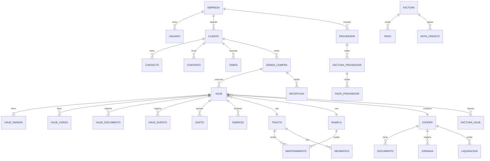

> **ARCHIVADO 2026-10-29 — NO CITAR COMO ESTADO.**
> Documento histórico. Reemplazos y contexto: `docs/_archivo/README.md` · Estado real: `docs/estado.md`.
> Sus cifras y afirmaciones de "terminado" NO fueron re-verificadas en esta fecha.

# PLAN MAESTRO ERP TRANSTEI 2.0
## "Cerebro TEI": de un MVP de viajes a un sistema nervioso digital

**Versión:** 2.0  
**Fecha:** Octubre 2026  
**Alcance:** Transportes TEI SpA — transporte de carga terrestre, Chile  
**Documento:** análisis de dirección logística + arquitectura funcional + hoja de ruta

> **Advertencia:** este documento es una herramienta de gestión. No reemplaza asesoría legal, tributaria, laboral ni de seguridad. Las referencias normativas deben validarse con el contador, abogado y experto en prevención de riesgos de la empresa antes de implementar.

---

## 0. Resumen ejecutivo

### 0.1 Lo que revisé

Revisé el repositorio completo: las 3 migraciones SQL, los 12 routers del backend, los modelos, el motor de KPIs, las 15 pantallas del frontend, los tests y la documentación existente.

### 0.2 Veredicto

**Tienes un buen MVP administrativo, pero todavía no tienes un ERP logístico completo.**

El sistema actual hace bien lo básico: registra clientes, choferes, tractos, ramplas, viajes, gastos, facturas, cobranzas, IVA, liquidaciones y mantenciones. Tiene una interfaz cuidada, roles, una máquina de estados y un motor de KPIs seguro. Eso es más de lo que tiene la mayoría de las empresas de transporte de su tamaño.

Pero al mirarlo como dueño y como ingeniero de logística, le falta lo que realmente mueve la aguja:

1. **No sabe dónde están los camiones ni cuándo quedan libres de verdad.**
2. **No controla la rampla ni el chofer como recursos críticos.** Solo bloquea el tracto.
3. **No tiene OC, tarifa, carga, guía de despacho ni prueba de entrega (POD).**
4. **No calcula el costo real por viaje ni el costo por kilómetro.** Solo suma gastos sueltos.
5. **No tiene precio del diésel, simulador de tarifas ni un índice serio de calidad del flete.**
6. **No tiene cuentas por pagar, tesorería, flujo de caja ni conciliación bancaria.**
7. **No tiene nómina legal completa ni control de horas de conducción.**
8. **No tiene mantenimiento predictivo, repuestos, neumáticos ni bloqueo de unidades por taller.**
9. **No tiene auditoría, multiempresa, documentación vencida completa ni portal del cliente/conductor.**
10. **No tiene un copiloto que responda preguntas de negocio con datos confiables.**

**Cobertura estimada:** 30–35% de un ERP logístico completo; 80% del núcleo administrativo básico.

### 0.3 Lo bueno que hay que conservar

- Stack sólido y barato de operar: Next.js + FastAPI + PostgreSQL/Supabase.
- Roles base y autenticación con JWT de Supabase.
- Máquina de estados de viaje, aunque incompleta.
- Motor de KPIs seguro, sin SQL libre ni ejecución arbitraria.
- Diseño visual TEI claro, con letras grandes y semáforos.
- Tests de flujos críticos y CI básico.
- Script de respaldo y documentación de despliegue.
- La lógica de negocio está en el backend, no en el frontend. Eso es correcto.

### 0.4 La apuesta: tres capas

**Capa 1 — Operación digital:** saber qué carga hay, con qué equipo, con qué chofer, dónde está, cuándo se desocupa y qué documentos tiene. El viaje es el átomo del negocio.

**Capa 2 — Dinero y cumplimiento:** costo real, tarifa, margen, facturación, cobranza, pagos, caja, impuestos, nómina y documentos legales.

**Capa 3 — Inteligencia:** KPIs, alertas, simulación, predicción y un copiloto que responde preguntas y propone decisiones, con aprobación humana.

### 0.5 Resultado esperado

| Palanca | Meta a 12 meses |
|---|---|
| Viajes con OC, tarifa y documentación completa | ≥ 95% |
| Viajes con POD antes de facturar | 100% |
| Días entre entrega y facturación | ≤ 3 días |
| DSO (días de cobro) | Reducir 15–25% |
| Kilómetros vacíos | Reducir 8–12% |
| Cumplimiento de mantenimiento preventivo | ≥ 95% |
| Desviación de combustible | ≤ 3% |
| Cierre mensual | ≤ 5 días hábiles |
| Utilización de flota | ≥ 75% |
| Adopción diaria de usuarios clave | ≥ 90% |
| Margen operacional | Mejorar 2–4 puntos |

### 0.6 Plazo e inversión

- **Piloto operativo (90 días):** disponibilidad, OC, carga, documentos, POD, costo por viaje y alertas críticas.
- **ERP completo (10–12 meses):** operación, comercial, costos, finanzas, personas, cumplimiento, BI e integraciones.
- **Escala (12–18 meses):** multiempresa, portales, IA predictiva, optimización de retorno y expansión.

**Esfuerzo estimado:** 42–54 personas-mes para un ERP sólido; 60–80 si se incluye integración profunda, IA y multiempresa. Equipo de 4–6 personas de alto rendimiento. Infraestructura y servicios externos: USD 300–1.200/mes al inicio, según volumen.

---

## 1. Lectura del negocio: qué se gana y dónde se pierde

### 1.1 La empresa no vende viajes; vende capacidad confiable

El cliente no compra un camión ni un kilómetro. Compra la certeza de que su carga llega completa, a tiempo, con documentos en regla y a un precio predecible. Por eso el ERP no puede ser solo un registro de fletes: tiene que garantizar **cumplimiento, trazabilidad y control de costo**.

### 1.2 Las cinco decisiones que definen el resultado

1. **Qué carga acepto** (cliente, ruta, tipo de carga, riesgo, plazo).
2. **A qué precio la acepto** (tarifa, recargos, combustible, estadía, condiciones de pago).
3. **Con qué equipo y chofer la ejecuto** (disponibilidad, capacidad, cumplimiento, costo de reposicionamiento).
4. **Cómo la ejecuto** (ruta, tiempos, documentos, novedades, POD).
5. **Cuándo y cuánto cobro** (facturación, cobranza, financiamiento, caja).

Si el sistema no ayuda a tomar estas cinco decisiones, es un archivador caro. Si las ayuda, es un socio estratégico.

### 1.3 Las siete fugas de dinero más caras del rubro

| Fuga | Cómo se manifiesta | Cómo la ataca el ERP |
|---|---|---|
| **Flete mal cotizado** | Se acepta por intuición, sin costo real ni margen mínimo | Costo por km, tarifa piso, simulador, aprobación por margen |
| **Kilómetros vacíos** | El camión vuelve sin carga o se mueve por una mala asignación | Disponibilidad, retorno, deadhead, sugerencia de asignación |
| **Esperas no cobradas** | Horas de estadía en carga/descarga que nadie factura | Reloj de estadía, detención, recargo automático, evidencia |
| **Combustible sin control** | Desvíos, mal rendimiento, compras fuera de ruta, precio mal negociado | Transacciones, km/l, precio diario, anomalías, conciliación |
| **Mantenimiento reactivo** | Falla en ruta, camión parado, reparación de emergencia | Plan preventivo, telemetría, alerta, bloqueo de despacho |
| **Cobranza lenta** | Facturas emitidas tarde, clientes que pagan a 60–90 días | Facturación automática, aging, DSO, cobranza, factoring |
| **Documentos y cumplimiento** | Multas, retención de carga, siniestro no cubierto, nómina mal pagada | Vencimientos, checklist, auditoría, nómina integrada |

Hay una octava fuga, silenciosa: **compras y repuestos sin control**. El ERP debe cubrir también proveedores, órdenes de compra, recepción, inventario y pago.

### 1.4 El número que manda

**North Star: margen neto por tracto disponible al mes.**

No es “ingresos”, no es “viajes”, no es “facturación”. Es lo que queda después de pagar combustible, peajes, chofer, mantenimiento, neumáticos, seguros, financiamiento, administración e impuestos, dividido por los tractos que realmente están disponibles para producir.

Ese número obliga a mirar las tres variables a la vez: **precio, costo y utilización**.

### 1.5 Los cinco números del dueño, todos los días

1. **Caja disponible y proyectada a 13 semanas.**
2. **Margen del mes y desviación contra presupuesto.**
3. **Camiones disponibles, ocupados y en taller.**
4. **Cuentas por cobrar vencidas y DSO.**
5. **Viajes con margen bajo y fletes a renegociar.**

Y debajo, una lista corta: **“esto es lo que tienes que decidir hoy”**.

---

## 2. Auditoría del sistema actual

### 2.1 Cobertura por módulo

| Módulo | Estado actual | Qué falta para ser ERP |
|---|---|---|
| Clientes | CRUD + RUT + días de pago | Contactos, crédito, contratos, tarifas, OC, rentabilidad, portal |
| Choferes | CRUD + sueldo + comisión + licencia | Contrato, documentos, horas, descansos, cursos, desempeño, nómina legal |
| Tractos | CRUD + km + RT + seguro | Disponibilidad, documentos completos, GPS, telemetría, costo/km, depreciación |
| Ramplas | CRUD + tipo + RT | Disponibilidad, capacidad, documentos, neumáticos, mantenimiento, asignación |
| Viajes | CRUD + estados + gastos + rentabilidad simple | OC, carga, paradas, documentos, POD, incidentes, costos completos, facturación |
| Gastos | Categoría + monto + boleta | Aprobación, OCR, imputación, conciliación, política, auditoría |
| Facturación | Factura manual + asociación de viajes | DTE, guía, notas de crédito, pagos parciales, OC, retención, factoring |
| Cobranzas | Semáforo + pago total | Aging, promesas, dunning, parciales, conciliación, portal |
| IVA | Débito − crédito simple | F29, códigos de impuesto, prorrateo, notas, crédito diésel, cierre |
| Liquidaciones | Base + comisión + ajustes + PDF | Nómina legal, AFP/salud/cesantía/impuesto, horas, vacaciones, finiquito |
| Mantenimiento | Pauta por km solo tractos | Ramplas, fecha/horas, órdenes, repuestos, neumáticos, garantías, predictivo |
| KPIs | Motor configurable | Catálogo amplio, dimensiones, snapshots, metas, tendencia, drill-down |
| Alertas | Documentos y facturas vencidas | Mantenimiento, viajes sin facturar, margen, caja, horas, combustible, OC |
| Usuarios/roles | 3 roles | 8–10 roles, permisos granulares, aprobaciones, segregación de funciones |
| Auditoría | No existe | Log inmutable de cambios, quién, cuándo, antes/después |
| Multiempresa | No existe | `empresa_id`, RLS, sucursales, centros de costo |
| Documentos | Solo boleta de gasto | Expediente digital completo, versiones, vencimientos, firma, OCR |
| Movilidad | Web de escritorio | PWA para conductor, offline, cámara, firma, GPS |
| Integraciones | Ninguna | SII/DTE, GPS, combustible, peajes, bancos, contabilidad, WhatsApp |
| BI/IA | KPIs básicos | Modelo semántico, reportes, copiloto, predicción, anomalías |

### 2.2 Scorecard

| Dimensión | Nota | Comentario |
|---|---:|---|
| Operación | 2/5 | Registra viajes, pero no planifica ni controla disponibilidad real |
| Flota | 2/5 | Ficha básica; falta ciclo de vida, documentos, telemetría, costo |
| Mantenimiento | 2,5/5 | Buena base por km; falta taller, repuestos, neumáticos, fecha, ramplas |
| Comercial | 1,5/5 | No hay OC, tarifas, cotizaciones ni pricing |
| Costos | 1,5/5 | Solo gastos de viaje; no costo real ni fijos asignados |
| Finanzas | 2,5/5 | Factura y cobra; no tiene AP, tesorería, caja, contabilidad |
| Personas | 1/5 | Ficha mínima; nómina no legal; sin horas ni documentación |
| Cumplimiento | 1/5 | Vencimientos parciales; sin auditoría ni retención documental |
| Datos/BI | 2,5/5 | KPIs seguros, pero catálogo y modelo dimensional limitados |
| UX | 4/5 | Interfaz clara, letras grandes, semáforos; falta rol y móvil |
| Seguridad/arquitectura | 2,5/5 | JWT correcto; falta multiempresa, auditoría, RLS, observabilidad |
| Escalabilidad | 2,5/5 | Monolito adecuado; falta cola de trabajos, eventos, migraciones |
| **Global** | **2,4/5** | **MVP sólido; ERP incompleto** |

### 2.3 Hallazgos críticos de negocio

#### Operación

- Solo se valida que el **tracto** no esté en dos viajes activos. **No se valida la rampla ni el chofer.** Se puede asignar la misma rampla o el mismo conductor a dos viajes simultáneos.
- La validación es por estado, no por **rango de fechas**. Un viaje programado para la próxima semana bloquea el camión hoy; y dos viajes futuros pueden solaparse si se crean en momentos distintos.
- No existe el estado **“en taller”**, **“descanso”**, **“sin documentos”** o **“bloqueado”**. Un camión con revisión técnica vencida puede ser asignado.
- No se valida **licencia del chofer**, **revisión técnica**, **seguro**, **permiso de circulación** ni **capacidad de carga** al crear el viaje.
- No hay **multi-parada**, **carga**, **peso**, **volumen**, **bultos**, **sellos**, **temperatura** ni **carga peligrosa**.
- No hay **POD** ni checklist documental. Se puede finalizar y facturar un viaje sin prueba de entrega.
- No hay **GPS**, **geocercas**, **ETA**, **checkpoints** ni **torre de control**.
- No hay **incidentes**, **reclamos**, **siniestros** ni **evidencia fotográfica** estructurada.
- No hay **horas de conducción**, **descansos** ni **control de jornada**.

#### Comercial

- No existe **orden de compra del cliente (OC)**. El usuario no puede enlazar el flete a la OC, que es exactamente lo que pidió.
- No existe **tarifa** por cliente/ruta/tipo de camión/tonelada/km/hora.
- No existe **cotización** ni aprobación por margen.
- No existe **contrato** ni condiciones comerciales (recargos, estadía, demora, combustible, seguro, límite de responsabilidad).
- No existe **facturación parcial** ni **nota de crédito**.
- No existe **conciliación OC ↔ viaje ↔ guía ↔ factura ↔ pago**.

#### Costos y precios

- El “margen” del viaje es `flete − gastos − comisión`. No incluye **costos fijos**, **depreciación**, **seguros**, **permisos**, **administración**, **financiamiento** ni **costo de capital**.
- No hay **costo por kilómetro** por tracto, ruta o cliente.
- No hay **precio del diésel** ni **recargo por combustible**.
- No hay **costo de estadía** ni **detención**.
- No hay **costo de neumáticos**, **lubricantes**, **AdBlue**, **lavado**, **pesaje**, **escolta** ni **permisos especiales**.
- No hay **presupuesto** ni **desviación**.
- No hay **simulador** de “qué pasa si el diésel sube 10%” o “si este cliente paga a 60 días”.

#### Finanzas

- No hay **cuentas por pagar** ni **facturas de proveedores**.
- No hay **tesorería**, **conciliación bancaria**, **flujo de caja** ni **calendario de pagos**.
- No hay **pagos parciales**: una factura se paga completa o queda pendiente.
- No hay **notas de crédito**, **retenciones**, **factoring** ni **cesión de créditos**.
- No hay **DTE** ni integración con el SII; el número de factura es manual.
- El folio de factura es único por cliente, no por empresa/tipo de documento. Eso permite duplicar folios entre clientes.
- El IVA se calcula sobre el total del gasto con un factor simple; no distingue códigos de impuesto, exenciones, prorrateo ni notas.
- No hay **cierre mensual** ni **contabilidad de doble partida**.
- No hay **presupuesto** ni **forecast**.

#### Personas

- La “liquidación” actual no es una nómina legal: no calcula **AFP, salud, seguro de cesantía, impuesto único, gratificación, horas extra, vacaciones, licencias ni finiquito**.
- No hay **contrato**, **documentos**, **exámenes médicos**, **cursos**, **horas de conducción**, **descansos** ni **asistencia**.
- La comisión se calcula sobre fletes finalizados/facturados, aunque no se hayan cobrado. Si el cliente no paga, la empresa igual paga comisión. Hay que definir política.
- El PDF de liquidación se recalcula desde los viajes actuales; si un viaje cambia después de emitir, el PDF cambia. No hay snapshot.
- No hay **liquidación de viáticos** ni **rendición de gastos** del conductor.

#### Mantenimiento y flota

- Solo se mantienen **tractos**; las **ramplas** no tienen pauta.
- Solo se controla por **kilometraje**; no por **fecha**, **horas de motor** ni **condición**.
- No hay **órdenes de trabajo**, **repuestos**, **inventario**, **mano de obra**, **proveedores**, **garantías** ni **tiempo fuera de servicio**.
- No hay **neumáticos**: número de serie, posición, dibujo, presión, rotación, reencauche, costo por km.
- No hay **combustible transaccional**: solo un gasto agregado.
- No hay **telemetría** ni **códigos de falla**.
- El KPI de mantenimientos pendientes **ignora las unidades sin ningún registro**. Un camión nuevo o una pauta nunca registrada no genera alerta.
- El centro de alertas del dashboard **no muestra mantenimiento**; solo documentos y facturas vencidas.

#### Documentos y cumplimiento

- Solo se controlan RT y seguro del tracto, RT de rampla y licencia del chofer.
- Faltan **permiso de circulación, SOAP, seguro de carga, responsabilidad civil, tachógrafo, limitador de velocidad, extintores, botiquín, triángulos, sujeción de carga, permisos de carga peligrosa/sobredimensionada, revisión de gases, certificados y contratos**.
- No hay **checklist por tipo de viaje/cliente/carga**.
- No hay **versiones**, **firma electrónica**, **OCR**, **QR** ni **retención legal**.
- No hay **auditoría** de quién cambió qué.

#### Datos, seguridad y arquitectura

- No hay **`empresa_id`**. Si mañana se crea una segunda sociedad o se quiere vender como SaaS, hay que rehacer el modelo.
- No hay **auditoría** ni **soft delete**. Los registros financieros se pueden borrar.
- No hay **bloqueo optimista** ni **idempotencia**. Dos usuarios pueden pisarse.
- No hay **restricciones de exclusión** en PostgreSQL para evitar doble asignación.
- Las migraciones son **manuales y no tienen una única fuente de verdad**: conviven archivos SQL y modelos SQLModel, sin aplicación automática en CI ni verificación de deriva.
- No hay **cola de trabajos** para alertas, correos, OCR, DTE, GPS, reportes o sincronización.
- No hay **observabilidad** (logs estructurados, trazas, errores, métricas).
- No hay **entornos** staging/producción ni **backup restore drill**.
- No hay **tests E2E** ni tests de integración en CI con PostgreSQL real.
- No hay **paginación** en listados grandes.
- No hay **protección contra inyección de fórmulas** en CSV exportado (un nombre de cliente que empiece con `=`, `+`, `-` o `@` puede ejecutarse en Excel).
- El upload de respaldos lee el archivo completo en memoria, sin límite de tamaño ni análisis de contenido.
- No hay **MFA** ni política de sesión.
- No hay **RLS** efectiva en las tablas de negocio; el backend usa `service_role`. La seguridad depende del backend, no de la base.

### 2.4 Hallazgos técnicos concretos

| # | Hallazgo | Impacto | Corrección |
|---|---|---|---|
| 1 | Solo se valida tracto, no rampla/chofer | Doble asignación, incumplimiento | Restricción de exclusión por rango de fechas para los 3 recursos |
| 2 | Validación por estado, no por fechas | Bloqueos falsos y choques futuros | Calendario + `tstzrange` + `EXCLUDE USING gist` |
| 3 | No se validan documentos al asignar | Multa, seguro nulo, carga retenida | Regla dura: documento vigente + licencia + capacidad |
| 4 | `finalizado → en_ruta` permitido | Se reabre un viaje cerrado y se altera la comisión | Reapertura con motivo, aprobación y auditoría |
| 5 | Gastos se pueden crear/borrar en viaje facturado | Margen histórico cambia sin control | Bloqueo después del cierre; ajuste con asiento auditado |
| 6 | Factura se puede borrar si está pendiente | Pérdida de trazabilidad tributaria | Anulación con nota de crédito; nunca borrar |
| 7 | Folio único por cliente | Folios duplicados entre clientes | Único por empresa + tipo + folio |
| 8 | Pago total, sin parciales | No refleja la realidad | Tabla de pagos y aplicación a factura |
| 9 | Comisión sobre flete no cobrado | Se paga comisión de plata que no entró | Política configurable: devengado vs cobrado |
| 10 | PDF de liquidación recalcula desde viajes | Documento histórico inconsistente | Snapshot de líneas al emitir |
| 11 | KPI de mantenimiento ignora “sin registro” | Unidades nuevas nunca alertan | Incluir `sin_registro` como pendiente |
| 12 | Dashboard no muestra mantenimiento | Falla sorpresa | Centro de alertas unificado |
| 13 | `margen_bruto` no descuenta comisión | Margen sobreestimado | Separar contribución, bruto y neto |
| 14 | Gastos del mes vs ingresos devengados | Margen distorsionado | Política de devengo y matching |
| 15 | CSV sin sanitización | Inyección de fórmulas | Escapar `= + - @` y validar |
| 16 | Sin paginación | Lentitud y riesgo operativo | Paginación cursor/offset |
| 17 | Sin auditoría | No se puede investigar un error | `audit_log` inmutable |
| 18 | Sin multiempresa | Reescribir si crece | `empresa_id` desde ahora |
| 19 | Migraciones manuales y posible deriva SQLModel/SQL | Errores de esquema en producción | Una fuente de verdad + CI |
| 20 | Sin cola/worker | Procesos lentos y frágiles | Worker + outbox |

### 2.5 Veredicto de auditoría

**Aprobado como MVP. No aprobado como ERP de control total.**

La buena noticia: la base es rescatable. No hay que botar todo. Hay que **evolucionar** con una capa de datos bien diseñada, una capa operativa nueva y una capa financiera completa. Lo que está bien hecho —autenticación, roles, estados, KPIs seguros, diseño— se conserva. Lo que falta se construye por fases, sin big bang.

---

## 3. Principios de diseño del ERP

1. **Una sola verdad.** Cada viaje, OC, documento, gasto, factura y pago tiene un identificador único y una cadena de trazabilidad.
2. **El viaje es el átomo.** Todo cuelga del viaje: carga, documentos, costos, ingresos, incidentes, factura, cobro, KPI.
3. **Todo evento deja huella.** Quién, cuándo, qué cambió, antes y después. Nada crítico se borra: se anula, se corrige o se versiona.
4. **Configurable, no custom.** Reglas, tarifas, pautas, alertas y flujos se configuran; el código no se replica por cliente.
5. **Móvil para el conductor, escritorio para la oficina.** El conductor no llena planillas: usa el celular, con botones grandes y modo offline.
6. **Semáforo y siguiente acción.** Cada alerta dice qué pasa, cuánto cuesta y qué hacer.
7. **Automatizar lo repetitivo; humano aprueba lo crítico.** Facturas, pagos, ajustes y descuentos requieren control.
8. **Comprar lo commodity, construir lo diferenciador.** No reinventar SII, GPS, OCR, mapas, firma electrónica ni nómina legal.
9. **Legal desde el día 1.** El sistema debe ayudar a cumplir, no a esconder.
10. **Privacidad y seguridad por diseño.** GPS, datos de conductores y documentos son datos sensibles.
11. **Escalable sin sobreingeniería.** Monolito modular primero; microservicios solo cuando duela.
12. **Cero papel, con excepciones controladas.** Digitalizar, escanear, firmar y respaldar.

---

## 4. Arquitectura funcional objetivo

### 4.1 Mapa de módulos

| # | Módulo | Propósito | Pantallas clave | Roles |
|---|---|---|---|---|
| 1 | **Centro de Mando** | Ver la empresa en 30 segundos y decidir | Mi empresa hoy, alertas, caja, margen, flota | Dueño, gerentes |
| 2 | **Comercial** | Clientes, contratos, tarifas, cotizaciones, OC | Ficha cliente, tarifario, cotizador, OC | Dueño, comercial |
| 3 | **Operaciones** | Planificar, despachar, ejecutar y cerrar viajes | Mesa de despacho, viaje, torre de control, POD | Despacho, operaciones |
| 4 | **Flota** | Activos, disponibilidad, documentos, telemetría | Ficha tracto/rampla, calendario, mapa, documentos | Operaciones, taller |
| 5 | **Mantenimiento** | Prevenir fallas y controlar costo | Planes, órdenes, repuestos, neumáticos, tablero | Taller, operaciones |
| 6 | **Personas** | Conductores, contratos, horas, nómina, desempeño | Ficha chofer, horas, nómina, liquidación, seguridad | RRHH, contador |
| 7 | **Finanzas** | Facturar, cobrar, pagar, caja, impuestos, contabilidad | Facturación, cobranza, pagos, tesorería, cierre | Contador, tesorería |
| 8 | **Compras** | Proveedores, OC, recepción, inventario | Proveedores, OC, recepción, inventario | Compras, taller |
| 9 | **Documentos** | Expediente digital y cumplimiento | Repositorio, vencimientos, checklist, firma | Todos |
| 10 | **BI y KPIs** | Medir, comparar, explicar y proyectar | Tableros, KPI dictionary, reportes, simulador | Dueño, gerentes |
| 11 | **Alertas y Workflow** | Que nada se olvide | Centro de alertas, reglas, aprobaciones | Todos |
| 12 | **Portales** | Cliente, conductor, proveedor/taller | Portal cliente, PWA conductor, portal taller | Externos |
| 13 | **Copiloto TEI** | Preguntar en lenguaje natural y actuar | Chat, briefing diario, análisis | Dueño, gerentes |
| 14 | **Administración** | Usuarios, roles, configuración, integraciones, auditoría | Usuarios, permisos, integraciones, logs | Admin |

### 4.2 Los seis productos estrella

1. **Mesa de Despacho Inteligente:** calendario visual de tractos, ramplas y choferes; disponibilidad real; detección de conflictos; sugerencia de asignación; arrastrar y soltar.
2. **Expediente Digital del Viaje:** una pantalla con OC, carga, documentos, checkpoints, gastos, incidencias, POD, factura y cobro. QR para abrir desde el celular.
3. **Radar de Fletes:** costo real, tarifa piso, precio del diésel, simulador, Freight Score y recomendación de aceptar/renegociar/rechazar.
4. **Cash Cockpit:** flujo de caja a 13 semanas, cobros, pagos, impuestos, nómina, deuda y escenarios.
5. **Taller Predictivo:** mantenimiento por km/tiempo/horas, telemetría, alertas, bloqueo de unidad, repuestos y costo por km.
6. **Copiloto TEI:** “¿qué camión está libre el viernes en Concepción?”, “¿cuánto gané en septiembre y por qué?”, “¿qué tarifas debo subir si el diésel sube 10%?”.

---

## 5. El viaje como columna vertebral

### 5.1 Ciclo de vida completo

El estado actual (`programado → en_ruta → finalizado → facturado`) es demasiado corto. Propongo este ciclo:

| Estado | Qué significa | Quién lo mueve | Requisitos para entrar |
|---|---|---|---|
| `borrador` | Cotización interna o viaje tentativo | Comercial/despacho | Cliente y ruta |
| `cotizado` | Precio propuesto, pendiente de aprobación | Comercial | Tarifa, costo, margen |
| `confirmado` | Cliente aceptó / OC recibida | Comercial | OC o aprobación, tarifa |
| `asignado` | Tracto, rampla y chofer reservados | Despacho | Documentos vigentes, disponibilidad |
| `en_carga` | En origen, cargando | Conductor/despacho | Check-in, checklist |
| `cargado` | Carga asegurada y sellada | Conductor | Peso, fotos, guía |
| `en_ruta` | En tránsito | Conductor/GPS | Check-out, ETA |
| `en_descarga` | En destino, descargando | Conductor | Check-in, evidencia |
| `descargado` | Carga entregada | Conductor | POD, firma, fotos |
| `pod_pendiente` | Falta documentación | Despacho | Alerta |
| `cerrado` | Costos y documentos completos | Operaciones | Checklist, gastos, POD |
| `facturado` | Factura emitida | Contabilidad | DTE, OC, guía |
| `cobrado` | Pago recibido | Tesorería | Conciliación |
| `anulado` | Viaje cancelado con motivo | Dueño/admin | Motivo, auditoría |

**Regla de oro:** no se factura sin POD; no se cierra sin costos completos; no se paga comisión sin política definida; no se reabre sin aprobación.

### 5.2 Cadena de trazabilidad

```
OC del cliente (OC-2026-00123)
   └── Viaje (VJ-2026-000456)
         ├── Guía de despacho (GD-2026-000789)
         ├── Documentos (seguro, permiso, pesaje, fotos)
         ├── Gastos (combustible, peaje, viático, taller)
         ├── POD (firma, foto, geolocalización, hora)
         ├── Factura (FAC-2026-000321)
         └── Pago (PAG-2026-000654)
```

Cada entidad tiene:

- **ID legible** para humanos: `VJ-2026-000456`.
- **UUID** interno para la base.
- **QR** para abrir el expediente desde el celular.
- **Estado, responsable y fecha** de cada paso.
- **Documentos adjuntos** y **historial de cambios**.

### 5.3 Datos de la carga

Como mínimo:

- Tipo de carga, descripción, código interno del cliente.
- Peso bruto, peso neto, tara, volumen, bultos, dimensiones.
- Valor declarado de la carga y seguro.
- ¿Peligrosa? Número UN, clase, MSDS, permiso, capacitación.
- ¿Refrigerada? Temperatura mínima/máxima, registro, pre-enfriado.
- ¿Sobredimensionada? Largo, ancho, alto, peso por eje, permiso de Vialidad.
- ¿Granel, pallets, contenedor, maquinaria, ganado?
- Condiciones de carga/descarga: ventana horaria, muelle, grúa, montacargas.
- Contactos en origen y destino.
- Instrucciones especiales, sellos, precintos, fotos.
- Documentos: guía de despacho, carta de porte, packing list, certificados, permisos.

### 5.4 POD y evidencia

El POD debe capturar:

- Nombre y RUT de quien recibe.
- Firma digital o foto de la firma.
- Foto de la carga descargada, del camión y de la guía firmada.
- Fecha, hora y geolocalización.
- Observaciones y daños.
- Firma del conductor.

Sin POD, el viaje queda en `pod_pendiente` y **no se puede facturar**. Excepción: cliente con acuerdo de facturación electrónica o auto-factura, aprobada por el dueño.

### 5.5 Incidentes y reclamos

- Tipo: accidente, falla, demora, rechazo de carga, falta de documentos, sobrepeso, daño, robo, siniestro.
- Severidad, fotos, ubicación, testigos, policía, número de parte.
- Impacto operacional: horas perdidas, costo, carga afectada.
- Impacto financiero: reparación, deducible, reclamo, multa.
- Responsable, estado, plazo, evidencia.
- Vínculo con seguro, cliente y proveedor.

### 5.6 Cierre del viaje

Checklist de cierre:

- [ ] POD completo.
- [ ] Todos los gastos registrados y con respaldo.
- [ ] Combustible y peajes conciliados.
- [ ] Horas de conducción y descansos.
- [ ] Incidentes cerrados.
- [ ] Documentos completos.
- [ ] Costo real calculado.
- [ ] Margen y Freight Score calculados.
- [ ] Factura emitida o programada.
- [ ] Cobro programado.
- [ ] Comentario de cierre.

---

## 6. Modelo de datos objetivo

### 6.1 Principios

- **Multiempresa desde el día 1:** `empresa_id` en todas las tablas de negocio.
- **Auditoría:** `created_at`, `created_by`, `updated_at`, `updated_by`, `deleted_at`, `version`.
- **Dinero:** `numeric(14,2)` o `numeric(16,4)` para costos unitarios; moneda explícita.
- **Fechas:** `timestamptz` para eventos; `date` para días; zona horaria `America/Santiago`.
- **Unidades:** km, litros, toneladas, m³, horas; nunca mezclar.
- **Estados:** enums controlados, con tabla de transiciones.
- **Documentos:** metadata en base, archivo en object storage, hash y versión.
- **Eventos:** tabla `evento`/`outbox` para integraciones y auditoría.

### 6.2 Mapa de dominios



### 6.3 Tablas núcleo

| Dominio | Tablas principales |
|---|---|
| Organización | `empresa`, `sucursal`, `centro_costo`, `usuario`, `rol`, `permiso`, `usuario_rol` |
| Comercial | `cliente`, `contacto`, `contrato`, `tarifa`, `cotizacion`, `cotizacion_linea`, `orden_compra`, `orden_compra_linea` |
| Operación | `viaje`, `viaje_parada`, `viaje_carga`, `viaje_asignacion`, `viaje_evento`, `viaje_documento`, `viaje_incidente`, `viaje_checklist` |
| Flota | `tracto`, `rampla`, `equipo`, `documento_equipo`, `seguro`, `poliza`, `siniestro`, `gps_unidad`, `telemetria`, `odometro` |
| Mantenimiento | `plan_mantenimiento`, `plan_item`, `orden_trabajo`, `orden_item`, `repuesto`, `inventario`, `movimiento_inventario`, `neumatico`, `inspeccion_neumatico`, `garantia` |
| Personas | `chofer`, `empleado`, `contrato_laboral`, `documento_persona`, `licencia`, `examen_medico`, `curso`, `jornada`, `asistencia`, `vacacion`, `licencia_medica`, `liquidacion`, `liquidacion_linea` |
| Dinero | `factura`, `factura_linea`, `factura_viaje`, `nota_credito`, `pago`, `pago_aplicacion`, `factura_proveedor`, `pago_proveedor`, `cuenta_bancaria`, `movimiento_bancario`, `conciliacion` |
| Combustible | `precio_diesel`, `estacion`, `tarjeta_combustible`, `transaccion_combustible`, `consumo_estandar` |
| Compras | `proveedor`, `orden_compra_proveedor`, `recepcion`, `factura_proveedor`, `evaluacion_proveedor` |
| Documentos | `documento`, `documento_version`, `documento_tipo`, `documento_entidad`, `firma`, `ocr_resultado` |
| Analítica | `kpi_definicion`, `kpi_valor`, `kpi_meta`, `kpi_snapshot`, `alerta`, `alerta_regla`, `notificacion` |
| Plataforma | `evento`, `outbox`, `audit_log`, `integracion`, `webhook`, `job`, `configuracion` |

### 6.4 Restricciones que evitan errores caros

- **Doble asignación:** `EXCLUDE USING gist (tracto_id WITH =, tstzrange(inicio, fin) WITH &&)` para viajes activos. Lo mismo para rampla y chofer.
- **Una factura por viaje:** índice único en `factura_viaje(viaje_id)` mientras no exista facturación parcial.
- **Folio único:** `unique (empresa_id, tipo_dte, folio)`.
- **Pago no mayor al saldo:** trigger o validación transaccional.
- **OC no sobreconsumida:** trigger que valida `consumido <= monto_autorizado` salvo aprobación.
- **Kilometraje no retrocede:** trigger y auditoría.
- **Documento vencido no asignable:** regla en el servicio de despacho y en la base.
- **Cierre de período:** trigger que impide modificar asientos/facturas de un período cerrado.

### 6.5 Migración desde el esquema actual

No rehacer todo. Estrategia:

1. Agregar `empresa_id` con valor único inicial y backfill.
2. Agregar columnas de auditoría y soft delete.
3. Crear tablas nuevas (`orden_compra`, `viaje_carga`, `viaje_documento`, `documento`, `pago`, etc.).
4. Mantener compatibilidad con las tablas actuales mediante vistas o columnas puente.
5. Migrar datos históricos con scripts idempotentes y validación.
6. Congelar el esquema viejo y trabajar con una sola fuente de verdad.

---

## 7. Disponibilidad, planificación y torre de control

### 7.1 Definiciones que hoy no existen

| Concepto | Definición operativa |
|---|---|
| **Disponible** | Sin viaje activo, sin mantenimiento, sin bloqueo, con documentos vigentes |
| **Asignable** | Disponible + chofer disponible + rampla compatible + capacidad + requisitos del cliente |
| **En ruta** | Viaje activo con check-out |
| **En carga/descarga** | En instalación del cliente, con reloj de estadía |
| **En taller** | Orden de trabajo abierta; no asignable |
| **En descanso** | Descanso obligatorio o franco; no asignable |
| **Bloqueado** | Documento vencido, siniestro, sanción, decisión del dueño |
| **Libre desde** | Fecha/hora estimada de término + buffer + traslado |
| **Deadhead** | Km vacíos desde la posición actual hasta el origen de la próxima carga |

### 7.2 Cálculo de “libre desde”

```
libre_desde = max(
  fin_estimado_viaje_actual,
  fin_mantenimiento,
  fin_descanso,
  fecha_habilitación_documentos
) + buffer_operacional
```

Luego se suma el **traslado en vacío** hasta el origen de la próxima carga. Eso da la hora real de inicio posible.

### 7.3 Mesa de despacho

Vistas:

- **Calendario/Gantt:** filas = tractos, ramplas y choferes; columnas = días/horas; barras = viajes, mantenciones, descansos, bloqueos.
- **Mapa:** última posición GPS, estado, ETA, geocercas, alertas.
- **Lista:** viajes sin asignar, urgentes, con conflicto, con documentos faltantes.
- **Buscador:** “¿quién está libre el viernes en Santiago para 25 toneladas?”.

Funciones:

- Arrastrar un viaje a un tracto/rampla/chofer.
- Detectar conflicto antes de guardar.
- Sugerir el mejor recurso con explicación.
- Reservar y confirmar.
- Enviar la orden al conductor.
- Reasignar con motivo y auditoría.
- Ver el impacto en costo y margen.

### 7.4 Motor de asignación

**Restricciones duras:**

- Documentos vigentes del tracto, rampla y chofer.
- Licencia adecuada y vigente.
- Capacidad de peso/volumen.
- Compatibilidad de rampla con la carga.
- Requisitos de carga peligrosa, refrigerada o sobredimensionada.
- Horas de conducción y descanso.
- Mantenimiento al día.
- Disponibilidad en el rango de fechas.
- Cliente que exige equipo/chofer específico.

**Criterios blandos (puntaje):**

- Menor costo de reposicionamiento (deadhead).
- Menor consumo estimado.
- Mejor desempeño del chofer.
- Preferencia del cliente.
- Retorno/backhaul.
- Margen del viaje.
- Cercanía al origen.
- Balance de horas y descanso.

**Salida:** Top 3 opciones con explicación: “Tracto ABC, a 18 km del origen, documentos al día, chofer con licencia A3, costo estimado de reposicionamiento $45.000, margen proyectado 31%”.

### 7.5 Torre de control

- Estado en tiempo real de cada unidad.
- ETA y desviaciones.
- Alertas: sin movimiento, fuera de geocerca, retraso, exceso de velocidad, temperatura fuera de rango, puerta abierta.
- Comunicación con el conductor (WhatsApp/push/llamada).
- Registro de novedades.
- Parte diario automático 07:00 y 18:00.
- Modo “sin GPS”: check-in manual por el conductor o despacho.

### 7.6 KPIs de operación

- Utilización de flota (% tiempo productivo).
- Km vacíos / km totales.
- Viajes por tracto/mes.
- On-time pickup y on-time delivery.
- OTIF (on time in full).
- Tiempo de estadía en carga/descarga.
- Ciclo total del viaje.
- Cumplimiento de ventanas horarias.
- Disponibilidad mecánica.
- Incidentes por 100.000 km.

---

## 8. Comercial, OC y tarifas

### 8.1 Ficha del cliente

- Razón social, RUT, giro, dirección, contactos.
- Condiciones de pago, crédito autorizado, días reales de pago.
- Contratos y tarifas vigentes.
- OC y centros de costo.
- Historial de viajes, reclamos, siniestros y pagos.
- Rentabilidad histórica.
- Concentración y riesgo.
- Portal del cliente.

### 8.2 Orden de compra (OC)

La OC es la pieza que hoy falta y que el dueño pidió explícitamente. Debe tener:

- Número de OC del cliente y referencia interna.
- Fecha, vigencia, monto autorizado, moneda.
- Centro de costo / proyecto / faena.
- Líneas: servicio, ruta, tarifa, cantidad estimada, unidad.
- Condiciones: pago, recargos, seguro, estadía, documentación.
- Consumo: viajes asociados, monto consumido, saldo.
- Estado: abierta, parcial, cerrada, vencida, anulada.
- Alertas: 80% consumida, vencida, sin saldo, OC faltante.

**Regla:** si el cliente exige OC y el viaje no la tiene, el viaje queda bloqueado para confirmación o requiere aprobación del dueño.

### 8.3 Tarifario

Modalidades:

- Por viaje (flat).
- Por km.
- Por tonelada.
- Por tonelada-km.
- Por hora.
- Por contenedor.
- Por día de estadía.
- Mixto + recargos.

Recargos:

- Combustible (cláusula de reajuste).
- Estadía/detención.
- Carga peligrosa.
- Refrigeración.
- Sobredimensión.
- Peajes y TAG.
- Pesaje, escolta, permisos.
- Espera en frontera.
- Devolución de contenedor.
- Servicio nocturno/fin de semana.

### 8.4 Cotizador

Flujo:

1. Cliente, origen, destino, carga, fecha, requisitos.
2. Distancia y ruta.
3. Costo estimado (combustible, peajes, chofer, mantenimiento, neumáticos, fijos, riesgo).
4. Tarifa propuesta.
5. Margen y Freight Score.
6. Aprobación si está bajo el piso.
7. Envío al cliente.
8. Seguimiento y conversión a viaje/OC.

**Regla de aprobación:**

- Margen ≥ objetivo: puede cerrar el comercial.
- Margen entre piso táctico y objetivo: aprueba gerencia.
- Margen bajo el piso: solo dueño, con justificación (retorno, cliente estratégico, continuidad).
- Viaje sin OC o sin tarifa: bloqueado.

### 8.5 KPIs comerciales

- Win rate de cotizaciones.
- Tarifa media $/km, $/ton, $/viaje.
- Margen por cliente/ruta.
- Concentración top 5 clientes.
- DSO por cliente.
- Reclamos por cliente.
- Retención y churn.
- Crecimiento por cliente.
- Descuento promedio y fuga de precio.
- Cumplimiento de OC.

---

## 9. Costos, diésel y Freight Score

### 9.1 Taxonomía de costos

| Tipo | Ejemplos | Uso |
|---|---|---|
| **Directo variable** | Combustible, peajes, viáticos, comisión, lubricantes, AdBlue, neumáticos, mantenimiento variable | Margen de contribución |
| **Directo fijo** | Depreciación, leasing, seguro, permisos, GPS, salario base del chofer | Costo por km |
| **Indirecto operativo** | Taller, supervisión, administración de flota, almacén | Costo total |
| **Administrativo** | Sueldos de oficina, arriendo, sistemas, contador, marketing | EBITDA |
| **Financiero** | Intereses, factoring, comisiones bancarias | Utilidad neta |
| **No recurrente** | Multas, siniestros, reparaciones mayores, juicios | Análisis separado |

### 9.2 Costo por kilómetro

```
costo_km = (combustible_km
          + mantenimiento_km
          + neumáticos_km
          + chofer_km
          + seguros_km
          + permisos_km
          + depreciación_km
          + administración_km
          + financiero_km)
```

Cada componente se calcula con datos reales o estándares por unidad/ruta. El sistema debe mostrar **costo estándar vs real** y explicar la desviación.

### 9.3 Ejemplo concreto

Viaje Santiago–Concepción, 500 km, 25 toneladas, flete neto $1.200.000:

| Concepto | Cálculo | Monto |
|---|---|---:|
| Combustible | 500 km / 2,5 km/l × $1.100/l | $220.000 |
| Peajes | Ruta | $35.000 |
| Comisión chofer | 10% × flete | $120.000 |
| Mantenimiento | 500 km × $120/km | $60.000 |
| Neumáticos | 500 km × $80/km | $40.000 |
| Seguros/permisos | 500 km × $30/km | $15.000 |
| Costos fijos asignados | 500 km × $250/km | $125.000 |
| **Costo total** | | **$615.000** |
| **Margen** | $1.200.000 − $615.000 | **$585.000** |
| **Margen %** | $585.000 / $1.200.000 | **48,8%** |
| **Margen $/km** | $585.000 / 500 | **$1.170/km** |
| **Margen $/ton** | $585.000 / 25 | **$23.400/ton** |
| **Tarifa piso 25%** | $615.000 / 0,75 | **$820.000** |

Si el cliente ofrece $800.000, está bajo el piso de utilidad. Pero si es un retorno que de otro modo iría vacío, puede aceptarse si cubre costo variable y deja contribución positiva. Esa es la diferencia entre **piso táctico** y **piso estratégico**.

### 9.4 Precio del diésel y recargo

- Tabla `precio_diesel` con fecha, región, estación, precio, fuente.
- Precio de referencia diario/semanal (manual, importación o fuente pública).
- Consumo estándar por unidad/ruta (km/l o L/100km).
- Recargo:

```
recargo_combustible = (precio_actual − precio_base) × litros_estimados
```

o, si el contrato usa índice:

```
tarifa_actual = tarifa_base × (1 + participación_combustible × variación_precio)
```

- Simulador: “diésel +10% → impacto en margen por viaje/cliente/ruta”.
- Alertas: subida >5% en 7 días, margen bajo objetivo, ruta que deja de ser rentable.
- Cláusula de reajuste en contratos, con evidencia y fecha de aplicación.

### 9.5 Freight Score

Un índice de 0 a 100 para responder “¿qué tan bueno es este flete?”. Se detalla en `docs/CATALOGO_KPIS_Y_FREIGHT_SCORE.md`.

Componentes:

- 30% margen de contribución vs objetivo.
- 20% margen de contribución por km vs benchmark.
- 15% comportamiento de pago del cliente.
- 15% utilización de capacidad.
- 10% retorno/backhaul.
- 10% riesgo operativo.

Salida:

- **80–100:** verde, aceptar.
- **60–79:** amarillo, negociar o aceptar con condiciones.
- **<60:** rojo, rechazar o aprobar solo el dueño.

### 9.6 Simulador de escenarios

El dueño debe poder mover:

- Precio del diésel.
- Tarifa.
- Días de pago.
- Km vacíos.
- Consumo.
- Costo de mantenimiento.
- Tipo de cambio (si aplica).
- Volumen.

Y ver:

- Margen por viaje.
- Margen mensual.
- Caja a 13 semanas.
- Punto de equilibrio.
- Sensibilidad.

---

## 10. Combustible y energía

### 10.1 Control transaccional

- Tarjetas de combustible por unidad/chofer.
- Importación de transacciones (CSV/API).
- Estación, fecha, litros, precio, odómetro, producto.
- Conciliación con factura del proveedor.
- Detección de anomalías:
  - Litros > capacidad del estanque.
  - Carga fuera de la ruta.
  - Compra nocturna o en fin de semana.
  - Rendimiento muy bajo vs estándar.
  - Mismo chofer/tarjeta en dos lugares.
  - Precio muy superior al de referencia.
- Tanque y stock (si hay estanque propio).
- AdBlue, lubricantes y otros insumos.

### 10.2 Indicadores

- km/l por unidad, chofer, ruta y mes.
- L/100 km.
- Costo combustible/km.
- Desviación vs estándar.
- % transacciones conciliadas.
- % transacciones con anomalía.
- Ahorro potencial.

### 10.3 Crédito al impuesto específico del diésel

Chile permite a empresas de transporte de carga recuperar el impuesto específico al petróleo diésel bajo condiciones (propiedad/leasing con opción de compra, peso bruto vehicular mínimo, etc.). El ERP debe:

- Guardar la factura de combustible con su detalle.
- Separar el componente base y variable.
- Calcular el crédito estimado.
- Generar el reporte para el contador/F29.
- Mantener evidencia y trazabilidad.

Validar requisitos y cálculos con el contador antes de implementar.

---

## 11. Mantenimiento, flota y activos

### 11.1 Jerarquía de activos

- Empresa → sucursal → tipo de equipo (tracto, rampla, camión, grúa, montacargas).
- Marca, modelo, año, VIN, patente, configuración de ejes.
- Capacidad, peso bruto, tara, volumen.
- Propiedad: propia, leasing, arriendo, tercero.
- Medidor: km, horas.
- Estado: disponible, asignado, en ruta, taller, bloqueado, vendido.
- Documentos y seguros.
- GPS/telemetría.
- Neumáticos.
- Historial de costos.

### 11.2 Mantenimiento

- Plan por tipo/marca/modelo: ítem, intervalo km/tiempo/horas, criticidad, repuestos, mano de obra.
- Orden de trabajo: preventiva/correctiva, diagnóstico, trabajos, repuestos, proveedor, costo, fotos, garantía, tiempo fuera de servicio.
- Aprobación por monto.
- Repuestos e inventario: mínimo/máximo, punto de pedido, valorización, conteo cíclico.
- Neumáticos: serie, posición, dibujo, presión, rotación, reencauche, costo/km.
- Garantías y reclamos.
- Proveedores/talleres y evaluación.
- Combustible y lubricantes.
- Telemetría y códigos de falla.

### 11.3 Predictivo: hoja de ruta

**Nivel 1 — Reglas (mes 1):** km/tiempo/horas, alertas, bloqueo.

**Nivel 2 — Estadística (mes 3–6):** desviación de consumo, temperatura, presión de aceite, códigos de falla, costo por km, vida útil de neumáticos.

**Nivel 3 — Machine Learning (mes 9–18):** supervivencia (Weibull), gradient boosting, predicción de falla, ventana óptima de mantenimiento, costo esperado, repuesto recomendado. Requiere 12–24 meses de datos limpios.

### 11.4 Reglas de negocio

- No se asigna una unidad con mantenimiento crítico vencido.
- No se cierra una orden sin repuestos y costo.
- Un neumático bajo el mínimo de dibujo se cambia.
- Un camión con falla recurrente entra a análisis de causa raíz.
- El costo de mantenimiento se imputa a la unidad y, si corresponde, al viaje.
- La unidad en taller aparece como no disponible en la mesa de despacho.

### 11.5 KPIs

- Disponibilidad mecánica.
- Cumplimiento preventivo.
- MTBF (km entre fallas).
- MTTR (horas promedio de reparación).
- Costo mantenimiento/km.
- Costo neumáticos/km.
- % órdenes con repuestos.
- % unidades con documentación al día.
- Edad promedio de flota.
- Km por litro.
- Emisiones por km (si se mide).

---

## 12. Personas, nómina y seguridad

### 12.1 Ficha del conductor

- Datos personales, RUT, dirección, contacto de emergencia.
- Contrato, cargo, fecha de ingreso, sueldo base, comisión, bonos, beneficios.
- AFP, salud, seguro de cesantía, banco, cuenta.
- Licencia: clase, vencimiento, restricciones.
- Examen médico, cursos (carga peligrosa, manejo defensivo, primeros auxilios).
- Documentos: contrato, anexos, certificados, antecedentes.
- Horas de conducción, descansos, turnos, vacaciones, licencias.
- Historial de viajes, incidentes, multas, reclamos.
- Evaluación de desempeño.
- Liquidaciones y anticipos.

### 12.2 Jornada y descansos

Chile tiene reglas específicas para conductores de carga interurbana. El ERP debe controlar, como mínimo:

- Jornada mensual máxima (referencia: 180 horas).
- Conducción continua máxima (referencia: 5 horas).
- Descanso ininterrumpido dentro de 24 horas (referencia: 8 horas).
- Pausas proporcionales en jornadas menores a 5 horas.
- Distribución mínima de días.
- Horas extra y feriados.
- Vacaciones y licencias.
- Tachógrafo/telemetría cuando aplique.

Validar cada regla con el abogado laboral y la Dirección del Trabajo antes de configurarla como bloqueo duro.

### 12.3 Nómina

La nómina legal no se debe inventar. Opciones:

**A. Integrar con un proveedor de remuneraciones** (recomendado al inicio). El ERP calcula comisiones, viáticos y conceptos variables; el proveedor calcula AFP, salud, cesantía, impuesto único, gratificación y finiquito.

**B. Motor propio completo** (más adelante, si el volumen lo justifica). Requiere tablas de AFP, salud, tramos de impuesto, topes imponibles, gratificación, horas extra, vacaciones, licencias y finiquitos, con validación legal y actualización anual.

Para el tamaño de TEI, la opción A es más rápida, más segura y más barata. El ERP debe generar un **archivo de integración** y una **pre-liquidación** clara, no un documento legal falso.

### 12.4 Liquidación de comisiones y viáticos

- Base: flete neto, flete cobrado o margen, según política.
- Devengo: viaje finalizado, facturado o cobrado, configurable.
- Anticipos y descuentos.
- Viáticos y rendición de gastos.
- Multas, daños, faltantes.
- Firma del conductor.
- Snapshot inmutable al emitir.

### 12.5 Seguridad y desempeño

- Incidentes y accidentes.
- Multas e infracciones.
- Cursos y certificaciones.
- Puntaje de conducción (velocidad, frenadas, ralentí, consumo).
- Fatiga y horas.
- Reclamos de clientes.
- Reconocimientos y bonos.

### 12.6 KPIs

- Rotación de conductores.
- Ausentismo.
- Horas de conducción fuera de norma.
- Licencias/exámenes vencidos.
- Accidentes por millón de km.
- Costo de siniestros.
- Consumo por conductor.
- Cumplimiento de capacitación.
- Satisfacción del conductor.

---

## 13. Finanzas, caja y cumplimiento tributario

### 13.1 Tres números distintos que hoy se confunden

| Número | Qué mide | Fecha |
|---|---|---|
| **Ingreso devengado** | Fletes de viajes finalizados/facturados | Fecha de fin de viaje |
| **Facturación** | Documentos emitidos | Fecha de emisión |
| **Cobranza** | Dinero recibido | Fecha de pago |

El dueño debe verlos separados y reconciliados. Si no, “me fue bien” puede significar “facturé mucho” y aun así no tener caja.

### 13.2 Facturación

- DTE electrónico vía proveedor certificado (no reinventar el SII).
- Factura afecta, exenta, guía de despacho, nota de crédito, nota de débito.
- Facturación por viaje, por período, por OC o por hito.
- Validación OC ↔ viaje ↔ guía ↔ factura.
- Datos del cliente, giro, dirección, OC, centro de costo.
- Retenciones, impuestos y moneda.
- Envío automático al cliente.
- Estado de aceptación/rechazo del SII.
- PDF/XML y respaldo.
- Factoring/cesión de créditos.

### 13.3 Cobranza

- Aging por cliente y factura.
- DSO y días de pago reales.
- Promesas de pago.
- Dunning: recordatorios automáticos por email/WhatsApp.
- Intereses por mora (Ley 21.131) y comisión de cobranza, si aplica.
- Pagos parciales y aplicación.
- Notas de crédito.
- Conciliación bancaria.
- Priorización por monto, antigüedad, riesgo y relación.
- Portal del cliente con estado de cuenta.

### 13.4 Cuentas por pagar

- Factura de proveedor, OC, recepción y match de 3 vías.
- Vencimientos y calendario de pagos.
- Aprobaciones por monto.
- Retenciones.
- Programación de pagos y archivo bancario.
- Pago parcial.
- Anticipos.
- Proveedores de combustible, peajes, talleres, repuestos, seguros, arriendos.
- DPO y descuentos por pronto pago.

### 13.5 Tesorería y flujo de caja

**Flujo de caja directo a 13 semanas:**

```
caja_final = caja_inicial
           + cobros_esperados
           − pagos_proveedores
           − nómina
           − impuestos
           − deuda
           − capex
           − otros
```

- Cobros ajustados por comportamiento histórico del cliente (no solo fecha de vencimiento).
- Escenarios: base, estrés (ventas −20%, diésel +15%, DSO +30 días), crecimiento.
- Alerta si la caja proyectada cae bajo el mínimo (ej. 1 mes de costos fijos).
- Calendario de cobros y pagos.
- Conciliación bancaria por CSV/OFX/API.
- Líneas de crédito, factoring, leasing y préstamos.

### 13.6 Contabilidad

Dos alternativas:

**A. Contabilidad operativa + exportación** al software del contador. Más rápida y económica.

**B. Doble partida completa** en el ERP: plan de cuentas, asientos automáticos, centros de costo, períodos, libro mayor, balance, estado de resultados, flujo de efectivo. Más ambiciosa, pero da control total.

Recomendación: empezar con A y evolucionar a B si el volumen y la necesidad de control lo justifican. En ambos casos, el ERP debe ser la fuente de verdad operativa y generar asientos trazables.

### 13.7 Impuestos y obligaciones

- IVA débito/crédito, F29 (plazo habitual día 20; verificar calendario SII).
- PPM.
- Renta anual.
- Patente municipal.
- Impuesto específico al diésel (crédito).
- Retención de honorarios.
- Ley 21.131 (pago a 30 días) y Ley 19.983 (cesión de facturas).
- Documentos electrónicos y conservación.
- Cierre de período y bloqueo.

Si hay transporte internacional, agregar: aduanas, documentación de frontera, seguros, moneda, tipo de cambio, tiempos de espera y permisos del país destino.

Validar tasas, códigos y tratamientos con el contador.

### 13.8 Cierre mensual

Checklist:

1. Corte de viajes y gastos.
2. Facturación pendiente.
3. Conciliación de combustible y peajes.
4. Devengos y provisiones.
5. Depreciación.
6. Nómina.
7. Impuestos.
8. Conciliación bancaria.
9. Aging de CxC y CxP.
10. Inventario/repuestos.
11. Bloqueo del período.
12. Informe de gestión.

Meta: cerrar en **5 días hábiles**.

### 13.9 KPIs financieros

- Ingreso devengado, facturación y cobranza.
- Margen de contribución, bruto, EBITDA y neto.
- Costo por km, por viaje y por tonelada.
- Punto de equilibrio.
- DSO, DPO, CCC.
- Aging.
- % cobrado a tiempo.
- % facturas vencidas.
- Cash runway.
- Presupuesto vs real.
- Concentración de clientes.
- Rentabilidad por cliente/ruta/tracto/chofer.
- IVA a pagar.
- Costo financiero/factoring.

---

## 14. Compras, inventario y proveedores

- Maestro de proveedores con RUT, giro, condiciones, bancos, seguros y evaluación.
- Solicitud de compra, aprobación, OC, recepción, factura y pago.
- Match de 3 vías.
- Inventario de repuestos, neumáticos, combustible e insumos.
- Mínimos, máximos, punto de pedido, valorización y conteo cíclico.
- Trazabilidad por unidad/viaje.
- Devoluciones y garantías.
- Evaluación de proveedores: cumplimiento, calidad, precio, tiempo.
- KPIs: costo de compra, ahorro, rotación, quiebre, compras fuera de OC.

---

## 15. Documentos, cumplimiento y legal

### 15.1 Expediente digital

Un solo repositorio con:

- Tipo de documento, entidad, fecha, vencimiento, versión, hash.
- Archivo en storage, visor, descarga, firma.
- OCR para extraer datos.
- QR para abrir desde el celular.
- Permisos por rol y por entidad.
- Retención y eliminación controlada.
- Auditoría de acceso.

### 15.2 Checklists

- Por cliente.
- Por tipo de viaje.
- Por tipo de carga.
- Por unidad.
- Por conductor.
- Por proveedor.

Ejemplo de viaje:

- [ ] OC del cliente.
- [ ] Guía de despacho.
- [ ] Carta de porte.
- [ ] Permiso de carga especial.
- [ ] Seguro de carga.
- [ ] Pesaje.
- [ ] Fotos de carga.
- [ ] POD.
- [ ] Factura.
- [ ] Comprobante de pago.

### 15.3 Matriz de cumplimiento Chile

| Ámbito | Obligación | Cómo ayuda el ERP |
|---|---|---|
| **Societario** | Constitución, RUT, poderes, domicilio | Ficha empresa, documentos, alertas |
| **Tributario** | DTE, IVA, F29, PPM, renta, patente | Facturación, tax engine, reportes, calendario |
| **Laboral** | Contrato, jornada, descansos, AFP, salud, cesantía, impuesto, vacaciones, finiquito, Ley Karin, reglamento interno, comité paritario | Ficha, horas, pre-nómina, integración |
| **Subcontratación** | Ley 20.123, empresa principal, obligaciones de seguridad y pago, certificados | Registro de subcontratistas, documentos, cumplimiento |
| **Transporte** | Licencia profesional, RT, permiso de circulación, SOAP, seguro, tachógrafo, límites | Documentos, vencimientos, bloqueo de asignación |
| **Carga** | Guía de despacho, carta de porte, pesos/dimensiones, sujeción, carga peligrosa, refrigerada, sobredimensionada | Checklist, validaciones, permisos |
| **Seguridad** | EPP, extintores, botiquín, triángulos, hoja de ruta, emergencias | Checklist, incidentes, capacitación |
| **Seguros** | Pólizas, denuncios, plazos, deducibles | Pólizas, siniestros, alertas |
| **Datos** | Ley 21.719, consentimiento, finalidad, retención, derechos | Política, registro de tratamiento, accesos |
| **Medioambiente** | Emisiones, residuos, derrames | Consumo, emisiones, incidentes |

> Validar esta matriz con el abogado y contador. El ERP no reemplaza la asesoría profesional.

### 15.4 Privacidad y GPS

- Política de tratamiento de datos.
- Aviso al conductor sobre GPS y finalidad.
- Geolocalización solo en jornada laboral.
- Retención limitada.
- Acceso restringido.
- Derechos del titular.
- Evaluación de impacto si se usa monitoreo intensivo.
- Confidencialidad y no uso para fines ajenos.

---

## 16. KPIs y sistema de gestión

El catálogo completo, fórmulas, metas y Freight Score está en `docs/CATALOGO_KPIS_Y_FREIGHT_SCORE.md`.

### 16.1 Árbol de KPIs

```
North Star: Margen neto por tracto disponible/mes
├── Ingresos
│   ├── Tarifa $/km
│   ├── Viajes/mes
│   ├── Km productivos
│   └── Utilización de capacidad
├── Costos
│   ├── Combustible/km
│   ├── Mantenimiento/km
│   ├── Neumáticos/km
│   ├── Chofer/km
│   ├── Fijos/km
│   └── Administración
├── Capital de trabajo
│   ├── DSO
│   ├── DPO
│   ├── CCC
│   └── Cash runway
├── Operación
│   ├── Utilización
│   ├── Km vacíos
│   ├── OTIF
│   ├── Estadía
│   └── Disponibilidad
└── Riesgo
    ├── Siniestralidad
    ├── Documentos vencidos
    ├── Horas de conducción
    └── Concentración de clientes
```

### 16.2 Cadencia de gestión

- **Diario (07:00):** briefing del dueño y despacho.
- **Semanal:** reunión de operación y caja.
- **Mensual:** cierre, P&L, KPIs, desviaciones y plan.
- **Trimestral:** estrategia, clientes, flota, inversión.

### 16.3 Reglas de un buen KPI

- Tiene dueño.
- Tiene fórmula y fuente.
- Tiene meta y umbral.
- Tiene frecuencia.
- Tiene acción asociada.
- No se puede manipular fácilmente.
- Se compara con período anterior, presupuesto y benchmark.

---

## 17. Alertas, workflow y automatización

### 17.1 Catálogo inicial

| Alerta | Disparador | Severidad | Acción |
|---|---|---|---|
| Documento vencido | ≤ 30 días | Alta | Bloquear asignación |
| Mantenimiento vencido | km/tiempo | Alta | Bloquear despacho |
| Viaje sin POD | 24 h después de descarga | Alta | No facturar |
| Viaje entregado sin facturar | > 3 días | Alta | Facturar |
| Factura vencida | > 0 días | Alta | Cobrar |
| OC al 90% | Consumo | Media | Renovar/aumentar |
| Margen bajo | < objetivo | Alta | Renegociar |
| Caja bajo mínimo | Proyección | Crítica | Plan de acción |
| Combustible anómalo | > desviación | Media | Investigar |
| Exceso de horas | Jornada | Alta | Detener/rotar |
| Unidad sin movimiento | > X horas | Media | Contactar |
| Fuera de geocerca | Evento | Media | Verificar |
| Reclamo sin respuesta | SLA | Alta | Escalar |
| Pago duplicado | Match | Crítica | Bloquear |
| Precio bajo tarifa | Factura | Alta | Aprobar |

### 17.2 Workflow

- Aprobación de cotización bajo margen.
- Aprobación de gasto sobre monto.
- Aprobación de factura/nota de crédito.
- Aprobación de pago.
- Solicitud de mantenimiento.
- Aprobación de compra.
- Alta de proveedor.
- Alta de cliente con crédito.
- Cierre de siniestro.
- Onboarding/offboarding de conductor.

Cada workflow: pasos, responsables, SLA, evidencia, auditoría y notificación.

---

## 18. Experiencia de usuario y adopción

### 18.1 Principios

- **Una pantalla, un trabajo.** No menús anidados.
- **Letras grandes, botones grandes, alto contraste.**
- **Semáforo con significado claro.**
- **Siguiente acción visible.**
- **Búsqueda global** (cliente, viaje, patente, factura, OC).
- **Atajos de teclado** para oficina.
- **Mobile-first** para conductor.
- **Offline** para zonas sin señal.
- **Español de Chile**, CLP, fechas DD/MM/AAAA.
- **Accesibilidad** WCAG AA.
- **Ayuda contextual** y videos cortos.
- **Onboarding** por rol.

### 18.2 Pantalla de inicio por rol

| Rol | Qué ve al entrar |
|---|---|
| **Dueño** | Caja, margen, flota, cobranza, 3 decisiones del día |
| **Gerente de operaciones** | Viajes sin asignar, conflictos, retrasos, mantenimiento |
| **Despacho** | Mesa de despacho, documentos faltantes, próximos check-in |
| **Contador** | Facturas por emitir, cobranzas, pagos, impuestos, cierre |
| **Tesorería** | Calendario de cobros/pagos, conciliación, caja |
| **Taller** | Órdenes de hoy, repuestos, unidades bloqueadas |
| **Conductor** | Mi viaje, checklists, POD, gastos, incidentes |
| **Cliente** | Mis cargas, tracking, documentos, facturas, reclamos |

### 18.3 Matriz de permisos (borrador para validar)

**Leyenda:** `A` = administrar/configurar; `E` = crear/editar; `L` = solo lectura; `R` = registrar/reportar; `—` = sin acceso.

| Módulo | Dueño | Gerente Ops | Despacho | Contador | Tesorería | Taller | Conductor | Cliente | Auditor |
|---|---|---|---|---|---|---|---|---|---|
| Centro de mando | A | A | L | L | L | L | — | — | L |
| Clientes | A | E | E | L | L | — | — | L propio | L |
| Tarifas y OC | A | E | L | L | — | — | — | L propia | L |
| Cotizaciones | A | E | E | — | — | — | — | L propia | L |
| Viajes | A | A | E | L | L | L | R propio | L propio | L |
| Mesa de despacho | A | A | E | — | — | L | — | — | L |
| Documentos/POD | A | A | E | L | — | L | R propio | L propio | L |
| Gastos | A | A | E | E | L | L | R propio | — | L |
| Facturación | A | L | L | A | L | — | — | L propia | L |
| Cobranza | A | L | — | A | A | — | — | L propia | L |
| Pagos/tesorería | A | — | — | E | A | — | — | — | L |
| Nómina | A | — | — | A | L | — | L propio | — | L |
| Flota | A | A | E | L | — | E | L propia | — | L |
| Mantenimiento | A | A | L | L | — | A | R propio | — | L |
| Inventario/compras | A | E | L | L | L | E | — | — | L |
| KPIs/BI | A | L | L | L | L | L | — | — | L |
| Configuración | A | — | — | — | — | — | — | — | L |
| Usuarios/roles | A | — | — | — | — | — | — | — | L |
| Auditoría | A | — | — | — | — | — | — | — | L |
| Portal cliente | A | L | L | L | — | — | — | L propio | L |

**Reglas de segregación:**

- Quien crea un proveedor no puede pagarlo.
- Quien emite una factura no puede aprobar su nota de crédito.
- Quien calcula la nómina no puede autorizar el pago.
- Quien despacha no puede autorizar una tarifa bajo el piso.
- El conductor solo ve sus viajes y sus documentos.
- El cliente solo ve sus cargas, documentos y facturas.
- El auditor ve todo, pero no modifica nada.

### 18.4 Adopción

- Nombrar un **dueño del dato** y un **champion** por área.
- Capacitación práctica con datos reales.
- Manual de 1 página por proceso.
- Meta de adopción semanal.
- Revisar fricción: ¿cuántos clics? ¿cuánto demora?
- Incentivar el registro completo, no castigar el error.
- Escuchar al conductor: si la app no le sirve, no la usa.

---

## 19. Integraciones

| Integración | Para qué | Prioridad | Método |
|---|---|---|---|
| **SII / DTE** | Facturas, guías, notas | Alta | Proveedor certificado |
| **GPS/telemetría** | Posición, ETA, geocercas, fallas | Alta | API/adaptador |
| **Tarjetas de combustible** | Transacciones, km/l | Alta | CSV/API |
| **Peajes/TAG** | Costos por viaje | Alta | CSV/API |
| **Bancos** | Cartola, conciliación, pagos | Alta | CSV/OFX/API |
| **Contabilidad** | Asientos, exportación | Media | CSV/API |
| **Nómina** | Pre-líquido, AFP, salud | Media | CSV/API |
| **WhatsApp Business** | Notificaciones, POD, cobranza | Alta | API |
| **Email** | Facturas, reportes, alertas | Alta | SMTP/API |
| **Mapas/rutas** | Distancias, ETA, peajes | Alta | Google/Mapbox |
| **OCR** | Boletas, facturas, guías | Media | Document AI/Textract |
| **Firma electrónica** | Contratos, POD, liquidaciones | Media | Proveedor |
| **Factoring** | Cesión, liquidez | Media | Proveedor/banco |
| **Clima/rutas** | Riesgo, demoras | Baja | API |
| **Aduanas/frontera** | Internacional | Baja | Operador/API |

**Estrategia:** empezar con CSV/importación manual; luego API. Usar un patrón `adaptador` para no acoplar el ERP a un proveedor.

---

## 20. Datos, BI e inteligencia artificial

### 20.1 Arquitectura de datos

- Base operativa PostgreSQL.
- Eventos de negocio (`viaje.creado`, `viaje.finalizado`, `factura.emitida`, `pago.recibido`).
- Snapshots diarios/mensuales para KPIs.
- Modelo semántico con métricas certificadas.
- Data warehouse o réplica de lectura para analítica pesada.
- Retención y calidad de datos.

### 20.2 Copiloto TEI

**Ejemplos de preguntas:**

- “¿Cuánto gané en septiembre y por qué?”
- “¿Qué camiones estarán libres el viernes en Santiago?”
- “¿Qué viajes tienen margen bajo y qué clientes los generan?”
- “Si el diésel sube 10%, ¿qué tarifas debo ajustar?”
- “¿Qué mantenimiento se viene en los próximos 10.000 km?”
- “¿Quién me debe más y hace cuánto?”
- “Ármame el plan de despacho de mañana con estos 12 viajes.”
- “Explícame la caída del margen de este mes.”
- “¿Qué gastos están sin respaldo?”

**Arquitectura:**

- Modelo semántico + catálogo de métricas.
- Herramientas de solo lectura para consultar datos.
- RAG sobre contratos, políticas y manuales.
- Acciones con confirmación humana.
- Auditoría de cada respuesta y acción.
- “No inventar”: mostrar cálculo, fuente y fecha.
- Si no hay datos, decirlo.

**Guardrails:**

- No ejecutar pagos, facturas, ajustes ni despidos sin aprobación.
- No exponer datos de otros clientes/empresas.
- No usar IA para calcular impuestos/nómina sin revisión.
- Explicabilidad y trazabilidad.
- Evaluación de sesgos y alucinaciones.

### 20.3 Casos de IA priorizados

| Caso | Valor | Complejidad | Fase |
|---|---|---|---|
| OCR de boletas/facturas | Alto | Media | 2 |
| Detección de anomalías de combustible | Alto | Media | 2 |
| Predicción de mantenimiento | Alto | Alta | 4 |
| Recomendación de tarifa | Alto | Media | 3 |
| Priorización de cobranza | Alto | Baja | 3 |
| Predicción de caja | Alto | Media | 3 |
| Asignación/backhaul | Alto | Alta | 5 |
| Copiloto de datos | Alto | Media | 5 |
| Mantenimiento prescriptivo | Medio | Alta | 6 |
| Optimización de rutas | Medio | Alta | 6 |
| ESG/emisiones | Medio | Media | 6 |

---

## 21. Seguridad, privacidad y continuidad

### 21.1 Seguridad

- RBAC + ABAC (rol, empresa, sucursal, centro de costo, cliente).
- MFA para administradores y contabilidad.
- SSO opcional.
- Sesiones y expiración.
- Rate limiting.
- Cifrado en tránsito y en reposo.
- Secretos en vault, no en el repositorio.
- Auditoría inmutable.
- Revisión de accesos trimestral.
- Segregación de funciones:
  - Quien crea proveedor no paga.
  - Quien factura no aprueba nota de crédito.
  - Quien calcula nómina no paga.
  - Quien despacha no autoriza tarifa bajo piso.
- Respaldos automáticos y **prueba de restauración**.
- Plan de continuidad y recuperación (RTO/RPO).
- Monitoreo, alertas y respuesta a incidentes.
- Análisis de dependencias y escaneo de vulnerabilidades.
- Capacitación anti-phishing.

### 21.2 Privacidad

- Ley 21.719 (vigencia prevista 1 de diciembre de 2026; verificar si se posterga).
- Registro de actividades de tratamiento.
- Base legal y finalidad.
- Minimización.
- Retención.
- Derechos de acceso, rectificación, cancelación y oposición.
- Seguridad.
- Notificación de brechas.
- Encargados de tratamiento.
- Transferencias internacionales.
- DPO o responsable de privacidad.
- Política de GPS y monitoreo laboral.

### 21.3 Continuidad

- Si el sistema cae, ¿cómo se despacha? Formulario de papel, WhatsApp, plan de contingencia.
- Si se cae internet, ¿el conductor puede operar offline?
- Si se pierde la base, ¿cuánto dato se pierde?
- Si el proveedor de DTE falla, ¿cómo se factura?
- Si el banco no responde, ¿cómo se paga?
- Documentar y probar.

---

## 22. Arquitectura técnica y escalabilidad

### 22.1 Estado actual

- Next.js 16 + React 19 + Tailwind 4.
- FastAPI + SQLModel + PostgreSQL/Supabase.
- Monolito simple, sin cola, sin eventos, sin multiempresa.
- Migraciones SQL manuales.
- Tests unitarios de KPIs e integración opcional.

### 22.2 Arquitectura objetivo

```
[ Next.js / PWA ]  [ Portal cliente ]  [ App conductor ]
          │                │                  │
          └────────────────┴──────────────────┘
                           │
                    [ API Gateway / FastAPI ]
                           │
        ┌──────────────────┼──────────────────┐
        │                  │                  │
   [ PostgreSQL ]     [ Redis / cola ]   [ Object storage ]
        │                  │                  │
   [ Outbox / eventos ] [ Worker ]       [ Documentos ]
        │
   [ Modelo semántico / BI ]
        │
   [ Integraciones: SII, GPS, combustible, peajes, bancos, WhatsApp ]
```

**Decisión:** monolito modular, no microservicios. Separar por dominios lógicos, con interfaces claras. Un worker para tareas asíncronas. Un `outbox` para eventos. Una capa semántica para KPIs. Microservicios solo si un dominio lo exige por escala o equipo.

### 22.3 Multiempresa

- `empresa_id` en todas las tablas.
- RLS por empresa.
- Roles por empresa.
- Configuración por empresa.
- Moneda, zona horaria, numeración, impuestos.
- Aislamiento de documentos y storage.
- Reportes consolidados si hay grupo.

### 22.4 Base de datos

- PostgreSQL 15+.
- `pgcrypto`, `pg_trgm`, `btree_gist`.
- `PostGIS` si se usan geocercas.
- Particionamiento de telemetría por mes.
- Índices por fecha, estado, cliente, unidad, chofer.
- Vistas materializadas para KPIs.
- Restricciones de exclusión para disponibilidad.
- Triggers de auditoría.
- Migraciones versionadas (Alembic o Supabase CLI; una sola fuente de verdad).
- Backups PITR y restore drill.

### 22.5 API

- Versionado `/api/v1`.
- OpenAPI y cliente generado.
- Paginación, filtros, orden.
- Idempotency-Key en pagos/facturas.
- Errores estándar.
- Rate limiting.
- Webhooks firmados.
- Reintentos con backoff.
- Correlación de requests.

### 22.6 Frontend

- Server Components donde aporten.
- TanStack Query para datos.
- Formularios con validación compartida.
- Design system TEI.
- PWA con offline, cámara, firma, push.
- Mapas y Gantt.
- Accesibilidad.
- Tests E2E con Playwright.

### 22.7 DevOps

- Repositorio monorepo.
- Entornos dev/staging/prod.
- CI: lint, tipos, tests, migraciones, build, seguridad.
- CD con migraciones controladas.
- Feature flags.
- Observabilidad: Sentry/OpenTelemetry, logs, métricas, uptime.
- IaC (Terraform) cuando aplique.
- Backups y DR.
- Documentación viva.

### 22.8 Rendimiento

- Paginación.
- Índices.
- Caché de catálogos.
- Vistas materializadas.
- Workers para reportes.
- Evitar N+1 (hoy `_to_read` hace varias consultas por viaje).
- Límites de exportación.
- Pruebas de carga.

---

## 23. Plan de implementación

### 23.1 Estrategia

- **No big bang.** Entregas cada 2–3 semanas.
- **Valor primero:** operación y cobranza antes que IA.
- **Datos primero:** sin datos limpios no hay KPIs.
- **Adopción primero:** si el conductor no la usa, no existe.
- **Un dueño del producto** con poder de decisión.
- **Un dueño del dato** por área.
- **Presupuesto de deuda técnica:** 20%.

### 23.2 Fases

| Fase | Duración | Alcance | Resultado |
|---|---|---|---|
| **0. Blindaje** | 3 semanas | Multiempresa, auditoría, migraciones, seguridad, backups, observabilidad, roles v2 | Base confiable |
| **1. Núcleo operacional** | 8 semanas | OC, tarifas, carga, viaje v2, disponibilidad, mesa de despacho, documentos, POD, PWA conductor | “Quién está libre, dónde está, qué lleva, a qué OC” |
| **2. Costos y precios** | 8 semanas | Costo/km, combustible, peajes, neumáticos, mantenimiento v2, diésel, tarifa piso, cotizador, Freight Score | “Cuánto gano y si el flete es bueno” |
| **3. Dinero** | 8 semanas | DTE, guías, notas, pagos, cobranza, AP, tesorería, caja 13 semanas, presupuesto, cierre | “Cuánto me deben, cuándo pagan, cuánta caja tendré” |
| **4. Personas y cumplimiento** | 6 semanas | Ficha completa, horas, descansos, pre-nómina, integración, documentos, seguros, siniestros, auditoría legal | “Cero documentos vencidos y nómina sin errores” |
| **5. Inteligencia y experiencia** | 6 semanas | KPIs v2, dashboards por rol, alertas, portal cliente, WhatsApp, copiloto, OCR | “Decisiones diarias y copiloto” |
| **6. Integraciones y escala** | 6 semanas | GPS, combustible, peajes, bancos, contabilidad, nómina, mapas, multiempresa, performance | “ERP conectado y escalable” |
| **7. Optimización** | Continuo | ML, backhaul, rutas, pricing dinámico, ESG, internacional | “Ventaja competitiva” |

**Total:** 10–12 meses para el ERP completo; 90 días para el piloto operativo.

### 23.3 Equipo mínimo

| Rol | Dedicación | Responsabilidad |
|---|---|---|
| Product Owner | 100% | Dueño, prioridades, aceptación |
| Project Manager / BA | 100% | Plan, requisitos, coordinación |
| Tech Lead / Arquitecto | 100% | Diseño, calidad, decisiones técnicas |
| Backend Senior | 100% | Dominio, API, datos, integraciones |
| Frontend Senior | 100% | Web, PWA, UX técnica |
| UX/UI | 50% | Flujos, design system, usabilidad |
| QA | 50–100% | Pruebas, automatización, UAT |
| DevOps | 50% | CI/CD, infra, seguridad, observabilidad |
| Contador/asesor | 20% | Impuestos, nómina, validación |
| Abogado/asesor | 10% | Contratos, datos, cumplimiento |
| Experto de operación | 30% | Reglas, validación, adopción |

### 23.4 Presupuesto

**Esfuerzo:** 42–54 personas-mes para el ERP sólido; 60–80 con IA avanzada y multiempresa.

**Infraestructura y servicios:** USD 300–1.200/mes al inicio, más costos variables de DTE, OCR, WhatsApp y mapas.

**Contingencia:** 20%.

No incluye hardware GPS, licencias de terceros, ni el costo del equipo interno de TEI.

### 23.5 Gobernanza

- Sprint de 2 semanas.
- Demo cada 2 semanas.
- UAT con usuarios reales.
- Comité mensual: dueño, PM, tech lead, contador.
- Control de cambios por fase.
- Registro de riesgos.
- Criterios de aceptación por historia.
- Definition of Done: probado, documentado, permisos, auditoría, móvil, reporte, alerta, migración, capacitación.

### 23.6 KPIs del proyecto

- % de historias aceptadas en UAT.
- Defectos por release.
- Tiempo de ciclo.
- Adopción.
- Ahorro de tiempo.
- Reducción de errores.
- Cumplimiento de fechas.
- Satisfacción de usuarios.

---

## 24. Migración y puesta en marcha

### 24.1 Inventario de datos

- Clientes, contactos, RUT, condiciones.
- Choferes, contratos, licencias.
- Tractos, ramplas, documentos, seguros.
- Rutas, tarifas, OC abiertas.
- Viajes históricos y abiertos.
- Gastos, facturas, pagos, saldos.
- Mantenimiento, repuestos, neumáticos.
- Combustible, peajes.
- Nómina, anticipos, vacaciones.
- Documentos.

### 24.2 Limpieza

- Normalizar RUT, patentes, nombres, direcciones.
- Eliminar duplicados.
- Completar campos obligatorios.
- Validar fechas y montos.
- Separar datos históricos de datos maestros.
- Definir saldos de apertura.

### 24.3 Estrategia

1. Congelar la fuente vieja.
2. Migrar maestros.
3. Migrar saldos de apertura.
4. Migrar histórico mínimo.
5. Validar con el contador.
6. Correr en paralelo 1–2 meses para facturación/nómina.
7. Cut-over.
8. Hypercare 4 semanas.
9. Plan de rollback.

### 24.4 Capacitación

- Por rol.
- Con datos reales.
- Manual de 1 página por proceso.
- Videos cortos.
- Sesiones de preguntas.
- Champion por área.
- Soporte en terreno los primeros días.

---

## 25. Riesgos y mitigaciones

| Riesgo | Probabilidad | Impacto | Mitigación |
|---|---|---|---|
| Scope creep | Alta | Alto | Fases, comité, criterios de aceptación |
| Datos sucios | Alta | Alto | Dueño del dato, limpieza, validaciones |
| Baja adopción | Media | Alto | UX, móvil, capacitación, quick wins |
| Integraciones difíciles | Media | Medio | CSV primero, adaptadores, sandbox |
| Incumplimiento legal | Media | Alto | Asesoría, validación, auditoría |
| Problema de seguridad | Media | Alto | MFA, RLS, auditoría, backups, pruebas |
| Dependencia de una persona | Media | Alto | Documentación, code review, tests |
| Vendor lock-in | Media | Medio | Postgres estándar, storage S3, abstracciones |
| Falta de caja | Media | Alto | Fases, priorización, ROI |
| Sobrecarga del dueño | Alta | Medio | PM, delegación, decisiones semanales |
| IA alucina | Media | Alto | Modelo semántico, fuentes, aprobación humana |
| Cambios normativos | Media | Medio | Configuración, revisión anual |

---

## 26. Decisiones que necesito de usted

1. **Alcance:** ¿aprobamos las 7 fases o empezamos con el piloto de 90 días?
2. **Prioridad:** ¿qué duele más hoy: disponibilidad, cobranza, costos, mantenimiento o nómina?
3. **Datos:** ¿dónde están las planillas, contratos, tarifas y OC?
4. **Sistemas:** ¿qué GPS, tarjetas de combustible, TAG, banco, contabilidad y nómina usan?
5. **Equipo:** ¿quién será el Product Owner y el dueño del dato?
6. **Legal:** ¿qué régimen tributario, contratos y políticas de privacidad existen?
7. **Operación:** ¿cuántos tractos, ramplas, choferes, clientes y viajes/mes?
8. **Carga:** ¿hay peligrosa, refrigerada, sobredimensionada, internacional?
9. **Presupuesto:** ¿qué inversión mensual está dispuesto a sostener?
10. **Fecha:** ¿cuándo quiere el piloto en producción?

---

## 27. Próximos pasos

### Esta semana

1. Validar este plan y elegir el alcance del piloto.
2. Nombrar Product Owner y dueño del dato.
3. Hacer inventario de planillas y sistemas.
4. Congelar el alcance de la Fase 1.
5. Corregir los 5 riesgos más caros:
   - Doble asignación de rampla/chofer.
   - Documentos vencidos al asignar.
   - Mantenimiento sin alerta.
   - Factura sin POD.
   - Folio duplicado.
6. Configurar staging, backups y monitoreo.
7. Kickoff.

### Primeros 90 días

Ver `docs/PLAN_90_DIAS.md`.

### Lo que no haría

- No empezar por IA.
- No construir microservicios.
- No rehacer el frontend.
- No migrar todo el histórico de una vez.
- No comprar un ERP genérico y adaptarlo a la fuerza.
- No confundir “digitalizar” con “llenar formularios”.
- No construir nómina legal propia sin asesoría.
- No prometer “cero papeles” sin plan de contingencia.

---

## 28. Conclusión

TRANSTEI tiene una base valiosa. El MVP demuestra que se puede digitalizar el núcleo. Pero el salto a ERP exige dejar de mirar el viaje como un registro y empezar a mirarlo como un **sistema de decisiones**: qué carga, a qué precio, con qué equipo, con qué costo, con qué riesgo, cuándo cobro y cuánta caja tendré.

La diferencia entre un software útil y un ERP impresionante no está en la cantidad de pantallas. Está en que el dueño abra el sistema a las 7 de la mañana y vea, en 30 segundos, **qué tiene que decidir hoy**. Eso es lo que vamos a construir.

---

**Documentos relacionados:**

- `docs/CATALOGO_KPIS_Y_FREIGHT_SCORE.md`
- `docs/PLAN_90_DIAS.md`
- `docs/PLAN_DESARROLLO.md` (histórico)
- `docs/MODULOS.md` (estado actual)
- `docs/KPIS.md` (motor actual)
