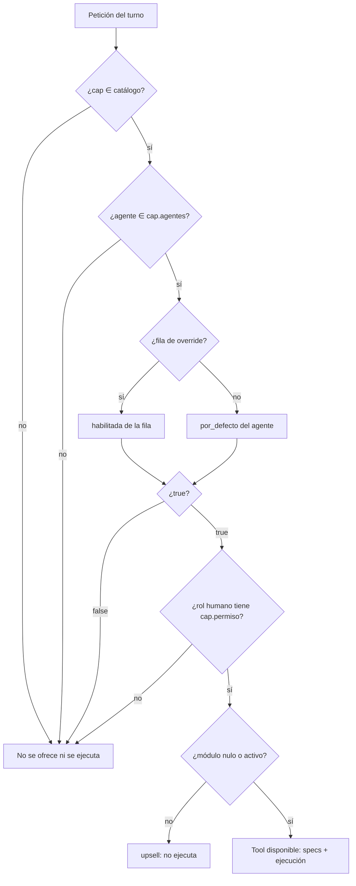

# ADR-0009: Capacidades configurables por empresa y agente del chat in-app

- **Estado:** **Propuesto** (2026-11-02), **en implementación** en la Ola 4
  (`docs/orquestacion/registro.md:1474-1493`) y **reconciliado el 2026-11-04** con
  la migración `0032` ya aplicada en local (`docs/datos/agente-capacidades.md:178-235`)
  y con el contrato del panel (`frontend/src/types/agente-config.ts:9-13`).
  La aceptación requiere: (a) que el dueño ratifique el alcance de escritura del
  gerente sobre el catálogo cerrado (reversa controlada de SEC-051), (b)
  revalidación de `auditor-seguridad` sobre esa vía, y (c) cerrar los bloqueadores
  de §1.5 (default `false` de `configuracion.escribir_catalogo`, `agente:configurar`
  en `PERMISOS_AGENTE`, endpoints, cableado del runtime y saneamiento). Sin
  (a)-(c), la tool de catálogo no debe habilitarse en producción.
- **Fecha:** 2026-11-02. Verificación y reconciliación de archivos: 2026-11-04.
- **Reconciliación 2026-11-04:** la DDL aplicada usa `habilitada boolean not null`
  (no `NULL = heredar`), `unique (empresa_id, agente, capacidad)` y FK simple;
  `capacidades.py` y el panel existen pero **no están cableados**. Este ADR acepta
  esa realidad, documenta las diferencias en §3.2 y §3.4 y **no** reescribe
  `0032`.
- **Decide:** agente `arquitectura`. Ejecutan: `datos` (migración `0032`),
  `backend` (catálogo, runtime, API, tools, prompts, saneamiento), `frontend`
  (panel `/configuracion/agentes`), `qa` (pruebas adversariales) y
  `auditor-seguridad` (revisión independiente).
- **Método de esta sesión:** lectura estática de código, migraciones, pruebas y
  documentación. `shell` no está disponible para este agente (permiso denegado),
  por lo que **no** se ejecutó ningún comando de base, prueba ni migración. Todo
  hecho que depende de comportamiento en ejecución se marca 🟡 con lo que lo
  cerraría.
- **Depende de:** `ADR-0005` (dos engines, `tei_app`, RLS por transacción),
  `ADR-0006` (identidad y alcance de tools), `ADR-0008` (configuración de tenant
  y autoridad de estados), migraciones `0004` (`fn_touch`/`fn_version`/
  `fn_auditoria`), `0020` (RLS, `ctx_empresa`, `tei_app`), `0021`
  (`permisos_contacto`), `0026` (`configuracion_empresa`), `0030`
  (`tenant_reglas_entidad`, `tenant_suscripciones`), `0031` (memoria del chat
  in-app).
- **Reemplaza a:** nada. No modifica ADR previos. **No** reabre `public`.
- **Relación con ADR-0008 y la migración `0030`:** este ADR **no** crea
  `tenant_config` ni una segunda tabla de parámetros por empresa; documenta una
  tabla de **grants** con catálogo cerrado en código (§7). Si el dueño interpreta
  que la prohibición de ADR-0008 §7 cubre también los grants, este ADR requiere su
  ratificación explícita antes de habilitar `0032` en el piloto; la tabla ya
  aplicada quedaría inerte.

---

## 0. Resumen de las decisiones

1. **El catálogo de capacidades vive en código**, en
   `backend/app/nucleo/agente/chat/capacidades.py` (existe; en cableado): nombre
   estable, agentes permitidos (límite duro), permiso humano, default por agente
   y módulo premium. Es la **única** fuente de nombres, permisos, defaults y
   límites.
2. **Los overrides viven en `nucleo.agente_capacidades`** (migración `0032`, ya
   aplicada en local): una fila por `(empresa_id, agente, capacidad)` con
   `habilitada boolean not null`. La ausencia de fila significa "aplica
   `por_defecto[agente]`"; no hay un tercer estado `NULL`. La tabla **no**
   duplica el catálogo: no guarda nombre de tool, permiso, default ni módulo.
3. **La capacidad efectiva es una conjunción, no una precedencia:** capacidad en
   catálogo ∧ agente permitido ∧ (fila de override si existe, si no
   `por_defecto[agente]`) ∧ permiso del rol humano ∧ módulo activo. Ningún
   override puede **ampliar** el conjunto de capacidades del agente.
4. **El enforcement es triple y en este orden:** la API rechaza configuraciones
   ilegales; el runtime filtra las **especificaciones** que se envían al LLM; el
   runtime **revalida** antes de ejecutar cada tool. El prompt no es un control.
   La API y el cableado del runtime están **en implementación** (§1.5).
5. **La reversa de SEC-051 es opt-in y explícita:** tool
   `gerente_actualizar_catalogo`, capacidad `configuracion.escribir_catalogo`,
   permiso humano `configuracion:escribir`, default **`false`**, escritura por
   `ServicioConfiguracion.actualizar` (misma validación de tipo/rango que el
   endpoint humano) y auditoría. `gerente_upsert_directiva` sigue rechazando las
   claves del catálogo. **Bloqueador B-01:** el `capacidades.py` actual no fija
   ese default y `_capacidad` lo deja en `true` (§1.5).
6. **`finanzas.leer_estrategico` no se ata a `finanzas_pro` en esta entrega**
   (el tenant piloto no tiene suscripción y el requisito del dueño es que el
   gerente responda margen). `whatsapp.recordatorio` **sí** queda gateada por el
   módulo `whatsapp`. `finanzas_pro` queda declarado, sin consumidor, para una
   fase posterior (§5, deuda).
7. **Los prompts dejan de enumerar capacidades** y el backend sanea el formato
   de la respuesta (markdown crudo) de forma determinista. El texto que ve el
   usuario no depende de que el LLM obedezca. **En implementación** (§1.5, B-08).
8. **El panel `/configuracion/agentes`** consume
   `GET/PUT /nucleo/agente/configuracion` y
   `POST /nucleo/agente/configuracion/restablecer` con permiso
   `agente:configurar` (solo `admin`), y **no** puede habilitar una capacidad
   cuyo permiso humano el operador no tenga (evita usar al LLM como proxy de un
   privilegio propio). La página existe; el backend y el permiso, no (§1.5).
9. **"Restablecer" escribe los defaults, no borra ni pone `NULL`.** Es la
   consecuencia de aceptar `habilitada NOT NULL`: la fila se materializa con el
   valor por defecto vigente. El coste (un cambio futuro de `por_defecto` no se
   propaga a las filas ya restablecidas) queda como deuda declarada (§5).

---

## 1. Contexto verificado

### 1.1 Estado actual del chat in-app

| # | Hecho | Evidencia | Certeza |
|---|---|---|---|
| 1 | Hay dos personas LLM (`gerente`, `secretaria`) con allowlist **fija** de tools en código | `backend/app/nucleo/agente/chat/personas.py:104-132` (gerente `:110-116`, secretaria `:124-129`) | 🟢 |
| 2 | Cada persona declara un permiso humano, por defecto `agente:chat` | `personas.py:22-30` (`permiso: str = "agente:chat"`) | 🟢 |
| 3 | El runtime exige `tiene_permiso(contexto.rol, persona.permiso)` antes de conversar | `runtime.py:464-468` | 🟢 |
| 4 | Solo el rol humano `admin` tiene `agente:chat`: `PERMISOS_AGENTE` se resta de los permisos de `gerente` (AB-02) | `permisos.py:15-18`, `:69-73`; `runtime.py:464` | 🟢 |
| 5 | El runtime ya aplica una allowlist por persona y por agente: la tool debe existir, estar en `persona.tools` y declarar `agente == persona.clave` | `runtime.py:657-669` | 🟢 |
| 6 | Las especificaciones que se envían al LLM se filtran por `persona.tools` | `runtime.py:539-542`; `herramientas.py:862-868` | 🟢 |
| 7 | El registro de tools declara `agente` y `modulo` por tool; hoy solo `secretaria_whatsapp_recordatorio` declara `modulo="whatsapp"` | `herramientas.py:701-708`, `:730-859`, `:837`; grep `modulo=` en el paquete: solo `whatsapp` | 🟢 |
| 8 | El muro de pago exige **dos** condiciones: `modulos_empresa.habilitado` **y** una `tenant_suscripciones` activa con plan premium | `servicio_modulos.py:27-30`, `:57-93` | 🟢 |
| 9 | `finanzas_pro` está declarado en el catálogo de módulos pero **ninguna tool lo consume**: `modulo="finanzas_pro"` = 0 coincidencias; solo aparece en el enum de `gerente_solicitar_modulo` | `servicio_modulos.py:29`; `herramientas.py:795-798`; grep propio | 🟢 |
| 10 | Los prompts enumeran capacidades ("Puedes: …") y el del gerente prohíbe en bloque ejecutar transacciones | `personas.py:56-71` (`:64-66` "No ejecutas transacciones"; `:69-71` "Solo escribes directivas") ; secretaria `:82-94` | 🟢 |
| 11 | El prompt del gerente ordena usar el prefijo `directiva_` como lenguaje de usuario, aunque la UI muestra el texto tal cual | `personas.py:59-61`, `:68-71`; `frontend/src/components/agente/chat-panel.tsx:382` (`whitespace-pre-wrap`), `:613` | 🟢 |
| 12 | El chat persiste conversaciones y mensajes en `nucleo.agente_chat_*`, con `agente in ('gerente','secretaria')` en la base | `0031:159-182`, `:180`; RLS+FORCE `:294-309`; grants sin DELETE `:323-327` | 🟢 |
| 13 | La API del chat acepta `agente: Literal["gerente","secretaria"]` y exige `clave_idempotencia` | `api.py:74-80`; `:148-170` | 🟢 |
| 14 | `GET /nucleo/agente/chat/agentes` devuelve la allowlist **estática** de cada persona (`persona.tools`), no el estado por empresa | `runtime.py:81-91`; `api.py:103-107`, `:137-145` | 🟢 |
| 15 | El frontend tipa `herramientas: string[]` para ese endpoint, pero el panel no lo renderiza (solo usa `clave`, `nombre`, `configurado`) | `frontend/src/types/agente-chat.ts:14-19`; `chat-panel.tsx:465-481` | 🟢 |

### 1.2 El requisito del dueño (Ola 4)

| # | Hecho | Evidencia | Certeza |
|---|---|---|---|
| 16 | El objetivo es que el gerente consulte y ejecute casi cualquier operación con datos reales; que la secretaria cree fletes al buzón y vea clientes/facturas pendientes sin acceder nunca a márgenes, costos o balances; panel `/configuracion/agentes`; módulos premium gateados | `docs/orquestacion/registro.md:1476` | 🟢 (contrato de la Ola 4) |
| 17 | La decisión de esta entrega es: catálogo en código + overrides en `nucleo.agente_capacidades` (`0032`) + límites duros por agente + permiso humano + auditoría | `registro.md:1484` | 🟢 (contrato) |
| 18 | `finanzas.leer_estrategico` no se ata a `finanzas_pro` porque el tenant piloto no tiene suscripción y el requisito es que el gerente responda margen; `whatsapp.recordatorio` sigue gateada | `registro.md:1482` | 🟢 (contrato) |
| 19 | La reversa de SEC-051 se hace con tool explícita `gerente_actualizar_catalogo`, capacidad `configuracion.escribir_catalogo` y permiso `configuracion:escribir`; `gerente_upsert_directiva` sigue rechazando el catálogo | `registro.md:1485` | 🟢 (contrato) |
| 20 | Los prompts deben ser naturales (sin "Puedo/No puedo", sin `**`, sin `directiva_`) y el backend debe sanear el formato de forma determinista | `registro.md:1486` | 🟢 (contrato) |
| 21 | `datos`, `backend`, `frontend`, `negocio-finanzas` y `arquitectura` tienen trabajo **en curso** en esta Ola; la evidencia de ejecución (unit, test, tsc/lint/build, adversariales, revisión independiente) **falta** | `registro.md:1487-1493` | 🟢 |

### 1.3 Lo que **no** existe todavía (en implementación)

| # | Pieza del contrato | Estado en el repo al 2026-11-04 | Evidencia |
|---|---|---|---|
| 22 | `backend/app/nucleo/agente/chat/capacidades.py` | **Existe, en cableado.** El catálogo `CAPACIDADES` y los helpers están escritos; el runtime sigue usando `persona.tools` y `Herramienta` no declara `capacidad` | `capacidades.py:96-232`, `:245-306`, `:309-362`, `:368-450`, `:453-489`; `runtime.py:541`, `:663`; `herramientas.py:701-708` |
| 23 | Migración `0032` y tabla `nucleo.agente_capacidades` | **Existe y está aplicada en `tei_test` y `postgres`.** `habilitada boolean not null`; `unique (empresa_id, agente, capacidad)`; FK simple; RLS+FORCE; 3 triggers; `tei_app` sin DELETE | `0032:158-170`, `:202-212`, `:218-229`, `:236-237`; `docs/datos/agente-capacidades.md:178-235` |
| 24 | Permiso `agente:configurar` | **No existe** | `permisos.py:18` (4 permisos); grep en `backend/`: 0 coincidencias |
| 25 | Endpoints `GET/PUT /nucleo/agente/configuracion` y `POST .../restablecer` | **No existen** | grep en `backend/`: 0 coincidencias; `api.py:137-181` solo expone `/agentes`, `POST ""` y `GET /{id}` |
| 26 | Tool `gerente_actualizar_catalogo` | **No existe** | grep en `herramientas.py`: 0 coincidencias; el registro termina en `secretaria_crear_solicitud` (`:730-859`) |
| 27 | Panel `/configuracion/agentes` | **Página, tipos y componente existen**; la entrada de navegación y el backend no | `frontend/src/app/(app)/configuracion/agentes/page.tsx:21-22`, `:156-164`, `:219-226`; `frontend/src/types/agente-config.ts:9-13`; `frontend/src/components/agente/panel-configuracion-agente.tsx:72-91`; grep nav: 0 |
| 28 | Saneamiento determinista de la respuesta | **No existe** | grep `sanear|sanitiz|markdown` en `backend/app/nucleo/agente/chat/` = 0; la UI pinta el texto crudo (`chat-panel.tsx:382`) |
| 29 | `docs/backend/agente-capacidades.md` (contrato citado por `capacidades.py:22`) | **No existe** | `glob docs/backend/agente-capacidades.md` = 0 |

> **Regla de lectura:** los hechos 1–15 son el estado real del runtime; 16–21 son
> el contrato de la Ola 4; 22–29 son piezas **en implementación o ausentes**.
> Ninguna afirmación de §3 debe leerse como "ya funciona" salvo que cite el
> archivo que lo implementa.

### 1.4 La garantía que SEC-051 cerró y lo que esta entrega cambia

| # | Hecho | Evidencia | Certeza |
|---|---|---|---|
| 30 | SEC-051 quedó **cerrado**: el gerente no podía escribir el catálogo cerrado (`iva_porcentaje`, alertas) por chat | `docs/seguridad/ola3-chat-hallazgos.md:62`, `:275`; `herramientas.py:92-106`; `servicio_configuracion.py:180-184` | 🟢 (código + pruebas escritas) / 🟡 (ejecución de `pytest` no registrada en ese informe, `:664`) |
| 31 | La defensa era doble: el validador de la tool rechaza el catálogo **antes** de tocar la sesión y el servicio lo rechaza otra vez | `herramientas.py:92-106`, `:247-259`; `servicio_configuracion.py:180-184` | 🟢 |
| 32 | El catálogo cerrado tiene 4 claves y validación de tipo/rango en el servicio; `iva_porcentaje` además tiene `CHECK` en la base | `servicio_configuracion.py:39-44`, `:58-107`; `0026:130-137` | 🟢 |
| 33 | El endpoint humano que ya escribe ese catálogo exige `configuracion:escribir` | `api_iva.py:39-43`, `:71-77`; `permisos.py:46` | 🟢 |
| 34 | `admin` ya tiene `configuracion:escribir` (hereda `TODOS_LOS_PERMISOS`); el rol humano `gerente` también lo tiene, pero **no** tiene `agente:chat` (AB-02) | `permisos.py:20-55`, `:69-73`; `runtime.py:464-468` | 🟢 |
| 35 | La escritura del catálogo ya está auditada por trigger en `configuracion_empresa` | `0026:263-265` (`trg_config_empresa_audit` → `fn_auditoria`) | 🟢 |
| 36 | `nucleo.auditoria` es append-only: `UPDATE`/`DELETE` rechazados por trigger | `0004:813-828` (tabla), `:830-878` (`fn_auditoria`), `:880-887` (`fn_auditoria_inmutable`) | 🟢 |
| 37 | El actor de auditoría sale de `nucleo.auth_id`, fijado por request y reaplicado en cada transacción | `deps.py:62-66`; `database.py:63-77`; `0004:872` | 🟢 |
| 38 | `capacidades.py` declara `configuracion.escribir_catalogo` con `agentes=("gerente",)` y **sin** `por_defecto`, por lo que `_capacidad` le asigna `True`. Eso contradice la decisión de default `false` y la reversa opt-in de SEC-051 | `capacidades.py:87`, `:176-183` | 🟢 (código) / 🔴 (no ejecutado) |
| 39 | El catálogo declara capacidades que aún no tienen tool (`operacion.crear_viaje`, `operacion.anular_viaje`, `comercial.escribir`): son inertes hasta que exista la tool y el runtime las cablee | `capacidades.py:106-136`; `herramientas.py:730-859` (sin tools de creación/anulación) | 🟢 |

**Conclusión del contexto:** la garantía de SEC-051 no se "reabre" en el mismo
camino. Se agrega un camino **distinto**, explícito y opt-in, que ejerce un
permiso que el operador humano ya tiene. La diferencia es de superficie y de
auditoría, no de privilegio humano. Aun así, es una ampliación del alcance del
LLM y por eso exige aceptación del dueño y revisión independiente (§11).

### 1.5 Bloqueadores de aceptación (reconciliación 2026-11-04)

Ninguno de estos bloqueadores es una hipótesis: se leyeron en el código o en la
migración. Se listan para que la Ola 4 no se declare cerrada con la mitad del
contrato.

| ID | Bloqueador | Evidencia | Qué lo cierra |
|---|---|---|---|
| **B-01** | `configuracion.escribir_catalogo` queda `true` por defecto porque `_capacidad` no recibe `por_defecto` | `capacidades.py:87`, `:176-183` | `por_defecto={"gerente": False}` + prueba de que sin fila la tool no se ofrece |
| **B-02** | `agente:configurar` no existe en `PERMISOS_AGENTE`: `admin` no lo hereda y el panel queda solo lectura | `permisos.py:18`, `:55`, `:69-73`; `page.tsx:80` | Agregarlo a `PERMISOS_AGENTE` (no a `TODOS_LOS_PERMISOS` por separado) |
| **B-03** | No hay endpoints de configuración; el panel llama rutas que hoy dan 404 | `page.tsx:21-22`; grep backend = 0 | Router + schemas + servicio con `agente:configurar` y validación de `cap.permiso` |
| **B-04** | El runtime no consume `capacidades.habilitadas`: sigue ofreciendo y ejecutando `persona.tools` | `runtime.py:541`, `:663`; `herramientas.py:701-708` | Campo `capacidad` en `Herramienta`; specs filtradas; revalidación antes de ejecutar |
| **B-05** | `capacidades.actualizar` no usa `version`: dos admins pueden pisarse sin 409 | `capacidades.py:426-448`; `0032:168` | `version` en GET/PUT y `WHERE version = :version` (o decisión explícita de last-write-wins; ver §3.4) |
| **B-06** | `actualizar` hace `UPDATE` aunque el valor sea el mismo: sube `version` y crea auditoría | `capacidades.py:426-448` | Comparar el valor actual antes del `UPDATE`; no-op si no cambia |
| **B-07** | La tool `gerente_actualizar_catalogo` no existe: la reversa de SEC-051 no está implementada | grep `herramientas.py` = 0 | Tool con `capacidad="configuracion.escribir_catalogo"` y `ServicioConfiguracion.actualizar` |
| **B-08** | No hay saneamiento determinista del markdown | grep chat = 0; `chat-panel.tsx:382` | Función pura + aplicación única + prueba POST/GET |
| **B-09** | El contrato de backend citado por `capacidades.py:22` no existe | `glob docs/backend/agente-capacidades.md` = 0 | Documento de contrato HTTP verificado |
| **B-10** | La entrada de navegación a `/configuracion/agentes` no existe | grep `configuracion/agentes` en `frontend/src` = solo la página | Enlace en el menú de configuración |

---

## 2. Problema

**En una frase verificable:** *¿cómo se permite que cada empresa habilite o
deshabilite capacidades por agente sin que la configuración pueda ampliar los
privilegios que el código no autoriza, y sin que el prompt sea el control de
seguridad?*

Hoy la respuesta es "no se permite": la allowlist es una tupla inmutable por
persona (`personas.py:104-132`) y el prompt enumera lo que el agente puede hacer
(`personas.py:56-94`). Cambiar una capacidad exige desplegar código; y si se
agregara una tabla de configuración sin límites duros, una fila podría darle a la
secretaria una capacidad financiera que el código nunca le concedió. El prompt no
sirve como control: SEC-051 demostró que el LLM escribía el catálogo mientras el
prompt decía que no (`ola3-chat-hallazgos.md:288`).

El problema tiene dos mitades que deben resolverse juntas:

1. **Configurabilidad por tenant** (sin desplegar y con panel).
2. **Límite duro** (la configuración no puede crear una capacidad que el código
   no haya declarado para ese agente).

Resolver solo (1) es escalar privilegios; resolver solo (2) es dejar el producto
sin panel.

---

## 3. Decisión

### 3.1 Catálogo en código: la única fuente de nombres, permisos, defaults y límites

El catálogo vive en `backend/app/nucleo/agente/chat/capacidades.py` (**existe; en
cableado**, hecho 22) como un registro inmutable, análogo a `HERRAMIENTAS`
(`herramientas.py:730-859`) y a `MODULOS` (`servicio_modulos.py:27-30`):

| Campo | Tipo | Regla |
|---|---|---|
| `clave` | `str` | Identificador estable, `dominio.accion` en minúsculas. Es el valor que se persiste en la tabla: **renombrarlo exige migración de datos**, no es un refactor. El `CHECK` de `0032` acepta `^[a-z][a-z0-9_.]{2,80}$`; el catálogo es más estricto porque la pertenencia se valida por diccionario, no por regex |
| `nombre` | `str` | Texto para el panel; no se persiste |
| `descripcion` | `str` | Texto para el panel y para la tool; no se persiste |
| `grupo` | `str` | Prefijo de `clave` (`finanzas`, `operacion`, …); solo presentación |
| `riesgo` | `"bajo" \| "medio" \| "alto"` | Clasificación informativa del panel; **no** es un control |
| `agentes` | `tuple[str, ...]` | **Límite duro**: agentes que pueden tener la capacidad. Un override no puede agregar un agente |
| `permiso` | `str` | Permiso humano que debe tener el rol que opera el chat. Debe existir en `TODOS_LOS_PERMISOS` (`permisos.py:20-55`) |
| `por_defecto` | `dict[str, bool]` | Valor por agente cuando no hay fila. `false` = deny-by-default. El helper `_capacidad` inicializa `true` para los agentes listados; toda capacidad nueva de escritura o tributaria debe pasar un `false` explícito |
| `modulo` | `str \| None` | Módulo premium que la gatea (`servicio_modulos.MODULOS`), o `None` |

**Reglas normativas del catálogo:**

1. **Toda tool declara exactamente una capacidad** (campo nuevo en
   `Herramienta`, `herramientas.py:701-708`). Una capacidad puede agrupar varias
   tools; una tool no puede pertenecer a dos capacidades. **Hoy el campo no
   existe** (B-04): el catálogo está escrito, pero ninguna tool lo referencia.
2. **Sin entrada en el catálogo no hay tool:** el runtime no la ofrece en las
   especificaciones ni la ejecuta, aunque exista en `HERRAMIENTAS`. La
   especificación y la ejecución usan **el mismo** conjunto efectivo
   (`INV-AGCFG05`).
3. **El permiso de la capacidad es el permiso del endpoint humano equivalente.**
   No se inventa un permiso nuevo para una lectura que el humano ya puede hacer
   con otro. Ejemplos: finanzas estratégicas → `rentabilidad:leer`
   (`api_rentabilidad.py:26`); catálogo cerrado → `configuracion:escribir`
   (`api_iva.py:39-43`); gastos → `gastos:leer` (`api_gastos.py:31`); facturas →
   `facturacion:leer` (`api_facturacion.py:29`); maestros → `maestros:leer`
   (`api_maestros.py:43`).
4. **Política de defaults de esta entrega:**
   - `true` para las capacidades que **ya existen** en la allowlist actual y no
     cambian de alcance (preserva el comportamiento al desplegar);
   - `true` para `finanzas.leer_estrategico` (solo lectura, requisito explícito
     del piloto, sin `finanzas_pro`);
   - **`false` para `configuracion.escribir_catalogo`** (reversa de SEC-051:
     opt-in explícito del admin, no un default). **B-01:** el código actual no lo
     fija y `_capacidad` lo deja en `true`; debe corregirse antes de agregar la
     tool;
   - `false` para toda capacidad nueva de escritura o tributaria que no esté
     exigida por el requisito del piloto;
   - `false` para `auditoria.leer` (ya está explícito en
     `capacidades.py:222-230`).
5. **La secretaria nunca tiene capacidades estratégicas, financieras, de IVA, de
   gastos, de configuración, de escritura comercial ni de creación/anulación de
   viajes.** Se codifica en `agentes`: esas capacidades declaran
   `agentes=("gerente",)`. Una prueba fija una **denylist** de claves y afirma
   `agentes == ("gerente",)` para todas (§9.2).
6. **Una capacidad sin tool es inerte.** El catálogo puede declarar capacidades
   futuras (`operacion.crear_viaje`, `operacion.anular_viaje`,
   `comercial.escribir`) antes de que exista la tool; no se ofrecen ni se
   ejecutan hasta que una `Herramienta` las declare. Eso no es deuda: es el orden
   de implementación.
7. **`por_defecto` es por agente, no global.** Un mismo `clave` puede estar
   habilitado por defecto para `gerente` y no existir para `secretaria`; el
   límite duro sigue siendo `agentes`.

**Lo que el catálogo NO es:** no es una tabla de configuración. No guarda valores
por empresa, no tiene vigencias, no se edita desde el panel y no se consulta
desde el frontend como fuente de datos. El frontend consume la API; el runtime
consume el catálogo.

### 3.2 Overrides en `nucleo.agente_capacidades` (migración `0032`)

**Estado real:** la migración `0032_agente_capacidades.sql` **existe y está
aplicada** en `tei_test` y `postgres` (`docs/datos/agente-capacidades.md:178-235`).
La DDL aplicada difiere del borrador original de este ADR; se acepta la realidad
y se documenta la diferencia. No se reescribe `0032` (forward-only).

DDL aplicada (`0032:158-170`):

| Columna | Tipo | Regla |
|---|---|---|
| `id` | `uuid` | PK, `default gen_random_uuid()` |
| `empresa_id` | `uuid` | `not null`, FK **simple** a `nucleo.empresas(id) on delete restrict` |
| `agente` | `text` | `not null`, `check (agente in ('gerente','secretaria'))` (mismo dominio que `0031:180`) |
| `capacidad` | `text` | `not null`, `check (capacidad ~ '^[a-z][a-z0-9_.]{2,80}$')` (3–81 caracteres) |
| `habilitada` | `boolean` | **`not null`**. `true`/`false` = override explícito; la ausencia de fila aplica `por_defecto[agente]` |
| `created_at` / `created_by` | `timestamptz` / `text` | `created_by` `not null default coalesce(nullif(current_setting('nucleo.auth_id', true), ''), 'sistema')` |
| `updated_at` / `updated_by` | `timestamptz` / `text` | `fn_touch`; `updated_by` nullable |
| `version` | `integer` | `not null default 1 check (version >= 1)`; `fn_version` |

Constraints y garantías aplicadas:

- `unique (empresa_id, agente, capacidad)` — una sola fila por par
  (`0032:169`).
- **No** hay `unique (empresa_id, id)` ni FK compuesta: `datos` la descartó
  porque la fila no referencia otra entidad y el aislamiento lo impone RLS
  (`docs/datos/agente-capacidades.md:50-52`). Es una diferencia aceptada respecto
  del borrador, no un defecto.
- RLS `ENABLE` + `FORCE` y política `tenant_empresa` con
  `empresa_id = nucleo.ctx_empresa()` en `USING` y `WITH CHECK`
  (`0032:218-229`).
- `GRANT SELECT, INSERT, UPDATE` a `tei_app`; **sin `DELETE`**. `postgres`
  (plataforma) recibe además `DELETE`. `anon`/`authenticated` revocados
  (`0032:236-249`).
- Triggers `touch`, `version` y `audit` (`0032:202-212`; `fn_auditoria`,
  `0004:830-878`). `fn_auditoria` ya cubre `INSERT`, `UPDATE` y `DELETE`
  (`0004:842-874`).
- **Sin `vigente_desde`/`vigente_hasta`:** esta tabla es **estado**, no
  historial. El historial es `nucleo.auditoria` (append-only, `0004:880-887`).
  Si el negocio exige "qué estaba habilitado el día X" como consulta de primera
  clase, eso sería una tabla temporal distinta y un ADR posterior; no se
  resuelve aquí.

**Por qué se acepta `habilitada NOT NULL` (reconciliación, no preferencia):**

- `0032` ya está aplicada y probada; cambiarla exigiría una migración `0033`
  (`alter column ... drop not null`) y un contrato `boolean | null` en la API y
  el frontend. El requisito del dueño es **habilitar/deshabilitar**, no "heredar
  dinámicamente"; el coste no se justifica hoy.
- El coste real: "restablecer" **materializa** el default vigente
  (`capacidades.py:453-489`). Si mañana el catálogo cambia `por_defecto`, las
  filas ya restablecidas conservan el valor viejo y nadie lo detecta. Queda como
  **deuda declarada** (§5). La mitigación es una prueba que compare los defaults
  del catálogo con las filas materializadas y, si el dueño exige "heredar"
  dinámico, una migración `0033` + `POST` con `habilitada = null`.
- La tabla sigue siendo de **overrides**: la ausencia de fila es el estado
  normal; "restablecer" es una comodidad del panel que escribe una fila por
  capacidad, no la eliminación del override.

**Lo que la base NO puede garantizar (y no se debe fingir):** que
`(agente, capacidad)` sea una combinación legal. La base no conoce el catálogo
(sería duplicarlo). Una fila insertada por SQL con un par ilegal **existe**, pero
es **inerte**: la API la rechaza al escribir y el runtime la ignora al ejecutar
(`INV-AGCFG03`). La prueba adversarial debe insertarla por SQL y verificar la
denegación; no basta con probar el camino feliz. La regex de `0032` acepta
nombres con puntos consecutivos o finales (`a..b`, `a.b.`) que el catálogo no
conoce; el servicio los descarta.

### 3.3 Capacidad efectiva: conjunción, no precedencia

```text
efectiva(empresa, agente, cap) =
      cap ∈ CATALOGO
    ∧ agente ∈ CATALOGO[cap].agentes
    ∧ (existe_fila(empresa, agente, cap)
         ? habilitada_de_la_fila
         : CATALOGO[cap].por_defecto[agente])
    ∧ tiene_permiso(rol_humano, CATALOGO[cap].permiso)
    ∧ (CATALOGO[cap].modulo IS NULL ∨ modulo_activo(empresa, CATALOGO[cap].modulo))
```



Propiedades que se siguen de la conjunción:

- **Ningún override amplía el límite del agente.** Si `agente ∉ cap.agentes`, la
  fila no tiene efecto. No hay "allow" que gane sobre el límite duro.
- **El permiso humano es necesario pero no suficiente.** Como hoy el chat solo lo
  opera `admin` (`permisos.py:69-73`), el permiso humano no distingue gerente de
  secretaria; lo que impide que la secretaria vea márgenes es `cap.agentes`, no
  el permiso. Si AB-02 se ratifica y otro rol humano entra al chat, el permiso
  pasa a ser la segunda barrera.
- **El módulo es un muro de pago, no un control de seguridad.** `whatsapp`
  apagado devuelve `upsell` sin ejecutar (`runtime.py:671-680`); encendido no
  concede nada que el catálogo no haya declarado.
- **El default no es una concesión implícita:** `por_defecto[agente] = false` es
  deny-by-default; la ausencia de fila no habilita por sí sola. Si el default es
  `true`, la ausencia de fila **sí** habilita: por eso la política de defaults de
  §3.1 es una decisión de seguridad, no un detalle.
- **No hay un tercer estado `NULL` en la API.** `habilitada` en la respuesta del
  panel es el valor **configurado** (la fila si existe; si no,
  `por_defecto[agente]`), **sin** cruzarlo con permiso ni módulo: eso lo expresan
  `disponible` y `motivo_no_disponible`. La capacidad **efectiva** para el
  runtime es `habilitada ∧ disponible` (§3.3). "Restablecer" escribe el default,
  no borra la fila (§3.4).

### 3.4 Enforcement en tres puntos

| Punto | Qué hace | Qué NO hace | Evidencia del patrón actual |
|---|---|---|---|
| **API de configuración** | Rechaza `PUT` con capacidad fuera de catálogo (404), par agente-capacidad no permitido (422), `version` desactualizada (409) y capacidad cuyo `permiso` el operador no tiene (403). No permite `DELETE` (no hay grant). **Hoy no existe** (B-03) | No es la única defensa: alguien con SQL puede insertar una fila ilegal | `api.py:137-181` (patrón de permisos y errores); `capacidades.py:368-450` (validaciones del servicio) |
| **Especificaciones al LLM** | Envía solo las tools cuya capacidad es efectiva; una capacidad apagada **no se ofrece**. **Hoy el runtime sigue usando `persona.tools`** (B-04) | No impide que el modelo invente el nombre de una tool apagada | `runtime.py:541`; `herramientas.py:862-868` |
| **Ejecución de la tool** | Revalida catálogo, agente, valor efectivo, permiso y módulo **antes** de ejecutar; devuelve error explicable si no. **Hoy solo valida `persona.tools` y `agente`** (B-04) | No sustituye la autorización del endpoint humano para la operación subyacente | `runtime.py:657-680` |

**Regla de oro:** el orden es "filtrar lo que se ofrece" y luego "revalidar lo
que se ejecuta". Filtrar sin revalidar deja la puerta abierta a un `tool_call`
inventado; revalidar sin filtrar hace que el modelo ofrezca acciones que no
puede cumplir y degrade la conversación.

**Contrato HTTP (base fijada por `frontend/src/types/agente-config.ts:9-13` y
`:26-61`; backend en implementación, B-03; la extensión de `version` es de este
ADR y exige actualizar el tipo del frontend, B-05):**

| Método | Ruta | Permiso | Cuerpo / respuesta | Errores |
|---|---|---|---|---|
| `GET` | `/nucleo/agente/configuracion` | `agente:configurar` | `{agentes: [{clave, nombre, capacidades: [{clave, nombre, descripcion, grupo, riesgo, habilitada, por_defecto, disponible, motivo_no_disponible, modulo, modulo_activo, version}]}]}`. `habilitada` es el valor **configurado** (fila o default), no el efectivo; `version` es `null` si no hay fila | 403 |
| `PUT` | `/nucleo/agente/configuracion` | `agente:configurar` + `cap.permiso` | `{agente, cambios: [{capacidad, habilitada, version?}]}` → `AgenteConfigNucleo` del agente | 404 capacidad; 422 par no permitido o `habilitada` no booleana; 409 `version`; 403 sin permiso humano |
| `POST` | `/nucleo/agente/configuracion/restablecer` | `agente:configurar` | `{agente}` → `AgenteConfigNucleo`; escribe `por_defecto[agente]` en cada capacidad permitida | 403; 422 agente inválido |

- **Extensión de contrato pendiente (B-05):** `version` **no** está hoy en
  `CapacidadAgenteNucleo` ni en `CambioCapacidadNucleo`
  (`frontend/src/types/agente-config.ts:26-40`, `:52-56`). Si se exige 409, el
  frontend debe agregar `version: number | null` a la capacidad y
  `version?: number` al cambio, y `page.tsx:156-159` debe enviarlo. Sin ese
  cambio, el backend no puede distinguir "no enviado" de "last-write-wins" y la
  decisión de concurrencia queda a medias. Es parte del handoff de `frontend`,
  no un supuesto.
- **`version` y concurrencia:** la tabla ya tiene `version` (`0032:168`) pero el
  servicio actual **no la usa** (B-05). La decisión de este ADR es exigirla para
  actualizar una fila existente: `UPDATE ... WHERE ... AND version = :version`;
  si afecta 0 filas, 409. Sin eso, dos admins pueden perder un cambio de
  autorización en silencio. Si el dueño prefiere no ampliar el contrato ahora,
  se acepta last-write-wins **solo** con la deuda y la prueba de auditoría
  declaradas; no se puede dejar implícito.
- **Idempotencia:** `PUT` con el mismo `habilitada` no debe hacer `UPDATE`, no
  sube `version` y no crea fila de auditoría (mismo patrón que
  `servicio_configuracion.py:158-164`). **Hoy no se cumple** (B-06): el
  `insert ... on conflict do update` siempre actualiza.
- **"Restablecer" no borra:** escribe el default con `insert ... on conflict do
  update` (`capacidades.py:453-489`), porque `tei_app` no tiene `DELETE`
  (`0032:236`). No hay `POST` con `habilitada = null`: la columna es `NOT NULL`
  (§3.2).
- **`GET /nucleo/agente/chat/agentes`** conserva su forma (`herramientas:
  string[]`) pero **debe** pasar a devolver las tools **efectivas** del tenant,
  no `persona.tools`. Es compatible con el tipo actual
  (`frontend/src/types/agente-chat.ts:14-19`) y con el panel, que no lo
  renderiza (`chat-panel.tsx:465-481`). **Hoy sigue estático** (B-04).
  `docs/backend/agente-chat-inapp.md` debe actualizarse (hoy describe la
  allowlist estática, `:139-146`); `docs/backend/agente-capacidades.md` debe
  crearse (B-09).

### 3.5 Reversa controlada de SEC-051

**Estado actual (2026-11-04):** la capacidad `configuracion.escribir_catalogo`
ya está declarada en `capacidades.py:176-183`, pero (a) **sin** `por_defecto`, por
lo que queda `true` (B-01), y (b) **sin** tool que la consuma (B-07). La reversa
de SEC-051 **no está implementada** todavía; este apartado fija el contrato que
debe cumplir.

**Qué cambia exactamente (contrato objetivo):**

1. Nueva tool `gerente_actualizar_catalogo` en `HERRAMIENTAS`, con
   `agente="gerente"`, `capacidad="configuracion.escribir_catalogo"` y
   `modulo=None`.
2. Nueva capacidad `configuracion.escribir_catalogo`:
   `agentes=("gerente",)`, `permiso="configuracion:escribir"`,
   `por_defecto=False`.
3. La tool escribe con `ServicioConfiguracion.actualizar(clave, valor,
   commit=False)`, **no** con `actualizar_directiva`. Es el mismo camino del
   endpoint humano (`api_iva.py:71-77`), por lo que aplica `_normalizar`
   (`servicio_configuracion.py:58-107`): tipo, rango y `CHECK` de
   `iva_porcentaje` (`0026:130-137`).
4. `gerente_upsert_directiva` **sigue** rechazando el catálogo
   (`herramientas.py:92-106`, `servicio_configuracion.py:180-184`). No se retira
   ni se debilita esa defensa: se agrega un camino separado.
5. La escritura queda auditada por `trg_config_empresa_audit`
   (`0026:263-265`) y el cambio de capacidad por el trigger de `0032`.

**Por qué esto no reabre SEC-051 en los mismos términos:**

- SEC-051 era "el LLM escribe el catálogo **sin que exista una vía declarada**,
  con el prompt como única barrera". Aquí hay una vía declarada, una capacidad
  propia, un permiso humano existente, default `false`, validación de tipo/rango
  y auditoría.
- El operador humano (`admin`) ya podía escribir ese catálogo por
  `PUT /configuracion/{clave}` (`api_iva.py:71-77`); el LLM no obtiene un
  privilegio que el humano no tenga. Lo que cambia es la **superficie**: el
  operador puede delegar la escritura en el LLM, con un registro de por medio.
- **Riesgo residual declarado:** el catálogo incluye `iva_porcentaje`, que es
  tributario. Por eso el default es `false` y la habilitación es explícita. Si
  el dueño prefiere que el gerente **nunca** escriba IVA ni por esta vía, la
  alternativa es dejar la capacidad fuera del catálogo (la tool no se registra)
  y conservar SEC-051 como está; este ADR no lo decide por él (§11, pregunta 1).

**Lo que no se hace:** no se le da al gerente un `SQL` libre, ni un `UPDATE`
directo a `configuracion_empresa`, ni la posibilidad de elegir una clave fuera
del `CATALOGO` (`servicio_configuracion.py:60-64`).

### 3.6 Prompts naturales y saneamiento de formato

**Estado actual:** los prompts siguen enumerando capacidades y el saneamiento
**no existe** (B-08). Esta sección fija el contrato objetivo.

**Problema actual:** los prompts enumeran capacidades (`personas.py:56-94`) y el
del gerente afirma "No ejecutas transacciones" (`:64-66`) y "Solo escribes
directivas" (`:69-71`). Con capacidades configurables, esa enumeración **miente**
en cuanto un tenant apaga o enciende algo. Además, el prompt usa `directiva_`
como lenguaje de usuario (`:59-61`, `:68-71`) y la UI muestra el texto crudo,
incluidos `**` (`chat-panel.tsx:382`).

**Decisión:**

1. **El prompt describe el rol, el tono y los límites invariantes; no enumera
   capacidades.** La lista de lo que puede hacer sale de las especificaciones de
   tools que el runtime envía (`runtime.py:539-542`). Se elimina la sección
   "Puedes: …" y la prohibición en bloque "No ejecutas transacciones"; se
   reemplaza por: "ejecuta solo lo que tus herramientas permitan; si una acción
   no está disponible, dilo y ofrece el buzón cuando corresponda".
2. **El prompt no expone nombres internos** (`directiva_`, `upsell`,
   `tool_call`). El prefijo `directiva_` queda en la descripción del esquema de
   la tool, que es donde el LLM lo necesita para construir el argumento; no en
   el texto que ve el usuario.
3. **La secretaria conserva su frontera:** prepara solicitudes y no ejecuta; la
   enumeración de acciones críticas vive en el `enum` de la tool
   (`herramientas.py:847-855`), no en el prompt.
4. **Saneamiento determinista en backend:** una función pura elimina énfasis
   markdown (`**`, `__`), encabezados (`#`), bloques de código y normaliza
   espacios, **sin** alterar números, IDs, montos ni el JSON de las tools. Se
   aplica en un único punto para que `POST` y `GET` devuelvan el mismo texto:
   recargar el historial no puede reintroducir `**`.
5. **Criterio de aceptación:** una respuesta que contiene `**margen**` se
   persiste y se devuelve como `margen`; `GET /nucleo/agente/chat/{id}` devuelve
   exactamente el mismo texto que el `POST`; una prueba unitaria cubre los casos
   (negritas, encabezados, bloques, texto normal, números y IDs intactos).

**Lo que el saneamiento NO es:** no es un filtro de seguridad ni un corrector
semántico. No reemplaza la revalidación de tools ni la autorización; solo evita
que el formato markdown del LLM se vea como basura en una UI de texto plano.

### 3.7 Panel de administración

- Ruta: `/configuracion/agentes`. **La página, los tipos y el componente ya
  existen** (`page.tsx:21-22`; `types/agente-config.ts:9-13`;
  `panel-configuracion-agente.tsx:72-91`); **la entrada de navegación no** (B-10)
  y el backend que consume **tampoco** (B-03).
- Permiso: `agente:configurar`, **solo `admin`**. Para que `gerente` quede
  excluido, el permiso debe agregarse a `PERMISOS_AGENTE` (`permisos.py:18`),
  no a `TODOS_LOS_PERMISOS` por separado: `ROLES_PERMISOS` resta
  `PERMISOS_AGENTE` del rol `gerente` (`permisos.py:69-73`). **Hoy el permiso no
  existe** (B-02): la página se muestra en modo consulta y el backend (cuando
  exista) devolvería 403.
- Contenido: matriz por agente con `nombre`, `descripcion`, `grupo`, `riesgo`,
  `habilitada` (efectiva), `por_defecto`, `disponible`,
  `motivo_no_disponible` (`permiso` \| `modulo_inactivo`), `modulo` y
  `modulo_activo`.
- **Capacidades que el agente no puede tener por límite duro: no se listan.**
  El panel solo recibe las que `cap.agentes` permite (`capacidades.py:323-325`);
  no se muestran "deshabilitadas" porque no son configurables. La explicación de
  por qué la secretaria no tiene márgenes vive en el límite de código y en la
  copy del panel (`page.tsx:248`: "Los límites de seguridad no se pueden
  cambiar"), no en una fila que el operador podría intentar activar.
- **Capacidades permitidas pero no disponibles** (permiso humano faltante o
  módulo inactivo): se muestran deshabilitadas con el motivo
  (`panel-configuracion-agente.tsx:72-91`, `:215-288`). El operador ve por qué
  no puede activarlas.
- **"Restablecer"** escribe los defaults del agente
  (`page.tsx:219-226`; `capacidades.py:453-489`); no borra filas ni pone `NULL`.
  El panel debe advertir que materializa el default vigente (§5, deuda).
- El panel **no** edita el catálogo ni crea capacidades: solo escribe overrides.
  Si una capacidad no está en el catálogo, no aparece.
- El panel **no** reemplaza la autorización del backend: ocultar un botón no es
  un control (`AGENTS.md` §9).

---

## 4. Alternativas consideradas

| Alternativa | Ventajas | Costes / riesgos | Reversible | Impacto frontend | Impacto datos |
|---|---|---|---|---|---|
| **A. Catálogo en código + overrides por tenant + enforcement en runtime/API** *(recomendada)* | Una sola fuente de nombres/permisos/defaults; el panel no requiere despliegue; el límite duro vive en código y se prueba; auditoría por fila; no duplica el catálogo | Tabla + permiso + tool + panel + pruebas; la base no puede validar el catálogo (fila ilegal inerte); renombrar una capacidad es migración | **Alta**: `DROP TABLE` + revert de código; el historial de auditoría queda | Nuevo panel y un campo efectivo en `/chat/agentes` | Tabla nueva vacía; sin backfill |
| **B. Solo prompt** (decirle al LLM qué puede hacer según la empresa) | Cero esquema, cero código de enforcement | **No es un control**: SEC-051 demostró que el LLM desobedece el prompt (`ola3-chat-hallazgos.md:288`); un cambio de prompt cambia privilegios sin auditoría; no hay panel | Alta | Ninguno | Ninguno |
| **C. Allowlist hardcodeada por tenant en código** (`if empresa_id == ...`) | Sin tabla; explícito | Requiere despliegue por tenant; ramas de código; no hay panel; no escala más allá del piloto; la configuración queda en el repo, no en la operación | Alta | Ninguno | Ninguno |
| **D. Un JSON de capacidades en `configuracion_empresa`** | Reutiliza una tabla existente con historial y auditoría | `CATALOGO` y `_normalizar` son numéricos (`servicio_configuracion.py:39-44`, `:58-107`): un mapa JSON no encaja sin un tipo nuevo; un solo valor jsonb por empresa pierde unicidad y auditoría **por capacidad**; dos admins que editan capacidades distintas compiten por la misma fila/`version`; el `EXCLUDE` y la vigencia son para parámetros, no para un toggle de autorización | Alta | El panel tendría que leer/escribir un blob | Una fila por empresa; historial de blob, no de capacidad |
| **E. Reutilizar roles humanos (`RolEmpresa`) como agentes** | Cero catálogo nuevo | **Error de categoría:** `RolEmpresa` es membresía humana (`deps.py:30-35`); `secretaria` no existe como rol (AB-02 abierta, `PLAN_DESARROLLO.md:80`); mapear agente→rol haría que un cambio de rol humano cambie en silencio los poderes del LLM; el gerente humano ya tiene `configuracion:escribir` (`permisos.py:69-73`), así que la secretaria heredaría de más | Media | Ninguno | Ninguno |
| **F. Tabla con el catálogo completo duplicado** (nombre, permiso, default, módulo, agentes) | El panel podría editar todo sin despliegue | **Dos fuentes de verdad:** una fila puede nombrar una capacidad inexistente o un par prohibido; cada capacidad nueva exige migración; la deriva no se detecta; contradice ADR-0008 §3.1 (catálogo en el servicio) | Media | El panel lee la tabla | Tabla con datos de catálogo + overrides mezclados |
| **G. Gatear todo lo financiero por `finanzas_pro` en esta entrega** | Un solo muro de pago; coherencia comercial | El tenant piloto no tiene suscripción (`registro.md:1482`); el requisito es que el gerente responda margen; la capacidad quedaría muerta al nacer; `finanzas_pro` no tiene contenido comercial decidido (`D-25`, ADR-0008 §3.4) y hoy no tiene consumidor (hecho 9); el muro de pago **no** es un control de seguridad | Alta | El panel mostraría todo como upsell | Ninguno |

**Decisión: A.** Descartadas: **B** porque el prompt no es autoridad y ya fue
vulnerado; **C** porque convierte la configuración en código y no tiene panel;
**D** porque fuerza un tipo y una semántica que `configuracion_empresa` no tiene
y pierde la granularidad de auditoría; **E** porque mezcla dos sistemas de
identidad y amplía privilegios por herencia; **F** porque crea la segunda fuente
de verdad que el repo prohíbe; **G** porque mata el requisito del piloto y
confunde pago con autorización.

---

## 5. Consecuencias

**Positivas**

- El panel ya está escrito (aún sin backend) y el catálogo sigue en código: una
  sola fuente para nombres, permisos, defaults, módulos y límites. La página y
  los tipos ya existen; falta el backend (B-03) y el cableado (B-04).
- La tabla de overrides ya está aplicada y probada en local (`0032`): unicidad,
  RLS, grants, auditoría y versionado tienen evidencia real
  (`docs/datos/agente-capacidades.md:259-342`).
- El LLM no puede exceder al operador humano ni al límite del agente: una fila
  ilegal es inerte aunque alguien la inserte por SQL.
- La secretaria queda protegida por un límite duro de código, no por un prompt.
- La reversa de SEC-051 es opt-in, validada por el mismo camino del endpoint
  humano y auditada; el camino de `directiva_*` sigue cerrado.
- `finanzas.leer_estrategico` funciona en el piloto sin una suscripción falsa;
  `whatsapp.recordatorio` conserva su muro de pago.
- El formato de la respuesta deja de depender del LLM: el saneamiento es
  determinista y probado (cuando se implemente, B-08).

**Negativas / deuda que genera**

- **B-01 es un bloqueador de seguridad, no una deuda:** mientras
  `configuracion.escribir_catalogo` no declare `por_defecto={"gerente": False}`,
  el gerente tendría la capacidad encendida por defecto en cuanto exista la tool.
  No se acepta la entrega con ese default.
- **"Restablecer" materializa los defaults.** Al no haber `NULL = heredar`, el
  botón escribe una fila por capacidad con el `por_defecto` vigente
  (`capacidades.py:453-489`). Si el catálogo cambia su default, las filas ya
  restablecidas no se actualizan y nadie lo detecta. Mitigación: prueba que
  compare defaults vs filas; si el dueño exige herencia dinámica, migración
  `0033` + `POST` con `null` + cambio de tipos del frontend. Es deuda declarada,
  no un efecto colateral oculto.
- **`version` existe en la tabla pero no en el contrato actual del servicio.**
  `capacidades.py:426-448` no compara versión; dos admins pueden perder un
  cambio. La decisión es exigirla (§3.4); si no se implementa, queda
  last-write-wins documentado y auditado.
- **`actualizar` no es idempotente:** un `PUT` con el mismo valor sube `version`
  y crea auditoría (B-06). El panel evita el caso comparando en el cliente
  (`page.tsx:133`), pero la API debe hacerlo en servidor.
- **`finanzas_pro` queda declarado sin consumidor.** Es deuda explícita: cuando
  `D-25` defina planes, decidir si el margen se mueve detrás del módulo. Si se
  mueve, los tenants sin suscripción pierden la capacidad: es un cambio
  incompatible que exige aviso, migración de overrides y prueba.
- **La aprobación de solicitudes sigue fuera del chat (four-eyes).** El gerente
  no recibe `agente:aprobar` ni una tool de aprobación; el humano `admin`
  aprueba en el buzón. Si el dueño quiere que el gerente apruebe, se rompe la
  separación y se requiere un ADR nuevo (§11, pregunta 2).
- **Las capacidades no reemplazan el RBAC humano.** Solo **restringen** el
  alcance del LLM; no conceden permisos a personas ni convierten a un rol sin
  permiso en uno con permiso.
- **La base no valida el catálogo.** Una fila con un par ilegal existe y es
  inerte; la detección es una prueba/consulta, no una constraint. Es el precio
  de no duplicar el catálogo (alternativa F).
- **Renombrar una capacidad es una migración de datos.** La `clave` está
  persistida en `agente_capacidades`; un refactor de nombres sin migración deja
  filas huérfanas (inertes, pero invisibles para el panel).
- **El historial de habilitación no es una tabla temporal.** Se reconstruye
  desde `nucleo.auditoria`; si se necesita "estado al día X" como consulta
  directa, es otra tabla y otro ADR.
- **`GET /chat/agentes` cambia de semántica** (de allowlist estática a efectiva).
  El tipo del frontend no cambia, pero la documentación de `backend` debe
  actualizarse para no describir una allowlist que ya no existe.
- **El panel no muestra las capacidades prohibidas por límite duro.** Es una
  decisión de diseño (§3.7), no un olvido: no se ofrece lo que no se puede
  configurar. La contrapartida es que el operador no ve la lista completa de lo
  que la secretaria *no* puede hacer; la copy lo explica en términos de límites
  de seguridad.
- **El default `true` de `finanzas.leer_estrategico` es una decisión de piloto.**
  Si el dueño prefiere opt-in, es un cambio de una línea en el catálogo + una
  prueba; no requiere migración.

**Queda prohibido**

- Crear una segunda tabla de capacidades o de configuración de agentes.
- Guardar en `agente_capacidades` el nombre de la tool, el permiso, el default o
  el módulo: eso es catálogo y vive en código.
- Permitir `DELETE` de `tei_app` sobre `agente_capacidades`.
- Presentar el prompt como control de seguridad o como fuente de la lista de
  capacidades.
- Habilitar `configuracion.escribir_catalogo` por defecto o sin revalidación de
  `auditor-seguridad`.
- Usar `agente:configurar` para editar el catálogo, o `configuracion:escribir`
  para togglear capacidades: son permisos distintos con dueños distintos.

---

## 6. Invariantes

Enunciados verificables. "Mecanismo" dice quién lo impone; si dice *propuesto*,
no está impuesto y no puede citarse como garantía.

**Invariantes de datos (`datos`, ya impuestos por `0032`).** No se redefinen en
este ADR; se referencian con su ID real (`docs/datos/invariantes.md:1163-1168`):

| ID | Enunciado | Mecanismo | Estado |
|---|---|---|---|
| **INV-AGCAP01** | No hay dos filas para `(empresa, agente, capacidad)` | `UNIQUE agente_capacidades_unica` (`0032:169`) | 🟢 impuesto y probado (`0032_01` 1C) |
| **INV-AGCAP02** | `agente ∈ {gerente, secretaria}` y `capacidad` cumple el formato de `0032` | 2 `CHECK` (`0032:161-162`) | 🟢 impuesto y probado (`0032_01` 1D) |
| **INV-AGCAP03** | Toda fila es invisible/inescribible fuera de `app.empresa_id` | RLS+FORCE + `ctx_empresa()` (`0032:218-229`) | 🟢 impuesto y probado (`0032_01` 1G) |
| **INV-AGCAP04** | `tei_app` no puede borrar overrides | `GRANT` sin `DELETE` (`0032:236`) | 🟢 impuesto y probado (`0032_01` 1H) |
| **INV-AGCAP05** | `INSERT`/`UPDATE`/`DELETE` dejan rastro en `nucleo.auditoria` | `trg_agente_capacidades_audit` (`0032:210-212`) | 🟢 impuesto y probado (`0032_01` 1I) |
| **INV-AGCAP06** | Cada `UPDATE` refresca `updated_at` y sube `version` | `fn_touch()` + `fn_version()` (`0032:202-208`) | 🟢 impuesto y probado (`0032_01` 1F) |

**Invariantes de arquitectura (`arquitectura`, propuestos).** Usan prefijo
`INV-AGCFG` para no colisionar con los `INV-AGCAP` de `datos`. Ninguno puede
citarse como garantía hasta que el código y las pruebas de §9 estén verdes.

| ID | Enunciado verificable | Mecanismo | Estado |
|---|---|---|---|
| **INV-AGCFG01** | Toda tool declara exactamente una capacidad del catálogo; toda capacidad declara al menos un agente, un `permiso` existente en `TODOS_LOS_PERMISOS`, un `por_defecto` por agente y un `modulo` nulo o del catálogo de módulos. Sin entrada en el catálogo, la tool no se ofrece ni se ejecuta | Catálogo en código + prueba estática (`set(tool.capacidad) ⊆ set(CAPACIDADES)`; `cap.permiso ∈ TODOS_LOS_PERMISOS`; `tool.agente ∈ cap.agentes`) | 🔴 propuesto (B-04: falta el campo `capacidad`) |
| **INV-AGCFG02** | La ausencia de fila aplica `por_defecto[agente]`; `false` es deny-by-default. `configuracion.escribir_catalogo` y toda capacidad nueva de escritura o tributaria tienen default `false`. Un tenant sin overrides solo tiene las capacidades con default `true` | Catálogo + prueba con tenant vacío | 🔴 propuesto (B-01: hoy `escribir_catalogo` queda `true`) |
| **INV-AGCFG03** | Un override no amplía el límite del agente: si `agente ∉ cap.agentes`, la fila no tiene efecto. La API rechaza el par (422); el runtime lo ignora aunque la fila exista. La base **no** lo impone | Catálogo + API + runtime; prueba adversarial con `INSERT` directo por SQL y llamada al runtime | 🔴 propuesto |
| **INV-AGCFG04** | La capacidad efectiva exige el permiso humano `cap.permiso` vigente para el rol que opera el chat y, si `cap.modulo` no es nulo, el módulo activo (flag **y** suscripción). El panel no puede habilitar una capacidad cuyo permiso el operador no tenga | `tiene_permiso` en runtime y API; `servicio_modulos.estado` antes de ejecutar (`runtime.py:671-680`); prueba con rol sin permiso y con módulo inactivo | 🔴 propuesto |
| **INV-AGCFG05** | La oferta y la ejecución usan el mismo conjunto: las especificaciones enviadas al LLM son exactamente las tools cuya capacidad es efectiva, y el runtime revalida antes de ejecutar. Una capacidad apagada no aparece en las specs ni se ejecuta | `especificaciones` filtradas + `_ejecutar_tool` revalidando; prueba de mutación | 🔴 propuesto (B-04: el runtime sigue con `persona.tools`) |
| **INV-AGCFG06** | El catálogo es la única fuente de nombres, permisos, defaults, módulos y límites; `agente_capacidades` no guarda ninguno de esos datos. Una fila huérfana no rompe el turno y no se borra sola | Revisión de esquema + prueba de que la tabla no tiene esas columnas | 🔴 propuesto (verificado por DDL: la tabla no las tiene) |
| **INV-AGCFG07** | Todo cambio de configuración deja una fila append-only en `nucleo.auditoria`; un `PUT` con el mismo valor es no-op (no `UPDATE`, no nueva versión, no nueva fila). `nucleo.auditoria` rechaza `UPDATE`/`DELETE` | `fn_auditoria` (`0004:830-878`), `fn_auditoria_inmutable` (`0004:880-887`), `fn_version`; servicio idempotente | 🔴 propuesto (B-06: hoy el `upsert` siempre actualiza) |

> **Nota de honestidad:** los `INV-AGCAP01..06` están **impuestos y probados** por
> `datos` en local; los `INV-AGCFG01..07` están **propuestos** y dependen del
> cableado del runtime, la API, el catálogo y las pruebas de §9. `INV-AGCFG03` es
> el más delicado: su garantía es de **código**, no de base, y debe probarse con
> una fila ilegal insertada por SQL.

---

## 7. Relación con ADR-0008 y la migración `0030`

ADR-0008 §3.1 decidió **no crear `tenant_config`** porque
`nucleo.configuracion_empresa` ya cubre el parámetro por empresa con clave/valor,
vigencia, historial inmutable y RLS (`0026:109-145`, `:270-282`). La migración
`0030` ejecutó la parte no condicional de ese ADR: creó
`nucleo.tenant_reglas_entidad` y `nucleo.tenant_suscripciones`
(`0030:231-290`, `:330-357`) y dejó escrito que `tenant_config` **no** se crea
(`0030:15-17`).

`nucleo.agente_capacidades` **no es** `tenant_config` ni una segunda tabla de
parámetros. Las diferencias son las que hacen admisible la tabla:

| Criterio | `configuracion_empresa` / `tenant_config` | `agente_capacidades` |
|---|---|---|
| Qué guarda | Un **valor** de negocio (número, texto, booleano) | Un **grant** booleano por agente |
| Catálogo | En el servicio, con tipo/rango (`servicio_configuracion.py:39-44`) | En código, con agentes/permiso/default/módulo |
| Cardinalidad | Una fila vigente por `(empresa, clave)` | Una fila por `(empresa, agente, capacidad)` |
| Ausencia | Puede significar "sin valor" o default del lector | Significa "hereda `por_defecto`" |
| Historial | Vigencia `[desde, hasta)` + inmutabilidad | Estado actual + `nucleo.auditoria` append-only |
| Consumidor | Lógica de negocio | Autorización del runtime |
| ¿Duplica `configuracion_empresa`? | — | **No**: no guarda valores de negocio ni claves arbitrarias |

**Estado de `0032`:** la migración ya está aplicada en local y su DDL
(`habilitada NOT NULL`, `unique (empresa_id, agente, capacidad)`, FK simple) no
la convierte en `tenant_config`: sigue siendo una tabla de **grants** por agente,
sin valores de negocio, sin vigencias y sin claves arbitrarias. La diferencia con
el borrador de este ADR se acepta y se documenta en §3.2; no se reabre
`tenant_config`.

**Precedente directo:** `nucleo.permisos_contacto` ya es una tabla de **ACL** por
entidad con `permitido boolean`, unicidad por `(contacto, componente,
variable)` y "ausencia = denegado" (`0021:243-270`). `agente_capacidades` es el
mismo patrón, con `(empresa, agente, capacidad)` en vez de
`(contacto, componente, variable)`. No se inventa un modelo nuevo: se replica el
que el repo ya usa para autorizar al agente de WhatsApp.

**Frontera con `tenant_reglas_entidad` (0030):** una regla por entidad es una
**regla de negocio** (p. ej. una excepción para un cliente); una capacidad es una
**autorización de tool**. No se mezclan: la primera se lee para operar; la
segunda se evalúa antes de ejecutar. Si una capacidad necesitara un parámetro
(p. ej. "hasta X monto"), ese parámetro va a `configuracion_empresa` o a
`tenant_reglas_entidad` según su forma, **no** a `agente_capacidades`.

**Si el dueño considera que ADR-0008 §7 prohíbe también esta tabla**, este ADR
queda bloqueado hasta que lo ratifique. La alternativa sería entonces la
alternativa C (allowlist por tenant en código) o D (JSON en
`configuracion_empresa`), ambas con los costes de §4.

---

## 8. Plan de migración y rollback

| Paso | Acción | Dueño | Criterio de aceptación observable | Rollback |
|---|---|---|---|---|
| 0 | **Precondiciones de `0032`:** no existe `nucleo.agente_capacidades`; existen `nucleo.empresas`, `nucleo.ctx_empresa()`, `tei_app` y `btree_gist` si se usa; `0031` aplicada | `datos` | **Hecho 🟢:** `0032:107-149` aborta si falta algo; salida real en `docs/datos/agente-capacidades.md:123-127` | Nada que revertir |
| 1 | **`0032_agente_capacidades.sql`:** tabla, `UNIQUE`, RLS+FORCE, política `tenant_empresa`, `GRANT` sin `DELETE`, triggers `touch`/`version`/`audit`, verificación en transacción | `datos` | **Hecho 🟢:** aplicada en `tei_test` y `postgres`; objetos y pruebas en `docs/datos/agente-capacidades.md:178-286`; `tei_app` sin `DELETE`; RLS+FORCE; 3 triggers; duplicado `23505`; empresa ajena `42501` | `supabase/tests/0032_99_rollback.sql` (drop triggers + tabla; la auditoría **no** se toca) |
| 2 | **Cableado de `backend`:** campo `capacidad` en `Herramienta`, gate en runtime, filtro de specs, endpoints GET/PUT/restablecer, tool `gerente_actualizar_catalogo`, prompts y saneamiento. **Corregir B-01, B-05 y B-06** | `backend` | `INV-AGCFG01/02/04/05/07` verdes; `make unit` verde; `escribir_catalogo` default `false`; `PUT` con `version` ⇒ 409; doble `PUT` ⇒ no-op; tool sin capacidad no se ofrece; prueba de mutación | `git revert` del paquete; el chat vuelve a la allowlist de `personas.py` |
| 3 | **Panel `/configuracion/agentes`:** la página, tipos y componente ya existen; falta nav, adaptar `version` si se exige y probar contra el backend real | `frontend` | `GET` muestra la matriz; `PUT`/`restablecer` reflejan el cambio; una capacidad permitida pero no disponible aparece deshabilitada con motivo; `tsc`/`lint`/`build` verdes | `git revert` del panel y del nav; la API sigue funcionando |
| 4 | **Pruebas adversariales y de integración** | `qa` | Fila ilegal por SQL ⇒ runtime deniega; `tei_app` no borra; RLS aísla; módulo inactivo ⇒ `upsell`; `iva_porcentaje` fuera de rango ⇒ 422; doble `PUT` ⇒ no-op; auditoría con antes/después | Revertir el commit de pruebas |
| 5 | **Revisión independiente de la reversa de SEC-051** | `auditor-seguridad` | Dictamen sin Críticos/Altos; confirma que `gerente_upsert_directiva` sigue rechazando el catálogo y que la nueva tool valida tipo/rango; confirma B-01 cerrado | Si el dictamen es negativo, **no** se habilita la capacidad en el piloto; se deja `por_defecto=false` y se corrige |
| 6 | **Habilitación en el piloto** | `orquestador` + dueño | Solo si 1–5 están verdes: el admin enciende `finanzas.leer_estrategico` (si no es default) y, si el dueño lo autoriza, `configuracion.escribir_catalogo`; queda fila de auditoría | `PUT` con `false` o `POST /restablecer`; no se borra la fila |

**Orden obligatorio:** los pasos 0–1 (tabla) **ya están hechos**; el paso 2
(código) va **antes** del 6 (habilitación). La tabla existe vacía sin efecto; el
código que la lee no puede desplegarse antes que la tabla (daría `42P01`), pero
como `0032` ya está aplicada, el orden pendiente es 2 → 3 → 4 → 5 → 6.

**Rollback completo (decisión):**

1. Detener la habilitación: `PUT` con `false` o `POST /restablecer` para dejar las
   capacidades en su default; el panel se puede retirar sin tocar la tabla.
2. Revertir el código de `backend` (catálogo, runtime, API, tool, prompts,
   saneamiento). El chat vuelve a la allowlist estática de `personas.py`.
3. Ejecutar `0032_99_rollback.sql`: drop de triggers y de la tabla. **No** se
   borra `nucleo.auditoria`: sus filas no tienen FK a la tabla
   (`0004:813-828`) y son el registro de lo que se habilitó.
4. **No** se edita `0032` después de aplicada (forward-only, `AGENTS.md` §8).
   Si hay que revertir en producción, se hace con una migración nueva o con el
   script de rollback autorizado, no con un `DROP` manual.
5. Pérdida de datos: **solo los overrides** (re-creables). El historial de
   auditoría se conserva. Las conversaciones y mensajes del chat (`0031`) no se
   tocan.

---

## 9. Criterios de aceptación

### 9.1 De contrato y seguridad

1. `GET /nucleo/agente/configuracion` con `admin` devuelve
   `{agentes: [{clave, nombre, capacidades: [...]}]}` con los campos base de
   `frontend/src/types/agente-config.ts:26-46` **más `version`** (`null` si no
   hay fila); `habilitada` es el valor configurado, no el efectivo; con un rol
   sin `agente:configurar` devuelve 403. `agente:configurar` está en
   `PERMISOS_AGENTE` y el rol `gerente` no lo tiene (`permisos.py:18`, `:69-73`).
   **B-02 debe estar cerrado.** El tipo del frontend debe extenderse con
   `version` (B-05) antes de exigir 409.
2. `PUT` con `(secretaria, finanzas.leer_estrategico)` devuelve 422 y **no**
   escribe. Un `INSERT` directo por SQL de esa fila (con `tei_app` o `postgres`)
   **sí** existe, pero el runtime deniega la tool y no la ofrece en las specs
   (`INV-AGCFG03`, prueba adversarial).
3. `PUT` con una capacidad fuera del catálogo devuelve 404; con `version`
   desactualizada, 409 (el frontend envía la `version` que recibió en el `GET`);
   con el mismo valor, no-op (no sube `version`, no crea auditoría); con
   `capacidad` repetida en el mismo `cambios`, 422.
4. `POST /nucleo/agente/configuracion/restablecer` escribe
   `por_defecto[agente]` en cada capacidad permitida; **no** pone `NULL`, **no**
   borra la fila y **no** usa `DELETE` (`tei_app` no tiene grant).
5. `tei_app` no puede `DELETE` (`42501`); `SELECT` con contexto de la empresa A
   no devuelve filas de B; sin contexto devuelve 0; `INSERT` de otra empresa da
   `42501`; duplicado da `23505` (`INV-AGCAP01..04`).
6. Cada `INSERT`/`UPDATE` de `agente_capacidades` deja una fila en
   `nucleo.auditoria` con `tabla`, `registro_id`, `operacion`, `datos_antes`,
   `datos_despues` y `auth_id`; `UPDATE`/`DELETE` de `nucleo.auditoria` dan
   `23514` (`INV-AGCAP05`).
7. `GET /nucleo/agente/chat/agentes` devuelve las tools **efectivas** del tenant,
   no `persona.tools`; el tipo del frontend no cambia y el panel sigue
   funcionando (`INV-AGCFG05`).

### 9.2 De catálogo y límites duros

8. Toda tool de `HERRAMIENTAS` declara una capacidad del catálogo y
   `tool.agente ∈ cap.agentes`; toda capacidad declara un `permiso` que existe en
   `TODOS_LOS_PERMISOS` y un `por_defecto` por agente (`INV-AGCFG01`).
9. La denylist de la secretaria se cumple: toda capacidad de finanzas
   estratégicas, IVA, gastos, configuración, escritura comercial, creación o
   anulación de viajes declara `agentes == ("gerente",)`. La prueba falla si
   alguien agrega `"secretaria"` a esa tupla.
10. Un tenant sin overrides solo tiene las capacidades con
    `por_defecto[agente] = true`; `configuracion.escribir_catalogo` **no** está
    entre ellas (`INV-AGCFG02`, B-01 cerrado).
11. `finanzas.leer_estrategico` funciona con `modulo=None` y el tenant sin
    suscripción; `whatsapp.recordatorio` con el módulo inactivo devuelve `upsell`
    y **no** ejecuta la tool; con el módulo activo, prepara el texto y no envía
    (`INV-AGCFG04`).
12. El panel no puede habilitar una capacidad cuyo `cap.permiso` el operador no
    tenga: `PUT` devuelve 403 y no escribe (`INV-AGCFG04`).

### 9.3 De la reversa de SEC-051

13. `gerente_upsert_directiva` sigue rechazando `iva_porcentaje` y las claves del
    `CATALOGO` (`herramientas.py:92-106`; `servicio_configuracion.py:180-184`).
14. `gerente_actualizar_catalogo` solo escribe claves del `CATALOGO` y aplica
    tipo/rango: `iva_porcentaje=150` ⇒ 422; `iva_porcentaje=19` ⇒ fila nueva con
    vigencia cerrada y auditoría (`servicio_configuracion.py:58-107`).
15. La capacidad `configuracion.escribir_catalogo` está en `false` por defecto;
    sin una fila explícita, el gerente no puede escribir el catálogo.
16. La tool no existe para la secretaria (`agentes=("gerente",)`) y el runtime la
    rechaza aunque el modelo la invente (`runtime.py:657-669`).

### 9.4 De prompts, formato y panel

17. Ningún prompt enumera capacidades ni contiene `directiva_`, `**` ni "Puedo/
    No puedo"; una prueba estática lo verifica (`personas.py`).
18. Una respuesta con `**margen**`, `# Título` o un bloque de código se devuelve
    sin esos marcadores; números, IDs y montos quedan intactos; `POST` y `GET`
    devuelven el mismo texto (saneamiento determinista).
19. El panel lista solo las capacidades que `cap.agentes` permite; las permitidas
    pero no disponibles se muestran deshabilitadas con
    `motivo_no_disponible` (`permiso` \| `modulo_inactivo`). No hay una fila
    "deshabilitada" para una capacidad prohibida por límite duro.

### 9.5 De ejecución (no verificado en esta sesión)

20. `make unit` verde y las pruebas nuevas verdes; `make test` verde cuando haya
    Supabase local; sin `skip` nuevos.
21. Prueba de mutación: retirar el gate de ejecución del runtime hace fallar la
    prueba adversarial de la fila ilegal; retirar el filtro de specs hace fallar
    la prueba de "no se ofrece"; cambiar el default de
    `configuracion.escribir_catalogo` a `true` hace fallar la prueba de
    `INV-AGCFG02`.
22. `auditor-seguridad` revalida SEC-051 y la nueva vía; sin Críticos/Altos;
    confirma B-01 cerrado.

---

## 10. Evidencia

### 10.1 Archivos y líneas citadas

| Archivo | Líneas | Qué prueba |
|---|---|---|
| `backend/app/nucleo/agente/chat/personas.py` | `22-30`, `56-71`, `82-94`, `104-132` | Persona, permiso, prompts enumerativos, allowlist fija |
| `backend/app/nucleo/agente/chat/runtime.py` | `81-91`, `464-468`, `539-542`, `657-680` | Permiso humano, specs, gate de tool y módulo |
| `backend/app/nucleo/agente/chat/herramientas.py` | `92-106`, `247-259`, `701-708`, `730-859`, `862-868` | SEC-051, registro, `agente`/`modulo`, specs |
| `backend/app/nucleo/agente/chat/servicio_modulos.py` | `27-30`, `57-93` | Catálogo de módulos y doble condición del muro de pago |
| `backend/app/nucleo/agente/chat/api.py` | `74-80`, `103-107`, `137-181` | Contrato actual del chat |
| `backend/app/nucleo/permisos.py` | `15-18`, `20-55`, `69-73` | `PERMISOS_AGENTE`, `configuracion:escribir`, AB-02 |
| `backend/app/nucleo/servicio_configuracion.py` | `39-44`, `58-107`, `158-164`, `180-184` | Catálogo cerrado, tipo/rango, idempotencia, SEC-051 |
| `backend/app/nucleo/api_iva.py` | `39-43`, `71-77` | Endpoint humano con `configuracion:escribir` |
| `backend/app/nucleo/api_rentabilidad.py` | `26` | `rentabilidad:leer` |
| `backend/app/nucleo/deps.py` | `62-66` | `nucleo.auth_id` antes de la primera consulta |
| `backend/app/core/database.py` | `63-77` | Reaplicación de GUC por transacción |
| `supabase/migrations/0031_agente_chat_inapp.sql` | `159-182`, `294-309`, `323-327` | Tablas del chat, RLS+FORCE, grants sin DELETE |
| `supabase/migrations/0030_tenant_config_agentes.sql` | `15-17`, `231-290`, `330-357`, `461-476` | `tenant_config` no se crea; reglas y suscripciones; RLS |
| `supabase/migrations/0026_configuracion_empresa.sql` | `109-145`, `263-265`, `270-282` | Config por empresa, auditoría, RLS/grants |
| `supabase/migrations/0004_nucleo_operacional.sql` | `813-828`, `830-878`, `880-887` | `nucleo.auditoria`, `fn_auditoria`, inmutabilidad |
| `supabase/migrations/0020_rls_multiempresa.sql` | `152-167`, `187` | `tei_app` sin BYPASSRLS, `ctx_empresa()` |
| `supabase/migrations/0021_agente_whatsapp.sql` | `243-270` | Precedente de ACL por entidad |
| `backend/app/nucleo/agente/chat/capacidades.py` | `87`, `96-232`, `245-306`, `309-362`, `368-450`, `453-489` | Catálogo, defaults por agente, límite duro, lectura de overrides, API interna, reset |
| `supabase/migrations/0032_agente_capacidades.sql` | `107-149`, `158-170`, `202-212`, `218-229`, `236-249` | Precondiciones, DDL aplicada, triggers, RLS, grants |
| `docs/datos/agente-capacidades.md` | `92-97`, `178-235`, `259-286` | Invariantes de datos, aplicación real, pruebas ejecutadas |
| `docs/datos/invariantes.md` | `1163-1168` | IDs `INV-AGCAP01..06` de `datos` |
| `frontend/src/app/(app)/configuracion/agentes/page.tsx` | `21-22`, `80`, `156-164`, `219-226` | Rutas, permiso, PUT, restablecer |
| `frontend/src/types/agente-config.ts` | `9-13`, `26-46` | Contrato HTTP del panel |
| `frontend/src/components/agente/panel-configuracion-agente.tsx` | `72-91`, `215-288` | Motivos de indisponibilidad y controles |
| `docs/seguridad/ola3-chat-hallazgos.md` | `62`, `275`, `288`, `664` | SEC-051 cerrado; prompt no es control; ejecución no registrada |
| `docs/orquestacion/registro.md` | `1474-1493` | Contrato de la Ola 4 y estado en curso |
| `frontend/src/components/agente/chat-panel.tsx` | `382`, `465-481`, `613` | Texto plano, uso de `/agentes`, respuesta |
| `frontend/src/types/agente-chat.ts` | `14-19` | Tipo de `herramientas` en `/agentes` |

### 10.2 Verificado 🟢

- Las personas y su allowlist son estáticas y están en código
  (`personas.py:104-132`).
- El runtime ya aplica allowlist, agente y muro de pago
  (`runtime.py:657-680`).
- El chat solo lo opera `admin` (`permisos.py:18`, `:69-73`).
- SEC-051 está cerrado en el camino de `directiva_*` (`herramientas.py:92-106`;
  `servicio_configuracion.py:180-184`; `ola3-chat-hallazgos.md:62`).
- `configuracion:escribir` existe y el endpoint humano ya lo usa
  (`permisos.py:46`; `api_iva.py:39-43`).
- `nucleo.auditoria` es append-only y `fn_auditoria` cubre INSERT/UPDATE/DELETE
  (`0004:813-887`).
- El patrón RLS+FORCE, grants sin DELETE y triggers `touch`/`version`/`audit`
  está probado en `0030`, `0031` y `0032`.
- `permisos_contacto` es el precedente de ACL por entidad
  (`0021:243-270`).
- `finanzas_pro` no tiene consumidor hoy (grep `modulo="finanzas_pro"` = 0).
- `0032` **existe y está aplicada** en `tei_test` y `postgres`, con pruebas
  reales (`docs/datos/agente-capacidades.md:178-286`).
- `capacidades.py` **existe** con el catálogo completo (`:96-232`), pero **no
  está cableado**: el runtime sigue con `persona.tools` (`runtime.py:541`,
  `:663`) y `Herramienta` no tiene `capacidad` (`herramientas.py:701-708`).
- La página, los tipos y el componente del panel **existen**; el backend y el
  nav no (`page.tsx:21-22`; `types/agente-config.ts:9-13`).
- Las piezas 24–26, 28 y 29 **no existen** (grep/glob propios); la 27 existe
  parcialmente.

### 10.3 Inferido 🟡

- Que el catálogo `capacidades.py` pueda cablearse sin tocar `personas.py` más
  allá de la allowlist: se infiere del diseño del registro
  (`herramientas.py:701-708`) y del runtime (`runtime.py:539-542`), pero no se
  ejecutó.
- Que el saneamiento en un solo punto haga coincidir `POST` y `GET`: se infiere
  del flujo actual (`runtime.py:629-648`; `historial` `:213-277`), pero no se
  probó.
- Que la fila ilegal insertada por SQL sea inerte: se infiere de que el runtime
  consulta el catálogo antes de ejecutar; lo confirma la prueba adversarial de
  §9.1.2. **Hoy el runtime ni siquiera lee el catálogo**, así que la inferencia
  depende del cableado (B-04).
- Que el panel tolere el backend real: se infiere de los tipos y del manejo de
  `NucleoError` (`page.tsx:25-44`), pero no se ejecutó contra los endpoints.

### 10.4 No determinable 🔴

- **Rol efectivo de `DATABASE_URL` en el entorno desplegado.** Si el backend
  conecta con un rol `BYPASSRLS`, `INV-AGCAP03` es inerte. No se leyó `.env`
  (prohibido) ni se ejecutó `current_user`. Lo cierra `datos`/`qa` con una
  consulta de solo lectura y sin imprimir la cadena. `docs/datos/agente-capacidades.md:361-363`
  declara que no hay prueba con el rol real del backend.
- **Comportamiento real del LLM** (DeepSeek) con los prompts nuevos y con las
  specs filtradas. No hay claves en esta sesión ni se ejecutó el runtime.
- **Resultado de `make unit`/`make test`/`tsc`/`lint`/`build`** de la Ola 4. El
  registro dice que falta (`registro.md:1493`); no se re-ejecutó.
- **Que `0032` esté aplicada en el entorno desplegado** (no solo en `tei_test` y
  `postgres` local). La evidencia es local; no se verificó staging/producción.
- **Que el dueño acepte la reversa de SEC-051** es una decisión, no un hecho
  verificable en código (§11).

---

## 11. Preguntas abiertas

Sin ID asignado: el prefijo `D-NN` pertenece al dueño y `negocio-finanzas` asigna
el número final en `docs/negocio/preguntas.md` (`AGENTS.md` §11.2). Se listan
como preguntas concretas, no como supuestos.

1. **¿`finanzas_pro` debe gatear el margen en el futuro?** Hoy no se ata
   (`registro.md:1482`) porque el piloto no tiene suscripción y el requisito es
   que el gerente responda. Si mañana se ata, los tenants sin plan pierden la
   capacidad: es un cambio incompatible que exige aviso, migración de overrides
   y una prueba de upsell. **Destinatario:** dueño + `negocio-finanzas` (D-25
   sigue abierta).
2. **¿El gerente debe aprobar solicitudes del buzón?** Hoy **no**: la aprobación
   queda en el humano `admin` (`agente:aprobar`, `permisos.py:18`) para preservar
   cuatro ojos. Si el dueño quiere que el gerente apruebe, se rompe la separación
   entre quien redacta y quien aprueba; requiere un ADR nuevo y revisión de
   `auditor-seguridad`. **Destinatario:** dueño.
3. **¿La secretaria debe poder ver maestros?** Hoy sí, para preparar fletes
   (clientes, vehículos, conductores). Si el dueño quiere ocultarlos, la
   capacidad correspondiente se declara `agentes=("gerente",)` o `por_defecto=
   false`; no requiere migración. **Destinatario:** dueño.
4. **¿Quién puede togglear capacidades?** Hoy cualquier miembro `admin` con
   `agente:configurar` (cuando el permiso se agregue, B-02). ¿Debe ser solo el
   dueño o un "super admin"? Si se requiere, es un permiso/rol nuevo, no una
   capacidad. **Destinatario:** dueño.
5. **¿Un cambio de capacidad debe exigir un segundo aprobador?** Hoy no: se
   audita, pero un admin puede habilitar `configuracion.escribir_catalogo` sin
   cuatro ojos. Si el dueño considera que la escritura de IVA por LLM es
   sensible, se agrega aprobación (nueva tabla o flujo) y un ADR. **Destinatario:**
   dueño + `auditor-seguridad`.

---

## 12. Lo que este ADR NO autoriza

- **No** crea, modifica ni reaplica `0032`: la migración ya fue aplicada por
  `datos` (`docs/datos/agente-capacidades.md:178-235`). Este ADR **acepta** su DDL
  y documenta las diferencias en §3.2; no la reescribe (forward-only).
- **No** implementa `backend/**` ni `frontend/**`; las piezas 22–29 están **en
  implementación o ausentes** y las ejecutan sus dueños. Lo que ya existe
  (`capacidades.py`, página, tipos y componente del panel) se cita como estado,
  no como trabajo de este ADR.
- **No** habilita `configuracion.escribir_catalogo` en el piloto; eso requiere
  aceptación del dueño y revalidación de `auditor-seguridad` (§8, paso 6).
- **No** cambia el estado de SEC-051: lo describe como cerrado en su camino y
  autoriza un camino **nuevo** con default `false`. Si el dueño no lo acepta,
  SEC-051 se queda como está.
- **No** ata `finanzas.leer_estrategico` a `finanzas_pro` ni decide el contenido
  comercial de `finanzas_pro` (`D-25`).
- **No** le da al gerente la aprobación del buzón ni `agente:aprobar`.
- **No** crea una segunda tabla de configuración, ni reabre `tenant_config`, ni
  reabre `public`.
- **No** declara implementados los `INV-AGCFG01..07`: están **propuestos** hasta
  que el cableado, la API, las tools y las pruebas de §9 estén verdes. Los
  `INV-AGCAP01..06` son de `datos` y ya están impuestos por `0032`; este ADR solo
  los referencia.
