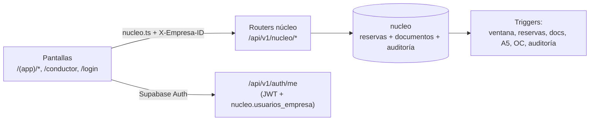

# Flujos reales — de la pantalla a la tabla

> **Pregunta que responde:** ¿qué camino recorre cada operación crítica, quién escribe, quién lee y dónde se corta la cadena?
> **Dueño:** arquitectura · **Verificado:** 2026-10-29 · **Revisado:** 2026-11-12 (retiro del legacy) · **Método:** lectura estática de pantallas, clientes HTTP, routers, servicios, DDL y triggers; sin ejecución ni base.
> **Caduca si:** cambia un endpoint, un permiso, un trigger o el cliente HTTP de una pantalla.
> **Re-verificar con:** `grep -n "include_router" backend/app/api/router.py` y `grep -rn "nucleo/viajes" frontend/src`
>
> **Nota (2026-11-12):** los flujos (d) y (e) de la revisión 2026-10-29 describían
> el legacy (`public`, `lib/api.ts`, `api/routes/*`), retirado por `0028`
> (2026-11-01). (d) quedó reescrito contra el módulo de liquidaciones del núcleo
> (`0025`); (e) se conserva como contraste histórico y no describe ningún camino
> ejecutable hoy.

---

## 0. Cómo leer

Formato: `pantalla → cliente HTTP → endpoint → auth/permiso → servicio → tabla/trigger`.
Cada paso cita `archivo:línea`. **"Se corta"** significa que el flujo no continúa sin un paso externo (decisión, dato o módulo que no existe).

---

## (a) Crear viaje en el núcleo y ocupar recursos

| Paso | Evidencia |
|---|---|
| Pantalla: diálogo "Nuevo viaje" en `/despacho` | `frontend/src/components/despacho/nuevo-viaje-dialog.tsx:230-234` |
| Cliente HTTP: `nucleo.post("/nucleo/viajes", empresaId, body)` con `Authorization` y `X-Empresa-ID` | `frontend/src/lib/nucleo.ts:25-49,89-106` |
| Endpoint: `POST /api/v1/nucleo/viajes` | `backend/app/nucleo/api.py:95-100` |
| Permiso: `operacion:escribir` (rol con membresía en la empresa) | `backend/app/nucleo/api.py:54-58`; `deps.py:43-82` |
| Servicio: valida cliente, tarifa, vigencia y OC; calcula flete; crea en estado `confirmado` sin recursos | `servicio_disponibilidad.py:869-981` (flete `903-914`, estado `951`, commit `972`) |
| Tabla: `nucleo.viajes`; trigger de ventana/folio y de auditoría | `0004:542-698`; `fn_viaje_ventana` `0004:899-940`; triggers `0004:1832-1846` |
| Pantalla: mesa de despacho consulta disponibilidad de tracto/rampla/chofer | `frontend/src/app/(app)/despacho/page.tsx:195-201`; `api.py:122-147` |
| Endpoint: `POST /nucleo/disponibilidad/validar-asignacion` (solo lectura, previsualiza) | `api.py:169-175`; `servicio_disponibilidad.py:1150-1384` |
| Endpoint: `POST /nucleo/viajes/{id}/asignar` | `api.py:178-189`; `despacho/page.tsx:321-325` |
| Servicio: toma advisory locks por recurso, valida, actualiza recursos + `estado='asignado'` en una transacción | `servicio_disponibilidad.py:1397-1409,1462-1511` |
| Dispara `fn_viaje_reservas`: si hay 3 recursos y no está anulado, inserta **3 reservas** activas con la misma ventana | `0015:183-238` |
| Garantía dura: 3 `EXCLUDE` impiden solape de tracto, rampla o chofer | `0004:744-757` |
| Garantía documental: trigger valida documentos de los 3 recursos | `0015:247-313`; reglas `0004:1019-1104` |
| Garantía licencia A5 | `0016:193-255` |

**Quién escribe:** servicio `servicio_disponibilidad` → `nucleo.viajes`, y el trigger → `nucleo.reservas_recurso`, `nucleo.auditoria`.
**Quién lee:** despacho, agenda, alertas y facturación.
**Se corta:** crear el viaje **no reserva nada**. La reserva nace al asignar los tres recursos (`0015:192-197`); un viaje `confirmado` sin recursos no ocupa el libro. Un borrador con recursos parciales tampoco (`0015:30-35`). La UI obliga a dos pasos (crear y asignar).

---

## (b) Finalizar viaje y facturar

| Paso | Evidencia |
|---|---|
| Pantalla: pestaña Expediente → botón cerrar viaje | `frontend/src/app/(app)/expediente/[id]/page.tsx:364` |
| Cliente/endpoint: `POST /nucleo/expediente/viajes/{id}/cerrar` | `backend/app/nucleo/api_expediente.py:89-95` |
| Permiso: `expediente:escribir` | `api_expediente.py:45` |
| Servicio: exige estado `descargado` o `pod_pendiente`, checklist obligatorio completo y fecha de inicio cumplida | `servicio_expediente.py:1244-1258`; motivos `311-315` |
| Escritura: `UPDATE nucleo.viajes SET estado='cerrado', fin_real=...` con control de versión | `servicio_expediente.py:1261-1288` |
| Trigger: la transición `descargado/pod_pendiente → cerrado` existe en la máquina de estados | `0004:779-808,1511-1547` |
| POD: `POST /nucleo/expediente/viajes/{id}/pod` con firma, fotos y geo | `api_pod.py:43-84`; tabla `0009:8-36` |
| Pantalla: `/cobranza` → "Nueva factura" consulta viajes facturables | `frontend/src/components/cobranza/nueva-factura-dialog.tsx:53` |
| Endpoint: `GET /nucleo/cobranza/viajes-facturables`, `POST /nucleo/cobranza/facturas` | `api_facturacion.py:48,79` |
| Permiso: `facturacion:emitir` | `api_facturacion.py:36` |
| Servicio: exige viaje `cerrado`, OC, POD y que el viaje no esté en otra factura; todos los viajes deben compartir una sola OC | `servicio_facturacion.py:462-528` |
| Escritura: crea `facturas_nucleo` + `factura_viajes`, marca cada viaje `facturado` con control de versión y agrega evento | `servicio_facturacion.py:530-618` (update `586-594`) |
| Garantía dura: trigger impide `estado='facturado'` sin OC vigente y del mismo cliente | `0004:1387-1449` |

**Quién escribe:** expediente → `nucleo.viajes`; facturación → `nucleo.facturas_nucleo`, `nucleo.factura_viajes`, `nucleo.viajes`, `nucleo.folio_contador`, `nucleo.viaje_eventos`.
**Se corta:** (1) el cierre no ocurre si el conductor no llegó a `descargado/pod_pendiente`; (2) no se factura sin POD ni sin OC, aunque el viaje esté cerrado; (3) el núcleo no emite DTE: el folio es simulado (`0013:4`); (4) facturación escribe `viajes` y `viaje_eventos` directamente, lo que viola la frontera de M04/M06 declarada en `destino-modular.md:88,108`.

---

## (c) Registrar gasto y calcular rentabilidad

| Paso | Evidencia |
|---|---|
| Pantalla: `/expediente/[id]` pestaña "Gastos y costos" | `expediente/[id]/page.tsx:818-819` |
| Componente: lista gastos y precio vigente de diésel | `components/expediente/gastos-panel.tsx:94-99` |
| Endpoint: `POST /nucleo/expediente/viajes/{id}/gastos` | `api_gastos.py:90-100` |
| Permiso: `gastos:escribir` | `api_gastos.py:36` |
| Servicio: bloquea viaje anulado/facturado/cobrado; exige moneda de la empresa; para combustible exige litros y resuelve precio vigente | `servicio_gastos.py:255-309` |
| Tabla: `nucleo.viaje_gastos` en estado `pendiente` | `0011:29-83` |
| Aprobación: `POST /nucleo/expediente/gastos/{id}/aprobar` con segregación | `api_gastos.py:120-126`; `servicio_gastos.py:346-388` |
| Trigger: solo gastos **aprobados** entran al costo; recalcula `costo_variable_real`, `costo_total_real` y comisión del chofer | `0011:91-135` (filtro `estado='aprobado'` en `112`) |
| Pantalla: panel de rentabilidad del viaje | `components/rentabilidad/rentabilidad-viaje-panel.tsx:29-31` |
| Endpoint: `GET /nucleo/expediente/viajes/{id}/rentabilidad` | `api_rentabilidad.py:61-69` |
| Servicio: margen = ingreso − costo; incluye gastos aprobados y comisión | `servicio_rentabilidad.py:323-416`; componentes del Freight Score `239-247` |

**Quién escribe:** gastos → `nucleo.viaje_gastos`; el trigger → `nucleo.viajes.costo_*`. Rentabilidad **no escribe** salvo configuración.
**Se corta:** un gasto `pendiente` no altera el costo (solo `aprobado` en `0011:112`). Un gasto nuevo se rechaza si el viaje ya está `facturado` o `cobrado` (`servicio_gastos.py:257-260`), pero no si está `cerrado`. La comisión usada para el costo es `nucleo.choferes.porcentaje_comision` (`0011:119-124`), distinta de la que paga la nómina legacy (SEC-003).

---

## (d) Liquidar comisión de chofer — núcleo (`0025`)

> Reescrito 2026-11-12: la revisión 2026-10-29 describía este flujo en el legacy
> (`public.liquidaciones`, router `liquidaciones.py`), retirado con `public`
> (`0028`). El módulo fue portado al núcleo en la Ola B (`0025`).

| Paso | Evidencia |
|---|---|
| Pantalla: `/liquidaciones`, botones calcular, emitir y anular | `frontend/src/app/(app)/liquidaciones/page.tsx:262,286,314` |
| Cliente: `nucleo.post("/nucleo/liquidaciones", …)` (único cliente HTTP) | `liquidaciones/page.tsx:14`; `lib/nucleo.ts:37-49` |
| Endpoint: `POST /nucleo/liquidaciones` (calcular), `POST /nucleo/liquidaciones/{id}/emitir`, `POST /nucleo/liquidaciones/{id}/anular` | `backend/app/nucleo/api_nomina.py:58,71,80` |
| Anticipos y ajustes: `GET/POST /nucleo/anticipos`, `GET/POST /nucleo/ajustes` | `api_nomina.py:90,100,113,123` |
| Permiso: `liquidaciones:leer` / `liquidaciones:escribir` | `api_nomina.py:35,42` |
| Tablas: `nucleo.liquidaciones` (`unique (chofer_id, mes)`), `nucleo.anticipos_chofer`, `nucleo.ajustes_liquidacion` | `supabase/migrations/0025_liquidaciones_nucleo.sql` |
| Base de comisión: `nucleo.choferes.porcentaje_comision` (default 10 % desde `0017`/`0019`) | `0004:282-321`; `0017:47-48`; `0019:44-67` |

**Quién escribe:** `api_nomina.py` → `nucleo.liquidaciones`, `nucleo.anticipos_chofer`, `nucleo.ajustes_liquidacion`.
**Se corta / pendiente:** la regla de devengamiento de la comisión (al finalizar, facturar o cobrar) sigue abierta como decisión de negocio (`D-01`); la emisión del núcleo congela montos, pero la base de cálculo no está ratificada. La versión legacy de este flujo (comisión sobre flete no cobrado, PDF recalculado, SEC-002/SEC-003) se describe como histórico en `retiro-legacy.md` y en `docs/_archivo/retiro-legacy-modulos.md`.

---

## (e) Crear viaje en el legacy (contraste histórico)

> **2026-11-12: este flujo ya no existe.** El router `routes/viajes.py`, el
> cliente `lib/api.ts`, la pantalla `/viajes` y el esquema `public` fueron
> retirados (Olas A–E, `0028`). Se conserva como registro del defecto
> estructural (RA-02) que motivó el núcleo.

| Paso | Evidencia |
|---|---|
| Pantalla: `/viajes` → diálogo → guardar | `frontend/src/app/(app)/viajes/page.tsx:165-173` |
| Cliente/endpoint: `POST /api/v1/viajes` | `backend/app/api/routes/viajes.py:152-178` |
| Permiso: `admin` u `operacion` | `viajes.py:33-34` |
| Validación: cliente/chofer/tracto/rampla existen y están activos | `viajes.py:74-88` |
| Validación de disponibilidad: **solo tracto**, y solo contra viajes en estado `programado` o `en_ruta` | `viajes.py:99-115` |
| Validación de fechas: solo `fin >= inicio` | `viajes.py:91-96` |
| Escritura: inserta en `public.viajes` con estado `programado` | `viajes.py:167-177`; tabla `0001:97-112` |
| Triggers: solo `updated_at` | `0001:240` |

**Quién escribe:** router legacy → `public.viajes`.
**Se corta:** no escribe en `nucleo`, no crea reservas, no valida documentos, no valida capacidad/peso, no audita y **no comprueba rampla ni chofer**. La única defensa es un `SELECT` en Python, que no impide una carrera entre dos peticiones. Es la causa estructural de RA-02 y la razón por la que el cutover debe congelar el legacy.

---

## (f) Login y selección de empresa

| Paso | Evidencia |
|---|---|
| Pantalla: `/login` → `signIn(email, password)` | `frontend/src/app/login/page.tsx:20-32` |
| Cliente: Supabase Auth directo (`signInWithPassword`), no pasa por FastAPI | `frontend/src/context/auth-context.tsx` |
| Redirección: `next` o `/tablero` | `login/page.tsx:30-31` |
| Bootstrap: el `AuthProvider` llama `GET /auth/me`; la identidad sale del JWT (`sub`, `email`, `user_metadata`) y del rol de menú de `nucleo.usuarios_empresa` | `auth-context.tsx:61`; `backend/app/api/routes/auth.py:10-15`; `api/deps.py:4-8,96` |
| Núcleo: `getEmpresas()` → `GET /nucleo/mis-empresas` sin `X-Empresa-ID` | `frontend/src/lib/nucleo.ts:85-86`; `backend/app/nucleo/api.py:69-76` |
| Servicio: lee `nucleo.usuarios_empresa` activos y empresas activas | `servicio_disponibilidad.py:98-120` |
| Selección: la pantalla toma **la primera empresa** y la guarda en estado local | `despacho/page.tsx:162-167` |
| Cada request del núcleo envía `X-Empresa-ID`; el backend valida membresía y empresa activa | `nucleo.ts:25-34`; `deps.py:43-82` |
| Autorización fina: rol → permisos por endpoint | `permisos.py:15-172` |

**Quién escribe:** Supabase Auth emite el JWT; el backend no crea usuarios en este flujo. La membresía vive en `nucleo.usuarios_empresa`; **no existe** `public.usuarios` (retirado por `0028`).
**Se corta:** no hay selector de empresa ni persistencia de la selección; un usuario con dos membresías ve la primera y no puede cambiarla desde la UI (🟢 código: no existe componente de selector).

---

## Diagrama de capas (2026-11-12)

