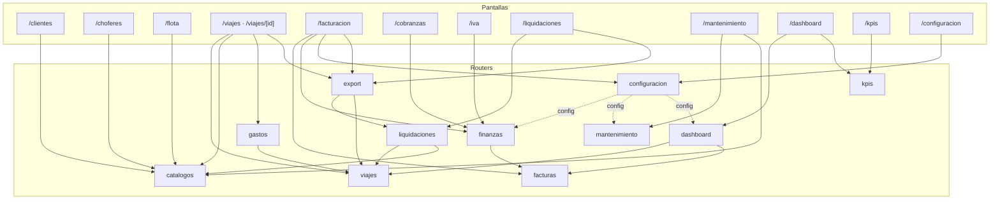

# Matriz de retiro del legacy `public` — por módulo, con evidencia

> **Pregunta que responde:** ¿en qué orden se puede retirar el legacy sin romper la operación?
> **Dueño:** `arquitectura` · **Estado:** borrador · **Verificado:** 2026-10-29 · **Método:** lectura estática
> **Caduca si:** cambia `public`, el cutover o una pantalla legacy.
> **Re-verificar con:** `grep -rn "from \"@/lib/api\"" frontend/src/app | wc -l`


- **Fecha:** 2026-10-29
- **Estado:** borrador de trabajo, derivado de ADR-0002
- **Método:** lectura estática de routers, pantallas, migraciones, scripts y
  pruebas. **En esta sesión no se ejecutó ningún comando ni consulta SQL** (sin
  permiso de shell). Todo lo que dependa de ejecución está marcado 🔴 con la
  consulta exacta que lo mediría.

Este documento es el **registro de qué falta** para borrar cada módulo. Una fila
desactualizada es peor que ninguna: se corrige en la misma entrega que cambia el
estado.

---

## 0. Cómo leer esta matriz

| Marca | Significado |
|---|---|
| 🟢 | Leído en archivo, con `archivo:línea` |
| 🟡 | Deducido de código; se indica qué lo confirmaría |
| 🔴 | No determinable en esta sesión; se indica la consulta/comando exacto |
| **P1…P4** | Puertas de ADR-0002 §B.2 (paridad, datos, referencias, reversibilidad) |
| **G0** | Precondición transversal de ADR-0002 §B.3 |
| **S/M/L** | Esfuerzo relativo: S ≤ 2 días-agente · M ≤ 1 semana · L > 1 semana |

**Regla de la columna "datos":** "volumen" nunca es una cifra inventada. Cuando
no hay medición, la celda dice 🔴 y remite a la consulta de §5.

---

## 1. Inventario de `public` (17 tablas) y clasificación

Creadas por `0001`–`0003`. La clasificación manda qué se puede borrar: **código
sí, datos nunca sin backup verificado y autorización (ADR-0002 §B.4)**.

| Tabla | Migración | Qué es | Clase |
|---|---|---|---|
| `usuarios` | `0001:36-45` | Espejo de `auth.users` con rol global; **identidad de todo el backend legacy** (`api/deps.py:15-17`) y destino del trigger `handle_new_user` (`0001:248-262`) | **Datos de runtime** — bloquea G0.1 |
| `clientes` | `0001:47-58` | Maestro duplicado de `nucleo.clientes` | Dato de negocio |
| `choferes` | `0001:60-70` | Maestro duplicado; contiene `sueldo_base` y `porcentaje_produccion` que `nucleo` también tiene (`0004:299-301`) | Dato de negocio |
| `tractos` | `0001:72-84` | Maestro duplicado; **sin** peso/tara/capacidad, que `nucleo` exige `NOT NULL` (`0004:201-203`) | Dato de negocio |
| `ramplas` | `0001:86-94` | Maestro duplicado; **sin** capacidad, que `nucleo` exige `NOT NULL` (`0004:244`) | Dato de negocio |
| `viajes` | `0001:97-112` | Histórico operativo. Estados `programado/en_ruta/finalizado/facturado` (`0001:12`) | Dato de negocio |
| `gastos_viaje` | `0001:114-125` | Histórico de gastos + `respaldo_url` a Storage | Dato financiero |
| `facturas` | `0001:127-143` | Documentos emitidos. `unique (numero_sii, cliente_id)` en `:142` | **Dato financiero/tributario** |
| `factura_viaje` | `0001:145-149` | Vínculo factura↔viaje | Dato financiero |
| `anticipos_chofer` | `0001:151-159` | Anticipos de sueldo | **Dato laboral** |
| `ajustes_liquidacion` | `0001:161-169` | Bonos/descuentos | **Dato laboral** |
| `liquidaciones` | `0001:171-186` | Liquidaciones; `unique (chofer_id, mes)` en `:185` | **Dato laboral** |
| `pautas_mantenimiento` | `0001:189-196` | Pauta por km (6 filas de seed, `0001:296-302`) | Configuración operativa |
| `mantenimientos` | `0001:199-209` | Historial por tracto | Dato operativo |
| `configuracion` | `0001:212-215` | 4 claves (`0001:290-293`, `0002:12`), incluida **`iva_porcentaje`** | **Configuración tributaria** — bloquea G0.3 |
| `kpis` | `0003:5-20` | KPIs por fórmula; 4 filas de seed (`0003:31-71`) | Configuración de producto |
| `_migraciones` | `0002:6-9` | Trazabilidad de migraciones aplicadas | **Metadato** — no se borra |

**RLS:** todas las tablas tienen RLS habilitado y **una sola política** en todo el
esquema (`usuarios`, `0001:284-285`). No es aislamiento: es "solo `service_role`
pasa". 🟢

---

## 2. Matriz por módulo

| # | Router legacy | Pantallas (`frontend/src/app/**`) | Cliente HTTP | Equivalente en `nucleo` | Datos a migrar (tabla · volumen) | Puerta que falta | Riesgo | Esf. |
|---|---|---|---|---|---|---|---|---|
| **M01** | `auth.py` → `GET /auth/me` (`:10-18`) | **Todas** (bootstrap en `context/auth-context.tsx:59`) | `fetch` directo | **Parcial**: identidad y rol por empresa en `nucleo/deps.py:43-82`; no hay endpoint de perfil único | `public.usuarios` · 🔴 §5.1 | P1, P3, **G0.1** | Alto | M |
| **M02** | `catalogos.py:27-87` `/clientes` | `/clientes` (`clientes/page.tsx:126-129,164`) | `api.ts` | **Sí** CRUD (`api_maestros.py:57-88`); **no** import CSV | `public.clientes` · 🔴 §5.2 | P1 (import), P2, P3 (5 refs) | Medio | S/M |
| **M03** | `catalogos.py:93-153` `/choferes` | `/choferes` (`choferes/page.tsx:127-130,165`) | `api.ts` | **Sí** CRUD (`api_maestros.py:168-199`) | `public.choferes` · 🔴 §5.2 | P1 (import), P2, P3 (4 refs) | Medio | M |
| **M04** | `catalogos.py:159-224` `/tractos` | `/flota` (`flota/page.tsx:77-88,165-168`), `/mantenimiento` (`:113`), `/viajes` (`:107`) | `api.ts` | **Sí** CRUD (`api_maestros.py:94-125`) | `public.tractos` · 🔴 §5.2 · **requiere tara/peso/capacidad reales** | P1, P2 (**dato inexistente en legacy**), P3 (3 refs) | **Alto** | M |
| **M05** | `catalogos.py:230-288` `/ramplas` | `/flota` (`flota/page.tsx:77-88,194-197`), `/viajes` (`:108`) | `api.ts` | **Sí** CRUD (`api_maestros.py:131-162`) | `public.ramplas` · 🔴 §5.2 · **requiere capacidad real** | P1, P2 (**dato inexistente**), P3 | **Alto** | M |
| **M06** | `viajes.py:118-348` (`/viajes`, `/{id}`, `/{id}/estado`, `DELETE`, `/{id}/rentabilidad`) | `/viajes` (`viajes/page.tsx:104-173`), `/viajes/[id]` (`:114-206`) | `api.ts` | **Parcial**: crear `api.py:95-100`; listar despacho `servicio_disponibilidad.py:1046-1050`; listar histórico `api_expediente.py:50-69`; transiciones por `api_expediente.py:89` y `api_conductor.py:37-57` | `public.viajes` · 🔴 §5.3 | P1 (mapeo de estados), P2 (histórico completo), P3, **G0.2** | **Alto** | L |
| **M07** | `gastos.py:42-122` | `/viajes/[id]` (`viajes/[id]/page.tsx:115,206`) | `api.ts`/`apiUpload` | **Sí y superior**: crear/listar/aprobar/rechazar/costos (`api_gastos.py:76-144`) | `public.gastos_viaje` + **objetos de Storage** `respaldos` (`gastos.py:25-39`) · 🔴 §5.4 | P1 (borrado duro vs blando), P2 (**archivos**), P3 | **Alto** | M/L |
| **M08** | `facturas.py:73-263` | `/facturacion` (`facturacion/page.tsx:94-180`) | `api.ts` | **Parcial**: facturables/crear/listar/pagos/NC/promesas/aging (`api_facturacion.py:48-128`); **falta anulación** | `public.facturas` + `factura_viaje` (mapeo de viajes) · 🔴 §5.5 | P1 (**D-09**), P2 (dinero), P3 | **Alto** | L |
| **M09** | `finanzas.py:27-185` | `/facturacion` (`:94,106`), `/cobranzas` (`cobranzas/page.tsx:65,74,96`), `/iva` (`iva/page.tsx:55`) | `api.ts` | `fletes-por-facturar` ↔ `viajes-facturables` **sí** (`api_facturacion.py:48-56`); `cobranzas` ↔ `aging` **parcial** (`:124-128`); `iva/resumen` **no** | Sin tablas propias (lee facturas/gastos) · 🔴 §5.5 | P1 (IVA), P3 | Medio (IVA **Alto**) | S (cobranzas) / L (IVA) |
| **M10** | `liquidaciones.py:65-504` | `/liquidaciones` (`liquidaciones/page.tsx:95-271`) | `api.ts` | **No existe** (`grep -i liquidacion backend/app/nucleo/` → 0) | `public.liquidaciones`, `anticipos_chofer`, `ajustes_liquidacion` · 🔴 §5.6 | P1 (**D-02, D-03**), P2, P3 | **Alto** (laboral) | L |
| **M11** | `mantenimiento.py:28-228` | `/mantenimiento` (`mantenimiento/page.tsx:111-223`) | `api.ts` | **No existe** (solo bloqueo de agenda: `models.py:187`, `servicio_alertas.py:172`) | `public.pautas_mantenimiento`, `public.mantenimientos`; `km_actual` de tractos · 🔴 §5.7 | P1 (**D-07**), P2, P3 | Medio | L |
| **M12** | `dashboard.py:42-179` | `/dashboard` (`dashboard/page.tsx:52-54`) | `api.ts` | **Parcial**: `/nucleo/alertas/tablero` (`api_alertas.py:24-28`) cubre documentos, bloqueos, sin POD, sin facturar, OC, margen; **no** totales de dinero | Sin tablas propias (lee viajes/facturas/gastos) · 🔴 §5.3/§5.5 | P1 (**D-12**), P3 | Medio | S/M |
| **M13** | `kpis.py:38-204` | `/kpis` (`kpis/page.tsx:98-247`), `/dashboard` (`dashboard/page.tsx:54`) | `api.ts` | **No existe** motor de fórmulas; `nucleo` tiene rentabilidad fija (`api_rentabilidad.py:38-61`) | `public.kpis` (4 filas seed, `0003:31-71`) · 🔴 §5.8 | P1 (**D-11**), P2, P3 | Medio | M |
| **M14** | `configuracion.py:14-40` | `/configuracion` (`configuracion/page.tsx:54`), `/facturacion` (`:108`) | `api.ts` | **Parcial**: `nucleo.configuracion_costos` (`0012:8-25`) **no tiene IVA**; `dias_alerta_documentos` vive en `nucleo.empresas` | `public.configuracion` (4 claves) · 🔴 §5.8 | P1, P3, **G0.3** (**D-10**) | **Alto** (tributario) | S |
| **M15** | `export.py:49-272` | `/viajes` (`:195`), `/facturacion` (`:209`), `/liquidaciones` (`:271`), `/clientes` (`:164`), `/choferes` (`:165`) | `api.ts`/`apiUpload` | **No existe** | Sin tablas propias; **import** escribe `public.clientes`/`public.choferes` (`:194-272`) | P1, P3 | Bajo (export) / Medio (import) | S/M |

**Lectura de la tabla.** 15 módulos: **2** con equivalente completo (M02, M03 —
salvo import), **5** con equivalente parcial (M01, M06, M08, M09, M12, M14),
**4** sin equivalente (M10, M11, M13, M15), **1** superior en `nucleo` (M07) y
**3** transversales que no son módulos de negocio (M01 identidad, M14
configuración tributaria, M15 export/import).

---

## 3. Dependencias entre módulos legacy (por qué el orden es el que es)

Grafo construido leyendo las llamadas de pantalla (`api.get/post/put/patch/del`)
y los `import` de servidor.



**Hojas del grafo** (nada depende de ellas, se pueden retirar sin tocar otras):
`cobranzas` (dentro de `finanzas`), `iva` (idem), `dashboard`, `liquidaciones`,
`mantenimiento`, `kpis` (solo lo consume `/dashboard`, que se retira en la misma
ola).

**Nodos con dependientes** (no se pueden borrar sin retirar antes a sus
consumidores): `catalogos` (lo usan `/viajes`, `/mantenimiento`, `/liquidaciones`,
`export/import`), `viajes` (lo usan `gastos`, `finanzas`, `dashboard`,
`liquidaciones`, `export`), `facturas` (lo usan `finanzas`, `dashboard`,
`export`), `configuracion` (lo usan `finanzas`, `mantenimiento`, `dashboard`,
`kpi_engine`).

**Consecuencia verificable:** el primer módulo retirable **no** es `catalogos`
(aunque sea el más duplicado), porque `/viajes` y `/mantenimiento` lo consumen.
Es `cobranzas`, que es hoja.

---

## 4. Dependencias transversales (las que rompen todo)

No son módulos de negocio y no se retiran con las puertas P1–P4. Están detalladas
como **G0** en ADR-0002 §B.3.

| # | Dependencia | Evidencia | Qué rompe si se borra | Se cierra con |
|---|---|---|---|---|
| T1 | Identidad `public.usuarios` | `api/deps.py:15-17`; trigger `0001:248-262`; `auth-context.tsx:59` | Login sin perfil, `/auth/me` 401, alta de usuarios rota, **todas** las pantallas | G0.1 |
| T2 | Middleware de perímetro por prefijo | `main.py:45-50` | El flag deja de tener destinatario; escrituras legacy quedan sin control | G0.4 |
| T3 | Lectura cruzada `nucleo → public.viajes` | `servicio_cutover.py:67-71` | `GET /nucleo/cutover/estado` falla (500 o 0) | G0.2 |
| T4 | Parámetro tributario en `public.configuracion` | `settings_db.py:5-16`; `finanzas.py:133`; `facturas.py:36`; `kpi_engine.py:401` | IVA calculado con default silencioso | G0.3 (**D-10**) |
| T5 | Escalada de privilegio por rol legacy | `seed_local.py:101-110`; `catalogos.py:21`; `permisos.py:132-138` | Hoy `auditor`, `conductor` y `taller` **escriben** por el legacy; en `nucleo` no | Se cierra retirando rutas legacy (olas 1–6) |
| T6 | Flag de cutover sin dueño ni auditoría | `0014:8-19`; `api_cutover.py:24-28`; sin trigger de auditoría | Un admin de cualquier empresa congela todo el sistema sin rastro | **D-05** (ADR-0001), fuera de alcance de este plan |

---

## 5. Consultas de medición (🔴 no ejecutadas)

Todas son `SELECT`. Se ejecutan contra una **copia**, nunca contra producción, y la
salida se archiva con fecha y hash. Mientras no se ejecuten, toda cifra de volumen
en este documento es 🔴.

### 5.1 Conteo total de `public`

```sql
select 'public.usuarios' t, count(*) n from public.usuarios
union all select 'public.clientes', count(*) from public.clientes
union all select 'public.choferes', count(*) from public.choferes
union all select 'public.tractos', count(*) from public.tractos
union all select 'public.ramplas', count(*) from public.ramplas
union all select 'public.viajes', count(*) from public.viajes
union all select 'public.gastos_viaje', count(*) from public.gastos_viaje
union all select 'public.facturas', count(*) from public.facturas
union all select 'public.factura_viaje', count(*) from public.factura_viaje
union all select 'public.liquidaciones', count(*) from public.liquidaciones
union all select 'public.anticipos_chofer', count(*) from public.anticipos_chofer
union all select 'public.ajustes_liquidacion', count(*) from public.ajustes_liquidacion
union all select 'public.pautas_mantenimiento', count(*) from public.pautas_mantenimiento
union all select 'public.mantenimientos', count(*) from public.mantenimientos
union all select 'public.configuracion', count(*) from public.configuracion
union all select 'public.kpis', count(*) from public.kpis
union all select 'public._migraciones', count(*) from public._migraciones
order by 1;
```

**Referencia local (no medición):** el seed inserta 8 usuarios
(`seed_local.py:91-100`), 3 clientes (`:214-218`), 3 tractos (`:245-249`),
3 ramplas (`:283-287`) y 3 choferes (`:314-318`). No inserta viajes, facturas,
gastos ni liquidaciones en `public` (`grep "public\.(viajes|facturas|gastos_viaje|liquidaciones|mantenimientos)" scripts/seed_local.py` → 0). Es decir: **en local
esas tablas solo tienen lo que dejaron las pruebas**, y no sirven como estimación
de producción. 🔴

### 5.2 Maestros (M02–M05)

```sql
-- Duplicados entre esquemas (los que se perderían si se borra public)
select count(*) from public.clientes c
 where not exists (select 1 from nucleo.clientes n
                    where upper(regexp_replace(n.rut,'[^0-9K]','','g'))
                        = upper(regexp_replace(c.rut,'[^0-9K]','','g')));

select count(*) from public.choferes c
 where not exists (select 1 from nucleo.choferes n
                    where upper(regexp_replace(n.rut,'[^0-9K]','','g'))
                        = upper(regexp_replace(c.rut,'[^0-9K]','','g')));

select count(*) from public.tractos t
 where not exists (select 1 from nucleo.tractos n
                    where upper(regexp_replace(n.patente,'[^A-Z0-9]','','g'))
                        = upper(regexp_replace(t.patente,'[^A-Z0-9]','','g')));

select count(*) from public.ramplas r
 where not exists (select 1 from nucleo.ramplas n
                    where upper(regexp_replace(n.patente,'[^A-Z0-9]','','g'))
                        = upper(regexp_replace(r.patente,'[^A-Z0-9]','','g')));
```

**Hallazgo bloqueante para M04/M05:** `public.tractos` (`0001:72-84`) y
`public.ramplas` (`0001:86-94`) **no tienen** peso bruto, tara ni capacidad;
`nucleo.tractos` los exige `NOT NULL` con `CHECK` de coherencia
(`0004:201-203,222-223`) y `nucleo.ramplas.capacidad_carga_kg` también
(`0004:244`). El cutover actual **inventa** esos valores: `39000 / 9000 / 30000`
para todo tracto (`cutover_legacy.py:193`) y `30000` para toda rampla (`:251`).
Esos números alimentan la validación de capacidad y sobrepeso
(`0004:1198-1225`). **Migrar maestros con capacidad inventada deja la garantía de
sobrepeso calculando contra datos falsos.** Cerrar P2 en M04/M05 exige que el
dueño/taller entregue tara y capacidad reales (ver §7, pregunta Q2).

### 5.3 Viajes (M06, M12)

```sql
select estado, count(*) n, coalesce(sum(valor_flete_neto),0) flete
  from public.viajes group by 1 order by 1;

-- Viajes que el cutover actual NO migra (cerrados) y que sostienen el histórico
select count(*) from public.viajes where estado in ('finalizado','facturado');

-- Viajes abiertos (los únicos que el cutover sí migra)
select count(*) from public.viajes
 where estado in ('programado','en_ruta');
```

### 5.4 Gastos y archivos (M07)

```sql
select count(*) n, coalesce(sum(monto),0) total,
       count(*) filter (where respaldo_url is not null) con_respaldo
  from public.gastos_viaje;
```

Los archivos viven en el bucket `respaldos` (`0002:19`), ruta
`gastos/{viaje_id}/{uuid}{ext}` (`gastos.py:35`). **Contar filas no cuenta
archivos**: P2 exige listar el bucket y comparar con `respaldo_url`.

### 5.5 Facturación y cobranza (M08, M09)

```sql
select estado, count(*) n, coalesce(sum(total),0) total
  from public.facturas group by 1 order by 1;

select count(*) from public.factura_viaje fv
 where not exists (select 1 from public.viajes v where v.id = fv.viaje_id);

-- Facturas "pagadas" sin registro de pago (defecto que retira M09)
select count(*) from public.facturas where estado = 'pagada' and fecha_pago is null;
```

La última consulta mide el tamaño del defecto de `PATCH estado=pagada`
(`facturas.py:212-217`): el legacy marca pagada sin exigir monto ni medio de pago,
mientras el núcleo exige `POST /nucleo/cobranza/facturas/{id}/pagos`
(`api_facturacion.py:97-103`). 🔴

### 5.6 Liquidaciones (M10)

```sql
select mes, count(*) n, coalesce(sum(total_liquido),0) liquido
  from public.liquidaciones group by 1 order by 1;
select count(*) from public.liquidaciones where estado = 'emitida';
select count(*) n, coalesce(sum(monto),0) from public.anticipos_chofer;
select tipo, count(*) n, coalesce(sum(monto),0) from public.ajustes_liquidacion group by 1;
```

**Nota de regla:** la comisión legacy se calcula sobre viajes en
`finalizado`/`facturado` (`liquidaciones.py:50`), es decir **sobre flete no
necesariamente cobrado**. Cualquier migración a `nucleo` tiene que decidir antes
si eso se mantiene (D-02). Migrar los números sin decidir la regla congela un
criterio posiblemente incorrecto.

### 5.7 Mantenimiento (M11)

```sql
select count(*) from public.pautas_mantenimiento where activo;
select count(*) n, coalesce(sum(costo),0) costo, max(km) from public.mantenimientos;
select count(*) from public.tractos where km_actual is null or km_actual = 0;
```

`nucleo.tractos.km_actual` es `numeric(12,1)` (`0004:205`) y `public.tractos.km_actual`
es `integer` (`0001:78`). La conversión es trivial; el problema es que el
`km_actual` legacy se actualiza al registrar una mantención
(`mantenimiento.py:133-135`) y en `nucleo` no hay módulo que lo haga.

### 5.8 Configuración y KPIs (M13, M14)

```sql
select clave, valor from public.configuracion order by 1;
select id, nombre, uso, activo from public.kpis order by orden;
```

**Hallazgo bloqueante para M14:** `iva_porcentaje` vive **solo** en
`public.configuracion` (`0001:290-293`) y es leído por `settings_db.py:5-16` desde
`finanzas.py:133`, `facturas.py:36` y `kpi_engine.py:401`. `nucleo.configuracion_costos`
(`0012:8-25`) **no tiene** columna de IVA, y el núcleo acepta la tasa **desde el
cliente**: `tasa_iva: Decimal = Field(default=Decimal("0.19"), …)` en
`schemas.py:1543`, usada en `servicio_facturacion.py:544`. Es decir: hoy el IVA
del núcleo es un parámetro de request, no una configuración con dueño. Borrar
`public.configuracion` sin resolver esto deja el IVA en manos de quien arme el
JSON. **No es basura: es una regla tributaria sin fuente (AGENTS.md §3.15).**

---

## 6. Orden de retiro y desbloqueo

Reproduce ADR-0002 §B.5 con el detalle de esta matriz.

| Ola | Módulos | Tipo de trabajo | Desbloquea | Prerrequisito |
|---|---|---|---|---|
| 1 | M09-cobranzas | Retirar pantalla + separar el PATCH | Deja de existir "pagar sin pago" | Línea base (§5) |
| 2 | M12 | Retirar pantalla + decidir totales (D-12) | Deja de leer `public.*` en la primera pantalla | Ola 1 cerrada |
| 3 | M02, M03 (pantallas) + M15-import | Retirar 3 pantallas y el import CSV | Elimina 3 escritores duplicados de maestros | Ola 2 |
| 4 | M06, M07 | Migrar histórico + archivos | Permite borrar `catalogos` | Ola 3 + D-12 |
| 5 | M08, M09-resto | Migrar facturas + D-09 | Permite borrar `facturas` | Ola 4 |
| 6 | M13, M14 | Mover `iva_porcentaje` + D-10, D-11 | **Cierra G0.3** | Ola 5 |
| 7 | M10 | Construir liquidaciones en `nucleo` | Permite borrar tablas laborales | D-02, D-03 |
| 8 | M11 | Construir mantenimiento por km | Permite borrar tablas de taller | D-07 |
| 9 | M09-IVA | Construir módulo IVA/F29 | Cierra el último `get_config` | D-10 |
| 10 | M01 + T2 + T4 | Identidad en `nucleo`, retirar middleware y flag | **Cierra G0** | Olas 1–9 |

**Por qué M07 va antes que M08 aunque sea "superior":** M07 aporta los gastos
aprobados que el núcleo necesita para el costo real (`servicio_gastos.py:456-461`)
y para la rentabilidad; sin gastos migrados, la facturación del núcleo se apoya
en costos incompletos.

---

## 7. Preguntas abiertas que esta matriz no responde

| ID | Pregunta | Destinatario |
|---|---|---|
| Q1 | ¿Cuántas filas y cuánto dinero hay realmente en cada tabla de `public`? (consultas §5) | `datos` (solo lectura, sobre copia) |
| Q2 | Tara, peso bruto y capacidad reales por tracto y rampla, para no migrar maestros con `39000/9000/30000` inventados | Dueño + taller |
| Q3 | ¿Cuántos archivos hay en el bucket `respaldos` y cuántos `respaldo_url` apuntan a objetos existentes? | `datos` + `auditor-seguridad` |
| Q4 | ¿El histórico de viajes cerrados se migra a `nucleo` o se conserva en `public` como archivo (D-08)? | Dueño + contador |
| Q5 | ¿Se acepta perder los totales de dinero del dashboard si el tablero no los incorpora (D-12)? | Dueño |

---

## 8. Lo que esta matriz **no** afirma

- No afirma que ningún módulo sea retirable hoy: **ninguno pasa las cuatro
  puertas** (ADR-0002 §B.2). Lo verificado es qué falta, no que esté listo.
- No afirma volúmenes: §5 está sin ejecutar por prohibición expresa de SQL en esta
  tarea.
- No afirma que las pantallas legacy estén rotas: hoy funcionan mientras el flag
  `cutover_control` esté en `false`. Si está en `true`, **todas** sus escrituras
  devuelven 409 (`main.py:50-60`) sin que la UI lo explique.
- No propone una tercera fuente de verdad: no hay tabla de reconciliación, solo
  consultas (§5) y scripts de migración por concepto.
