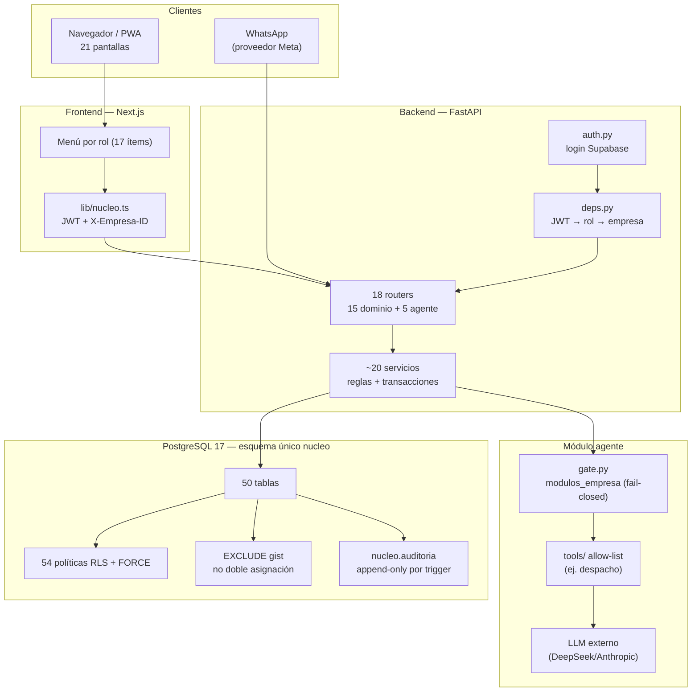
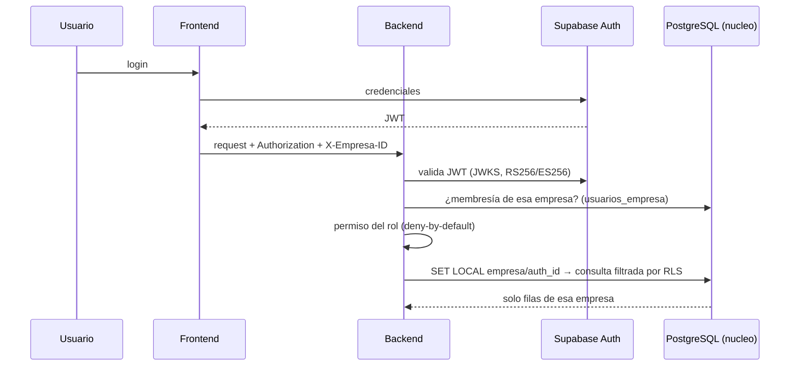
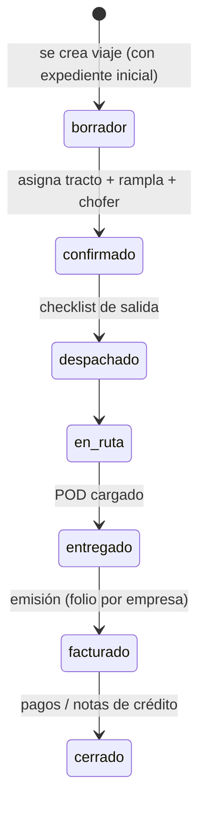
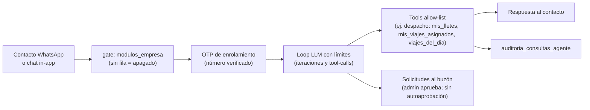

# Auditoría del sistema — TMS (producto sin nombre) · TEI Advisory

> **Fecha:** 2026-11-12 · **Autor:** orquestador (sesión de erradicación del legacy + auditoría)
> **Para quién:** lectura para personas técnicas y no técnicas (dirección). Lenguaje llano donde importa.
> **Cómo leerlo:** cada afirmación lleva una marca de certeza:
> 🟢 **Verificado** = se leyó en código/esquema o salió de un comando ejecutado en esta sesión (con cita).
> 🟡 **Inferido** = deducción razonable; se dice qué la confirmaría.
> 🔴 **No verificado** = falta evidencia, entorno o decisión; se dice cuál.
> **Naming:** el producto **no tiene nombre comercial**. Se comercializa bajo licencia
> B2B por **TEI Advisory**. Su piloto/caso original es Transportes TEI SpA. No es
> "TRANSTEI" ni un ERP por y para una sola empresa: es multiempresa desde el esquema.
> **Estado del repo al auditar:** cambios de la entrega 2026-11-12 sin commitear (autorización pendiente del dueño). **Post-cierre:** el dueño autorizó el commit del 2026-11-12; la entrega quedó en `478a86d` (BD), `06ff1ed` (backend), `c8db948` (frontend) y `4eaee02` (docs/auditoría).

---

## 1. Qué es este sistema (página para leer en 3 minutos)

Es un **TMS** (Transportation Management System): el software que una empresa de
carga terrestre usa para despachar viajes, asignar tractos/ramplas/choferes,
controlar documentos legales, cobrar y medir rentabilidad. Está construido como
producto multiempresa (varias empresas de transporte en una misma base, aisladas
entre sí), para licenciarlo B2B. El primer tenant real es Transportes TEI SpA.

**En una frase:** despacho + expediente documental + POD + facturación/cobranza +
liquidaciones + agente conversacional (chat web y WhatsApp), sobre PostgreSQL con
garantías de aislamiento y doble asignación impuestas **en la base de datos**, no
solo en el código.

**Dónde está hoy:**

- 🟢 El producto existe y **funciona en local de punta a punta**, con 50 tablas de
  negocio en un único esquema (`nucleo`), 18 routers de API, 21 pantallas y un
  agente LLM con permisos acotados.
- 🟢 Las suites de pruebas corren verdes hoy mismo: **135 unitarias**, **490 de
  integración (0 skip)**, prueba de aislamiento multiempresa **A–L con el rol real
  de la app**, y **20/20 E2E** (re-escritas hoy con 404 en las rutas legacy).
- 🔴 **No hay producción**: no hay servidor desplegado, CI real, pooler probado ni
  decisiones tributarias chilenas (IVA/DTE) definidas con contador. Un verde en
  local **no** equivale a "listo para vender".

---

## 2. Stack y entorno (verificado en el repo)

| Capa | Tecnología | Versión | Fuente |
|---|---|---|---|
| Frontend | Next.js (App Router) + React + TypeScript + Tailwind | 16.4.3 / 19.2.8 / 5 / 4 | `frontend/package.json` 🟢 |
| Backend | Python + FastAPI + SQLModel + Pydantic + psycopg | 3.13 / 0.162.0 / 0.0.24 / 2.11.4 / 3.2.6 | `backend/requirements.txt` 🟢 |
| Base de datos | PostgreSQL (Supabase local) | 17 | `supabase/config.toml` 🟢 |
| Auth y Storage | Supabase Auth (JWT RS256/ES256 contra JWKS) + Supabase Storage | — | `backend/app/nucleo/deps.py` 🟢 |
| LLM | DeepSeek (proveedor default) vía `AGENTE_LLM_*` | — | `backend/app/core/config.py:42-48` 🟢 |
| E2E | Playwright | 1.56 | `frontend/package.json` 🟢 |

Entorno local: Supabase en Docker (contenedor `supabase_db_TRANSTEI`), backend en
`:8000`, frontend en `:3000`. El "runtime local" es fiel al diseño (mismas
migraciones, misma RLS), pero **no** es producción.

---

## 3. Arquitectura general



**Regla de oro de esta arquitectura (🟢, `docs/arquitectura/fuentes-de-verdad.md` §5):**
`nucleo` es el único esquema de negocio. El legacy (`public`) fue retirado
físicamente el 2026-11-01 (`0028`) y el último artefacto del cutover (tabla
`nucleo.cutover_control`) se retiró el 2026-11-12 (`0035`). **No hay dos fuentes
de verdad.**

---

## 4. Base de datos

### 4.1 Modelo por dominios (50 tablas 🟢, conteo SQL re-ejecutado)

```mermaid
erDiagram
    EMPRESAS ||--o{ USUARIOS_EMPRESA : "membresía (rol)"
    EMPRESAS ||--o{ CLIENTES : tiene
    EMPRESAS ||--o{ TRACTOS : flota
    EMPRESAS ||--o{ RAMPLAS : flota
    EMPRESAS ||--o{ CHOFERES : dotación
    CLIENTES ||--o{ ORDENES_COMPRA : emite
    ORDENES_COMPRA ||--o{ ORDENES_COMPRA_LINEAS : detalla
    EMPRESAS ||--o{ VIAJES : despacha
    VIAJES ||--o{ RESERVAS_RECURSO : "ocupación (tracto/rampla/chofer)"
    VIAJES ||--o{ VIAJE_PARADAS : ruta
    VIAJES ||--o{ VIAJE_CHECKLIST : salida
    VIAJES ||--o{ VIAJE_EVENTOS : bitácora
    VIAJES ||--o{ VIAJE_DOCUMENTOS : expediente
    VIAJES ||--o{ VIAJE_INCIDENTES : novedades
    VIAJES ||--o{ VIAJE_GASTOS : costo real
    VIAJES ||--o| POD : entrega
    CHOFERES ||--o{ DOCUMENTOS : licencias/vigencias
    CHOFERES ||--o{ LIQUIDACIONES : paga
    LIQUIDACIONES ||--o{ AJUSTES_LIQUIDACION : ajusta
    CHOFERES ||--o{ ANTICIPOS_CHOFER : adelanto
    TRACTOS ||--o{ MANTENIMIENTOS : talleres
    TRACTOS ||--o{ PAUTAS_MANTENIMIENTO : "km/horas"
    CLIENTES ||--o{ TARIFAS : flete
    FACTURAS_NUCLEO ||--o{ FACTURA_VIAJES : "n:m"
    FACTURAS_NUCLEO ||--o{ PAGOS_NUCLEO : cobranza
    FACTURAS_NUCLEO ||--o{ NOTAS_CREDITO_NUCLEO : corrige
    FACTURAS_NUCLEO ||--o{ PROMESAS_PAGO_NUCLEO : compromiso
    EMPRESAS ||--o{ CONFIGURACION_COSTOS : parámetros
    EMPRESAS ||--o{ MODULOS_EMPRESA : "gate de módulos"
    EMPRESAS ||--o{ CONTACTOS_WHATSAPP : "chat del agente"
    CONTACTOS_WHATSAPP ||--o{ CONVERSACIONES : conversa
    CONVERSACIONES ||--o{ CONVERSACION_MENSAJES : historia
    CONTACTOS_WHATSAPP ||--o{ PERMISOS_CONTACTO : "qué puede pedir"
    CONTACTOS_WHATSAPP ||--o{ SOLICITUDES : "acción a aprobar"
    EMPRESAS ||--o{ HOJA_RUTA : "plan del día"
    AUDITORIA : "append-only, todo tenant"
    AUDITORIA_CONSULTAS_AGENTE : "qué preguntó el agente"
```

Cada tabla de negocio lleva `empresa_id` (28 de 50 🟢, `docs/datos/rls-multiempresa.md`
§2) con FKs compuestas por empresa donde corresponde. Las tablas sin `empresa_id`
son de plataforma o globales: `empresas`, `usuarios_empresa`, `auditoria` (nullable
por diseño), `transiciones_viaje` (catálogo), `folio_contador`, contadores,
`tenant_*`, `modulos_empresa`, catálogos de agente.

### 4.2 Garantías que la base impone (lo importante 🟢)

| Garantía | Mecanismo en PostgreSQL | Fuente |
|---|---|---|
| Nadie asigna el mismo recurso dos veces | `EXCLUDE USING gist` sobre `nucleo.reservas_recurso` (rangos semiabiertos `[inicio, fin)`) | `0004` 🟢 |
| Nadie lee/escribe filas de otra empresa | 54 políticas RLS `TO PUBLIC` + `FORCE` + contexto por transacción (`SET LOCAL`) | `0020`; conteo SQL 🟢 |
| El log de auditoría no se altera | triggers `BEFORE UPDATE/DELETE` + `revoke` | `0004:880-892` 🟢 |
| Folios por empresa sin colisión ni retroceso | `nucleo.siguiente_folio` + trigger de contador | `0004`/`0022` 🟢 |
| Documento tributario emitido no se edita ni borra | funciones de estado + `fn_pod_no_borrar` + triggers | `0013`/`0009` 🟢 |
| Viaje nace con expediente | trigger de expediente inicial | `0008` 🟢 |
| Facturar sin POD es imposible | función de facturación consulta POD | `0009` 🟢 |
| IDs comerciales inmutables | trigger `BEFORE UPDATE` | `0022` 🟢 |
| Escrituras de identidad/ACL solo vía funciones controladas | rol `tei_admin` + `nucleo.admin_*` (`SECURITY DEFINER`) | `0029`/`0033`/`0034` 🟢 |

**Aislamiento multiempresa: estado honesto.** La prueba
`supabase/tests/0020_01_aislamiento.sh` corre con el **rol real** de la app
(`tei_app`, `rolbypassrls=f`) y valida 12 veredictos (A–L): contexto ausente ve 0
filas, empresa B no ve nada de A, INSERT ajeno rechazado con `42501`, auditoría
append-only, folios por empresa, y el contexto muere con el COMMIT (0 herencia en
el pool). 🟢 Ejecutada hoy (2026-11-12) contra `tei_test`.
Lo que **falta** para declarar aislamiento total: probar el **rol efectivo** de la
cadena de conexión del backend en el despliegue real (RA-03/RA-15) 🔴.

### 4.3 Variables de conexión a la base (y qué hacen)

| Variable | Para qué | Verificada |
|---|---|---|
| `DATABASE_URL` | Cadena de conexión legacy/reserva del backend | 🟢 definida en `backend/app/core/config.py:25` |
| `NUCLEO_DATABASE_URL` | **La conexión de negocio** del esquema `nucleo`; el engine del núcleo se construye con ella | 🟢 `config.py:27` + `database.py` |
| `NUCLEO_TEST_DATABASE_URL` | Conexión usada por la suite de integración (clon `tei_test`, jamás la base real) | 🟢 `config.py:28`; `Makefile` (`make test`) |
| `SUPABASE_URL` / `SUPABASE_ANON_KEY` / `SUPABASE_SERVICE_ROLE_KEY` | Supabase (auth admin, storage); el `service_role` **no** se usa para negocio | 🟢 `config.py:16-19` |
| `SUPABASE_JWT_SECRET` / `SUPABASE_JWT_ISSUER` | Validación de tokens | 🟢 `config.py:19,22` |
| `WHATSAPP_MODE` / `_API_URL` / `_TOKEN` / `_PHONE_ID` | Canal WhatsApp (`fake` en local: no llama a la API real) | 🟢 `config.py:34-37` |
| `AGENTE_LLM_*` | Proveedor/base/timeout/límites de iteraciones del agente | 🟢 `config.py:42-48` |
| `AGENTE_OTP_PEPPER` | Sal para códigos OTP del enrolamiento de contactos | 🟢 `config.py:33` |
| `ENABLE_DOCS` / `DEBUG` | Documentación interactiva de la API (apagada por defecto) | 🟢 `config.py:11-14` |

Regla operacional (🟢 verificada en el código): el backend **nunca** conecta como
`service_role` para negocio; la escritura de identidad pasa por `tei_admin` vía
funciones. Lo que queda abierto (RA-16) es formalizar un rol de plataforma
(`tei_platform`) para scripts, porque hoy los scripts usan `postgres` (BYPASSRLS).

---

## 5. Backend

- **Capas:** router (`api_*.py`, validación + permisos) → servicio (`servicio_*.py`,
  reglas + transacciones) → SQLModel → PostgreSQL. `grep` verificado: 15 routers de
  dominio + 5 de agente/plataforma + `auth` = 18 `include_router` (`api/router.py:28-45`) 🟢.
- **Autorización:** deny-by-default; cada endpoint declara su permiso; la empresa
  viene del header `X-Empresa-ID` **validado contra membresía**, nunca del body
  (`deps.py:40-82`) 🟢. 8 roles: `admin, gerente, despacho, contador, tesoreria,
  taller, conductor, auditor` (`models.py:79-88`) 🟢.
- **Errores:** SQLSTATE → HTTP mapeado (`23505`/`23P01`→409, `23514`/`23502`→422,
  `42501`→403/404); sin 500 por conflicto de negocio ni mensajes crudos de PG
  (`nucleo/errores.py`) 🟢.
- **Seguridad de transporte:** `/docs` desactivado por defecto, cabeceras
  (`nosniff`, `DENY`, `no-referrer`, COOP), validación de `iss` del JWT 🟢
  (`docs/estado.md` §6.8). Sin rate limiting (queda para staging) 🔴.
- **Auditoría de consultas del agente:** lo que el agente consulta queda registrado
  (`auditoria_consultas_agente`) 🟢 (tabla en el esquema).

---

## 6. Frontend

- **21 pantallas** (`page.tsx`, conteo 🟢) organizadas en grupo `(app)`; PWA
  conductor en `/conductor`; agente en `/agente/chat` (chat in-app) y
  `/agente/buzon` (buzón de aprobaciones).
- **Un solo cliente HTTP** (`frontend/src/lib/nucleo.ts`): agrega `Authorization`
  y `X-Empresa-ID` 🟢. No hay cliente legacy (fue borrado).
- **Menú por rol:** 17 ítems con restricción de roles declarada en el cliente
  (`navigation.ts:41-82`) 🟢. **Importante:** el menú ocultar botones es UX, no
  seguridad; la autorización real vive en el backend 🟢.
- **Estados:** carga/error/sin-permiso tipados por pantalla; los errores PG→HTTP
  llegan al usuario como mensajes de negocio, no como stack traces 🟡 (revisión
  caso a caso pendiente; corroboraría un recorrido manual por pantalla).

---

## 7. Flujos de negocio (cómo funciona de verdad)

### 7.1 Identidad y multiempresa (cada request)



🟢 Probado end-to-end en la suite de integración y en la prueba RLS A–L con el rol
real. La empresa no se acepta del body: un atacante que manipule el JSON no elige
tenant.

### 7.2 Ciclo del viaje (el corazón del TMS)



Reglas duras en la base (🟢): no se puede **confirmar** sin documentos vigentes del
chofer (licencia A5, etc.); el **mismo tracto/rampla/chofer** no puede estar en dos
viajes solapados (`EXCLUDE`); el **expediente** (paradas, checklist, eventos,
incidentes, documentos) es inmutable una vez escrito; **no se factura sin POD**.
Si algo de esto se intenta evadir escribiendo directo a la base, PostgreSQL lo
rechaza — no depende del código ni de la UI.

### 7.3 Facturación y cobranza

Emisión con folio por empresa (`siguiente_folio`), factura↔viajes n:m
(`factura_viajes`), pagos, notas de crédito y promesas de pago con triggers de
estado y auditoría append-only 🟢 (`0013`). Renta: `viaje_gastos` + precios diésel
por fecha + parámetros de costo → margen por viaje y Freight Score 🟢
(`rentabilidad`).
🔴 **Deuda crítica de dinero:** los pagos no tienen idempotencia con
`Idempotency-Key`: un doble clic/reintento puede duplicar un pago (D-08;
`pagos_nucleo` sin `unique` de idempotencia, `0013:78-98`). Es el defecto de
dinero más importante que queda.

### 7.4 Agente conversacional (diferencial del producto)



- Módulo **por empresa**, apagado por defecto (fail-closed 🟢, `modulos_empresa`
  + `0034` revocó el EXECUTE de la función de activación a `tei_app`: activar
  módulos es operación de plataforma 🟢).
- El agente **no escribe dinero ni estado**: sus tools de lectura están en
  allow-list y las acciones que implican escribir van al buzón de aprobaciones 🟢
  (manifest: `"aprobacion": {"modo": "solicitud", "autoaprobacion": false}`).
- 🔴 **Riesgo abierto RA-23 (SEC-071):** el chat envía datos (RUT, facturación,
  márgenes) al proveedor LLM externo **sin DPA ni redacción**. Para un producto
  B2B con datos de terceros, esto exige decisión del dueño antes de vender.
- 🟡 RA-22 (SEC-067): un contacto pendiente de OTP reserva el teléfono en un
  índice global (squatting entre empresas) — requiere decisión de identidad (ADR-0003).
- 🟡 RA-24/RA-25: transacción de BD abierta durante la llamada al LLM y rate limit
  solo por proceso; clave de idempotencia del chat por empresa (no por usuario).

---

## 8. Pruebas: qué "verde" significa aquí

| Suite | Qué prueba | Resultado de hoy (2026-11-12) |
|---|---|---|
| `make unit` (135) | Reglas puras: cálculos, fechas/ DST Chile, estados, permisos | 🟢 passed |
| `make test` (490) | Integración real contra PostgreSQL (clon `tei_test`) + HTTP + adversariales | 🟢 passed, 0 skip |
| `0020_01_aislamiento.sh` | Aislamiento multiempresa con rol real `tei_app` | 🟢 12 veredictos OK |
| `supabase/tests/*_99_rollback.sql` | Que cada migración destructiva es reversible | 🟢 (incluida `0035`) |
| `make e2e` (20, Playwright) | Flujos completos en navegador | 🟢 20/20 (2026-11-12; 1.ª corrida falló por servidores dev huérfanos de una sesión anterior — entorno, no código) |

**Lo que el verde NO cubre:** producción real (pooler, límites de conexión,
balanceo), navegador real de clientes (los E2E locales cubren los flujos críticos
del piloto), y GitHub Actions (RA-18: el CI existe pero no prueba la base ni los
E2E, y nunca se corrió).

---

## 9. Comparación frente a un TMS/ERP profesional en producción

Criterio senior: no "¿lo tiene todo?" sino "¿lo que promete, lo cumple con
garantías? ¿y qué esperaría de un proveedor comercial?"

| Dominio | Este sistema | TMS/ERP comercial típico | Brecha |
|---|---|---|---|
| Despacho y disponibilidad | 🟢 fuerte: libro de ocupación único, `EXCLUDE` anti doble asignación, agenda | igual | **ninguna relevante** |
| Expediente documental + POD | 🟢 bitácora inmutable, checklist, POD obligatorio para facturar | similar | 🟡 visor de POD/URLs firmadas sin verificar (RA-11) |
| Multiempresa SaaS | 🟢 RLS probado en BD con rol real | igual | 🟡 rol efectivo/pooler en despliegue real (RA-03/15) |
| Facturación / cobranza | 🟢 folios por empresa, NC, promesas, auditoría | DTE electrónico, boletas, | 🔴 **sin integración DTE/SII** (decisión tributaria RA-19) |
| Idempotencia de dinero | 🔴 pagos sin `Idempotency-Key` | estándar en producción | 🔴 **D-08 — bloqueante para producción** |
| Liquidaciones / anticipos | 🟢 cálculo + ajustes | gratificación legal, mutuales | 🔴 reglas laborales pendientes con asesor (RA-19) |
| Mantenimiento y combustible | 🟢 pautas, talleres, precios diésel, alertas | telemetría GPS | 🔴 sin integración GPS/telemetría (no fue alcance del piloto) |
| Rentabilidad / KPIs | 🟢 margen por viaje, Freight Score, tablero | BI avanzado | 🟡 una fórmula canónica de margen pendiente de ratificar (dueño/contador) |
| Agente conversacional | 🟢 único en su tipo: gate por empresa, OTP, allow-list, buzón, auditoría de consultas | casi ningún TMS lo tiene | 🔴 DPA con proveedor LLM (RA-23) antes de comercializar |
| Seguridad operativa | 🟢 JWT+JWKS, roles DB, cabeceras, docs off | WAF, rate limit, MFA | 🔴 sin rate limiting ni MFA; 🟡 sesiones sin política |
| Observabilidad | 🔴 solo `/health` | logs estructurados, alertas 5xx | 🔴 mínimo viable antes de producción |
| Backups / DR | 🟢 dump + restore drill verificado por conteos | automatizado + monitorizado | 🟡 automatización y comparación automática (RA-05) |
| CI/CD | 🟡 workflow existe; no prueba BD/E2E y nunca corrió | pipeline con BD y E2E | 🔴 RA-18 |
| Import/Export | 🟢 export núcleo; 🔴 import CSV retirado sin reemplazo (RET-13/RA-21) | ambos | 🟡 decisión de producto |
| UI/i18n/español | 🟢 todo en español, PWA conductor | igual | 🟡 accesibilidad y detalle visual por pulir |

Lectura honesta: **el núcleo operativo del TMS está a nivel de producto real**
(despacho, ocupación, expediente, POD, facturación interna, multiempresa con RLS
probado). Lo que lo separa de "software comercializable" hoy no es funcionalidad
de transporte, sino: idempotencia de pagos, DTE/SII, DPA del LLM, observabilidad,
CI con base de datos y un despliegue real.

---

## 10. Pendientes que deciden el dueño (no son código)

| # | Decisión | Quién | Consecuencia de no decidir |
|---|---|---|---|
| 1 | DPA + redacción de datos con proveedor LLM (RA-23) | dueño + legal | no se puede vender el agente a clientes |
| 2 | Reglas tributarias: IVA crédito/F29, DTE/SII, impuesto específico combustible (RA-19) | contador | facturación sigue "interna", no reemplaza al ERP contable |
| 3 | Reglas laborales: gratificación, mutuales, tope de anticipos (RA-19) | asesor laboral | liquidaciones no son oficiales |
| 4 | Idempotencia de pagos y de emisión (D-08) | dueño (aprobación de desarrollo) | riesgo de dinero duplicado en producción |
| 5 | Nombre comercial del producto | dueño | el README y el marketing quedan con placeholder |
| 6 | Decisión de identidad para SEC-067 (ADR-0003) y rol de plataforma `tei_platform` (RA-16) | dueño + arquitectura | riesgo de squatting de teléfonos y scripts con superusuario |
| 7 | Import CSV: rehacer o descartar (RA-21) | dueño | onboarding de nuevos tenants más lento |

---

## 11. Qué haría antes de la primera venta (orden senior)

1. **Producción mínima:** servidor + PostgreSQL gestionado con el rol correcto
   (`tei_app` no-BYPASSRLS), pooler probado con dos conexiones reales (RA-15), y
   backups automatizados con restore drill semanal (RA-05).
2. **Dinero primero:** idempotencia con `Idempotency-Key` en pagos/emisión (D-08)
   + prueba adversarial de doble envío.
3. **Seguridad comercial:** rate limiting, MFA para admin (o al menos
   autenticación reforzada), DPA firmado con el proveedor LLM (RA-23).
4. **CI real (RA-18):** GitHub Actions con PostgreSQL + migraciones +
   `supabase/tests` + E2E; bloquear merge en rojo.
5. **Tributario:** integración DTE vía proveedor (SII) una vez el contador ratifique
   reglas (RA-19).
6. **Observabilidad:** logs estructurados + alerta de errores 5xx + trazas básicas.
7. Solo entonces: onboarding del segundo tenant con import/migración de datos.

---

## 12. Apéndice: dónde está cada cosa

| Qué | Dónde |
|---|---|
| Estado autorizado del sistema | `docs/estado.md` |
| Mapa técnico por capas | `docs/mapa-sistema.md` |
| Fuentes de verdad por concepto | `docs/arquitectura/fuentes-de-verdad.md` |
| Garantías de datos e invariantes | `docs/datos/garantias.md`, `invariantes.md` |
| Catálogo de migraciones | `docs/datos/catalogo-migraciones.md` |
| Diseño RLS multiempresa | `docs/datos/rls-multiempresa.md` |
| Deudas técnicas clasificadas | `docs/arquitectura/deuda.md` |
| Reglas de negocio | `docs/negocio/catalogo-reglas.md` |
| Hallazgos de seguridad | `docs/seguridad/hallazgos.md` |
| Migraciones (DDL real) | `supabase/migrations/0001`–`0035` |
| Pruebas de base de datos | `supabase/tests/` |
| Pruebas de aplicación | `backend/tests/` (135+490), `frontend/e2e/` (20) |
| Registro de orquestación | `docs/orquestacion/registro.md` |

*Documento generado el 2026-11-12 con conteos y suites ejecutados en esta sesión;
todo cambio posterior invalida las cifras — re-verificar con los comandos citados.*
